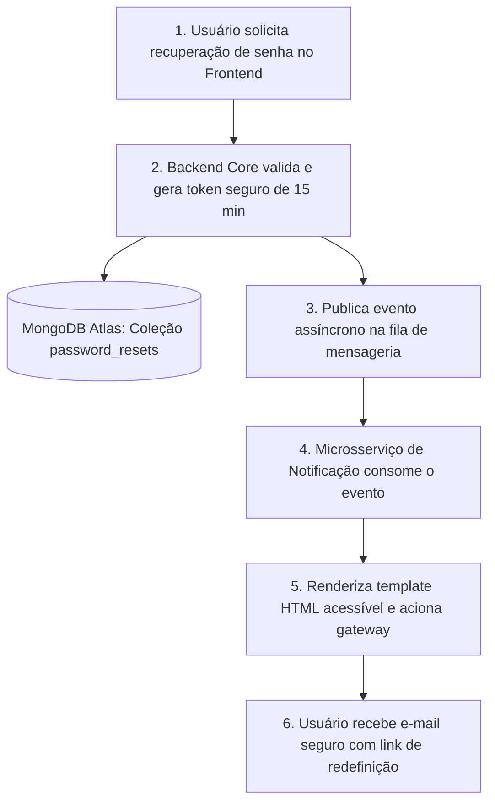

# 🗺️ BACKLOG DE FUNCIONALIDADES FUTURAS & ARQUITETURA DISTRIBUÍDA

> **Projeto:** Active Age — Plataforma Integral de Telessaúde Geriátrica  
> **Responsável:** Guilherme Silva (Product Owner & Tech Lead)  
> **Status:** Documento Vivo de Planejamento de Longo Prazo (Semestres 3º a 6º)

---

## 1. Visão Geral

Este documento registra as funcionalidades, melhorias arquiteturais e integrações de médio e longo prazo planejadas para o **Active Age**, com foco especial no desacoplamento de serviços, segurança da informação (LGPD e CFM) e conformidade com as diretrizes do curso de Desenvolvimento de Software Multiplataforma (DSM - Fatec Diadema).

---

## 2. Destaque: Módulo de Recuperação de Senha & Serviço de Mensageria

### 2.1. O Desafio e a Decisão Arquitetural do PO (Guilherme)
> **Decisão do Tech Lead:**  
> A funcionalidade de recuperação de senha não será implementada de imediato na API principal (`backend-core`) para evitar acoplamento síncrono com serviços externos de e-mail. Em vez disso, será concebido um **Microsserviço de Notificações & Mensageria** dedicado e assíncrono.

### 2.2. Avaliação de Engenharia de Software (Parecer Técnico)
Esta decisão é **altamente recomendada** e representa o estado da arte em arquitetura de microsserviços modernos:

| Critério | Abordagem Síncrona (Tudo no Core) | Abordagem Desacoplada (Microsserviço de Mensageria) | Veredito |
| :--- | :--- | :--- | :---: |
| **Resiliência do Core** | Se o provedor de e-mail (SendGrid, SES, Mailgun) oscilar ou ficar lento, a API principal trava threads de requisição e sofre lentidão. | A API principal apenas publica uma mensagem em fila/broker (< 5ms) e libera a thread imediatamente. | **Excelente** 🚀 |
| **Garantia de Entrega (Retry)** | Se falhar o envio de e-mail em tempo de requisição, o usuário recebe erro 500 e precisa recomeçar. | O microsserviço de mensageria possui *retry automático* com *Dead-Letter Queue* (DLQ), garantindo a entrega sem intervenção do usuário. | **Excelente** 🚀 |
| **Reutilização no Ecossistema** | O código de envio de e-mail fica preso ao módulo de autenticação. | O mesmo microsserviço atenderá: lembretes de consultas (UC05), chamadas de teleconsulta (UC06), alertas a cuidadores (UC11) e notificações de receitas (UC14). | **Excelente** 🚀 |
| **Segurança e Isolamento** | O core precisaria carregar chaves de API de terceiros e templates HTML pesados. | O microsserviço de mensageria cuida exclusivamente da renderização de templates e comunicação com provedores externos. | **Excelente** 🚀 |

---

### 2.3. Desenho da Solução: Arquitetura Orientada a Eventos

#### Fluxo Passo a Passo da Mensageria:
| Etapa | Origem | Ação Realizada | Destino |
| :---: | :--- | :--- | :--- |
| **1** | Frontend React | Usuário informa o e-mail na tela de recuperação | `POST /api/auth/forgot-password` |
| **2** | Backend Core | Gera token criptográfico (SHA-256) com TTL de 15 min | MongoDB Atlas (`password_resets`) |
| **3** | Backend Core | Publica mensagem assíncrona liberando a thread HTTP | Fila / Broker (RabbitMQ / Redis) |
| **4** | Broker de Mensageria | Entrega o evento ao worker em segundo plano | Microsserviço de Notificação |
| **5** | Microsserviço | Renderiza template com botões táteis e aciona provedor | Gateway (SendGrid / AWS SES) |
| **6** | Gateway de E-mail | Entrega o link seguro de redefinição de senha | Caixa de entrada do paciente/médico |

#### Responsabilidade Estrita de Cada Camada:
1. **API Principal (`backend-core`):**
   - **Endpoint 1:** `POST /api/auth/forgot-password`
     - Recebe o e-mail.
     - **Regra anti-enumeração de usuários:** Sempre retorna HTTP 200 com mensagem *"Se o e-mail estiver cadastrado, um link de recuperação foi enviado."* (impede invasores de descobrirem quem é usuário cadastrado).
     - Se o e-mail existir: gera um token aleatório criptograficamente forte (UUIDv4 ou `SecureRandom`), calcula o hash SHA-256 e armazena na coleção temporária `password_resets` com expiração de 15 minutos (TTL Index do MongoDB).
     - Publica a mensagem de disparo no broker de mensageria.
   - **Endpoint 2:** `POST /api/auth/reset-password`
     - Recebe `{ token, newPassword, confirmNewPassword }`.
     - Valida se o token existe e não expirou.
     - Atualiza a senha no banco aplicando hash **BCrypt**.
     - Invalida o token para uso único (*One-Time Token*).
2. **Microsserviço de Mensageria (`notification-service`):**
   - Escuta eventos da fila (`notification.email.reset`, `notification.sms.reminder`, etc.).
   - Aplica templates acessíveis com botões de alto contraste e linguagem acolhedora para geriatria.
   - Comunica-se com os provedores externos de mensageria.

---

## 3. Matriz de Funcionalidades Futuras por Semestre Letivo

| Módulo / Funcionalidade | Semestre de Foco | Descrição da Funcionalidade | Dependência Técnica |
| :--- | :---: | :--- | :--- |
| **Módulo de Mensageria & Notificações** | **3º / 4º Semestre** | Microsserviço independente para envio de e-mails de recuperação de senha, alertas de consulta e avisos por WhatsApp/SMS aos cuidadores. | RabbitMQ ou Redis Streams + Provedor SMTP/API. |
| **Assinatura Digital de Receitas (CFM)** | **4º Semestre** | Emissão de receitas e atestados em PDF com assinatura eletrônica padrão ICP-Brasil e QRCode para validação em farmácias. | Integração com biblioteca de assinatura e certificado digital A1/A3. |
| **Teleconsulta WebRTC com Sala Virtual** | **4º / 6º Semestre** | Chamada de vídeo peer-to-peer protegida por criptografia de ponta a ponta com chat em tempo real e visualizador de exames integrado. | WebRTC + Servidor de Sinalização (WebSocket / STUN / TURN). |
| **Módulo Cuidador & Compartilhamento Familiar** | **4º Semestre** | Perfil de acesso secundário onde o filho ou cuidador autorizado acompanha medicações tomadas, agenda do idoso e alertas clínicos. | RBAC com delegação de autoridade (`ROLE_CUIDADOR`). |
| **Aplicativo Mobile Acessível** | **4º Semestre** | App em React Native com botões gigantes, leitura em voz alta e comandos de emergência (botão SOS). | React Native + Expo + Push Notifications. |
| **Transcrição Inteligente de Consulta (NLP)** | **6º Semestre** | Speech-to-Text integrado à teleconsulta que gera automaticamente o rascunho da evolução clínica no prontuário do médico. | Whisper API / Gemini Multimodal API. |
| **IA Preditiva de Quedas & Sinais Vitais** | **5º / 6º Semestre** | Análise de séries temporais de dispositivos vestíveis (smartwatches) com alerta precoce de bradicardia ou arritmia. | Pipeline de Machine Learning + InfluxDB / TimeSeries. |

---

## 4. Recomendações de Segurança para a Implementação de Recuperação de Senha

Ao iniciar a codificação do módulo de mensageria e reset de senha, devem ser respeitadas as seguintes regras inegociáveis:
1. **Tokens com Tempo de Vida Curto (TTL):** Máximo de **15 minutos**.
2. **Uso Único (*One-Time Token*):** Assim que utilizado, o token é marcado como `used = true` ou excluído do MongoDB.
3. **Armazenamento Seguro do Token:** Nunca salvar o token em texto puro no banco. O link enviado por e-mail contém o token cru, mas o banco salva apenas o hash `SHA-256(token)`.
4. **Proteção Contra Força Bruta:** Limite máximo de **3 solicitações de recuperação de senha por hora por e-mail/IP**.
5. **Invalidação de Sessões Anteriores:** Ao redefinir a senha com sucesso, todos os cookies de sessão ou tokens JWT emitidos anteriormente devem ser invalidados.

---
*Documento registrado e mantido sob metodologia Spec-Driven Development (SDD).*  
*Active Age — Telessaúde Geriátrica Integrada.*
