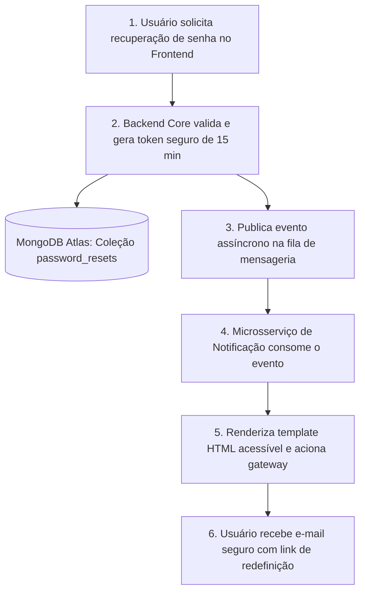
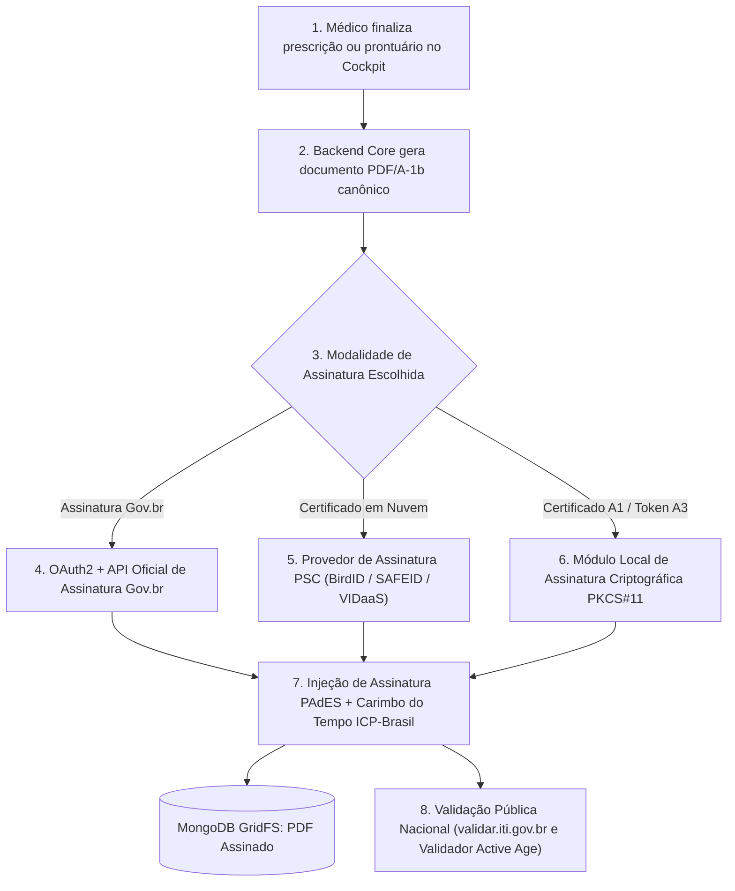
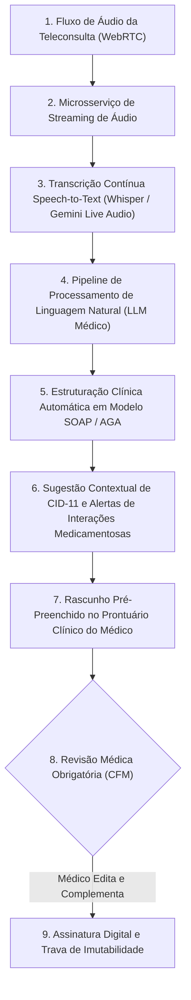

# 🗺️ BACKLOG DE FUNCIONALIDADES FUTURAS & ARQUITETURA DISTRIBUÍDA

> **Projeto:** Active Age — Plataforma Integral de Telessaúde Geriátrica  
> **Responsável:** Guilherme Silva (Product Owner & Tech Lead)  
> **Status:** Documento Vivo de Planejamento de Longo Prazo (Semestres 3º a 6º)

---

## 1. Visão Geral

Este documento registra as funcionalidades, melhorias arquiteturais e integrações de médio e longo prazo planejadas para o **Active Age**, com foco especial no desacoplamento de serviços, segurança da informação (LGPD e CFM) e conformidade com as diretrizes do curso de Desenvolvimento de Software Multiplataforma (DSM - Fatec Diadema).

---

## 2. Destaque: Módulo de Recuperação de Senha & Serviço de Mensageria

### 2.1. O Desafio e a Decisão Arquitetural do PO (Guilherme)
> **Decisão do Tech Lead:**  
> A funcionalidade de recuperação de senha não será implementada de imediato na API principal (`backend-core`) para evitar acoplamento síncrono com serviços externos de e-mail. Em vez disso, será concebido um **Microsserviço de Notificações & Mensageria** dedicado e assíncrono.

### 2.2. Avaliação de Engenharia de Software (Parecer Técnico)
Esta decisão é **altamente recomendada** e representa o estado da arte em arquitetura de microsserviços modernos:

| Critério | Abordagem Síncrona (Tudo no Core) | Abordagem Desacoplada (Microsserviço de Mensageria) | Veredito |
| :--- | :--- | :--- | :---: |
| **Resiliência do Core** | Se o provedor de e-mail (SendGrid, SES, Mailgun) oscilar ou ficar lento, a API principal trava threads de requisição e sofre lentidão. | A API principal apenas publica uma mensagem em fila/broker (< 5ms) e libera a thread imediatamente. | **Excelente** 🚀 |
| **Garantia de Entrega (Retry)** | Se falhar o envio de e-mail em tempo de requisição, o usuário recebe erro 500 e precisa recomeçar. | O microsserviço de mensageria possui *retry automático* com *Dead-Letter Queue* (DLQ), garantindo a entrega sem intervenção do usuário. | **Excelente** 🚀 |
| **Reutilização no Ecossistema** | O código de envio de e-mail fica preso ao módulo de autenticação. | O mesmo microsserviço atenderá: lembretes de consultas (UC05), chamadas de teleconsulta (UC06), alertas a cuidadores (UC11) e notificações de receitas (UC14). | **Excelente** 🚀 |
| **Segurança e Isolamento** | O core precisaria carregar chaves de API de terceiros e templates HTML pesados. | O microsserviço de mensageria cuida exclusivamente da renderização de templates e comunicação com provedores externos. | **Excelente** 🚀 |

---

### 2.3. Desenho da Solução: Arquitetura Orientada a Eventos

#### Fluxo Passo a Passo da Mensageria:
| Etapa | Origem | Ação Realizada | Destino |
| :---: | :--- | :--- | :--- |
| **1** | Frontend React | Usuário informa o e-mail na tela de recuperação | `POST /api/auth/forgot-password` |
| **2** | Backend Core | Gera token criptográfico (SHA-256) com TTL de 15 min | MongoDB Atlas (`password_resets`) |
| **3** | Backend Core | Publica mensagem assíncrona liberando a thread HTTP | Fila / Broker (RabbitMQ / Redis) |
| **4** | Broker de Mensageria | Entrega o evento ao worker em segundo plano | Microsserviço de Notificação |
| **5** | Microsserviço | Renderiza template com botões táteis e aciona provedor | Gateway (SendGrid / AWS SES) |
| **6** | Gateway de E-mail | Entrega o link seguro de redefinição de senha | Caixa de entrada do paciente/médico |

#### Responsabilidade Estrita de Cada Camada:
1. **API Principal (`backend-core`):**
   - **Endpoint 1:** `POST /api/auth/forgot-password`
     - Recebe o e-mail.
     - **Regra anti-enumeração de usuários:** Sempre retorna HTTP 200 com mensagem *"Se o e-mail estiver cadastrado, um link de recuperação foi enviado."* (impede invasores de descobrirem quem é usuário cadastrado).
     - Se o e-mail existir: gera um token aleatório criptograficamente forte (UUIDv4 ou `SecureRandom`), calcula o hash SHA-256 e armazena na coleção temporária `password_resets` com expiração de 15 minutos (TTL Index do MongoDB).
     - Publica a mensagem de disparo no broker de mensageria.
   - **Endpoint 2:** `POST /api/auth/reset-password`
     - Recebe `{ token, newPassword, confirmNewPassword }`.
     - Valida se o token existe e não expirou.
     - Atualiza a senha no banco aplicando hash **BCrypt**.
     - Invalida o token para uso único (*One-Time Token*).
2. **Microsserviço de Mensageria (`notification-service`):**
   - Escuta eventos da fila (`notification.email.reset`, `notification.sms.reminder`, etc.).
   - Aplica templates acessíveis com botões de alto contraste e linguagem acolhedora para geriatria.
   - Comunica-se com os provedores externos de mensageria.

---

## 3. Matriz de Funcionalidades Futuras por Semestre Letivo

| Módulo / Funcionalidade | Semestre de Foco | Descrição da Funcionalidade | Dependência Técnica |
| :--- | :---: | :--- | :--- |
| **Módulo de Mensageria & Notificações** | **3º / 4º Semestre** | Microsserviço independente para envio de e-mails de recuperação de senha, alertas de consulta e avisos por WhatsApp/SMS aos cuidadores. | RabbitMQ ou Redis Streams + Provedor SMTP/API. |
| **Aprimoramento de Moderação & Suporte 360º** | **3º / 4º Semestre** | Relatório estruturado de motivos de bloqueio/suspensão de contas e tela de atendimento com dossiê completo para operadores de suporte. | Expansão de `User` / `audit_logs` + Módulo de Atendimento. |
| **Assinatura Digital de Receitas (CFM)** | **4º Semestre** | Emissão de receitas e atestados em PDF com assinatura eletrônica padrão ICP-Brasil e QRCode para validação em farmácias. | Integração com biblioteca de assinatura e certificado digital A1/A3. |
| **Teleconsulta WebRTC com Sala Virtual** | **4º / 6º Semestre** | Chamada de vídeo peer-to-peer protegida por criptografia de ponta a ponta com chat em tempo real e visualizador de exames integrado. | WebRTC + Servidor de Sinalização (WebSocket / STUN / TURN). |
| **Módulo Cuidador & Compartilhamento Familiar** | **4º Semestre** | Perfil de acesso secundário onde o filho ou cuidador autorizado acompanha medicações tomadas, agenda do idoso e alertas clínicos. | RBAC com delegação de autoridade (`ROLE_CUIDADOR`). |
| **Aplicativo Mobile Acessível** | **4º Semestre** | App em React Native com botões gigantes, leitura em voz alta e comandos de emergência (botão SOS). | React Native + Expo + Push Notifications. |
| **Transcrição Inteligente de Consulta (NLP)** | **6º Semestre** | Speech-to-Text integrado à teleconsulta que gera automaticamente o rascunho da evolução clínica no prontuário do médico. | Whisper API / Gemini Multimodal API. |
| **IA Preditiva de Quedas & Sinais Vitais** | **5º / 6º Semestre** | Análise de séries temporais de dispositivos vestíveis (smartwatches) com alerta precoce de bradicardia ou arritmia. | Pipeline de Machine Learning + InfluxDB / TimeSeries. |

---

## 4. Recomendações de Segurança para a Implementação de Recuperação de Senha

Ao iniciar a codificação do módulo de mensageria e reset de senha, devem ser respeitadas as seguintes regras inegociáveis:
1. **Tokens com Tempo de Vida Curto (TTL):** Máximo de **15 minutos**.
2. **Uso Único (*One-Time Token*):** Assim que utilizado, o token é marcado como `used = true` ou excluído do MongoDB.
3. **Armazenamento Seguro do Token:** Nunca salvar o token em texto puro no banco. O link enviado por e-mail contém o token cru, mas o banco salva apenas o hash `SHA-256(token)`.
4. **Proteção Contra Força Bruta:** Limite máximo de **3 solicitações de recuperação de senha por hora por e-mail/IP**.
5. **Invalidação de Sessões Anteriores:** Ao redefinir a senha com sucesso, todos os cookies de sessão ou tokens JWT emitidos anteriormente devem ser invalidados.

---

## 5. Destaque: Aprimoramento da Moderação de Usuários (Bloqueio, Suspensão & Protocolo de Suporte)

### 5.1. Contexto e Diretriz do Tech Lead (Guilherme Silva)
> **Diretiva do PO:**  
> A funcionalidade de bloqueio perimetral e revogação de sessão de usuários (UC05) já está implementada e operacional. No entanto, é necessário aprimorar o fluxo de atendimento: melhorar a comunicação visual e acolhedora com o usuário quando este for bloqueado e registrar um **relatório/dossiê detalhado do motivo do bloqueio**, de modo que a equipe de suporte tenha todas as informações centralizadas para orientar o usuário quando houver contato.

### 5.2. Requisitos Planejados para a Evolução da Moderação

#### 1. Relatório Estruturado de Bloqueio / Suspensão (Backend Core & Admin)
Ao inativar ou suspender uma conta pela interface administrativa:
- **Categorização Mandatória:** Seleção da categoria de bloqueio (ex: *Inconsistência de CRM/RQE, Irregularidade Documental, Conduta Antiética/CFM, Solicitação do Titular/LGPD, Suspeita de Fraude ou Inadimplência SaaS*).
- **Justificativa Detalhada Interna:** Campo de texto estruturado para o auditor/administrador descrever os fatos apurados e passos recomendados para resolução.
- **Evidências & Anexos (Opcional):** Possibilidade de anexar print ou parecer comprobatório da decisão.
- **Rastreabilidade Imutável:** Vinculação automática com a coleção `audit_logs`, registrando o ID do operador, data/hora, IP e hash da operação.

#### 2. Dossiê de Atendimento para a Equipe de Suporte (Visão 360º)
Interface dedicada ou painel integrado de atendimento ao cliente:
- **Busca Rápida de Usuário Bloqueado:** Localização instantânea por e-mail, CPF ou CRM.
- **Ficha de Moderação do Usuário:** O atendente de suporte visualiza:
  - Quem bloqueou e quando;
  - Categoria e justificativa exata da moderação;
  - Histórico de reincidências ou advertências anteriores;
  - **Script de Resolução Aconselhada:** Orientações prontas para passar ao usuário (ex: *"Solicite que o médico envie certidão do CRM emitida nos últimos 30 dias pelo e-mail suporte@activeage.com.br"*).
- **Abertura de Protocolo de Reanálise:** O suporte poderá gerar uma solicitação interna de reavaliação para a fila do Administrador.

#### 3. Comunicação Acolhedora e Acessível para o Usuário (IHC Geriátrico)
- **Tela de Bloqueio Humanizada:** Substituição de mensagens genéricas de erro por uma tela explicativa, em conformidade com as diretrizes de acessibilidade para idosos.
- **Geração de Protocolo de Atendimento:** Exibição clara de um código de protocolo de contato e botão direto para acionar o canal oficial de atendimento (WhatsApp ou e-mail de suporte).

---

---
## 6. Destaque: Assinatura Digital Avançada & Qualificada (Gov.br & ICP-Brasil)

### 6.1. Contexto e Diretriz do Tech Lead (Guilherme Silva)
> **Diretiva do PO:**  
> A plataforma Active Age já emite documentos clínicos com código de validação institucional `AA-2026-XXXXXX` e hash criptográfico SHA-256. Para as próximas etapas (4º e 5º semestres), a arquitetura deve evoluir para integração com **Assinatura Eletrônica Avançada e Qualificada**, permitindo a assinatura direta via conta **Gov.br (níveis Prata e Ouro)** e suporte a certificados digitais **ICP-Brasil (A1, A3 e Nuvem/PSC)**.

### 6.2. Arquitetura da Solução de Assinatura Digital

### 6.3. Especificações Técnicas e Requisitos de Conformidade
1. **Padrão PAdES (PDF Advanced Electronic Signatures):**
   - Assinatura embutida no próprio arquivo PDF em conformidade com a ISO 32000-1 e padrão ICP-Brasil (DOC-ICP-15).
   - O documento torna-se auto-verificável: ao ser aberto no Adobe Acrobat Reader ou qualquer visualizador de PDF, os dados da assinatura, certificado do médico e integridade do carimbo aparecem validados com o selo verde.
2. **Integração com Assinador Gov.br:**
   - Autenticação e autorização via Single Sign-On (SSO) do Gov.br (`Brasil Cidadão`).
   - Verificação obrigatória de que a conta do médico possui selo **Prata** ou **Ouro**.
   - Chamada à API de Assinatura Digital do Gov.br enviando o hash SHA-256 do documento gerado e recebendo o pacote assinado com carimbo oficial do Governo Federal (Lei Federal nº 14.063/2020).
3. **Certificados ICP-Brasil em Nuvem (PSC):**
   - Suporte aos principais Provedores de Serviço de Confiança (PSCs) do Brasil: BirdID (Soluti), SAFEID (Certisign) e VIDaaS (Valid).
   - O médico autoriza a assinatura diretamente pelo aplicativo no celular via biometria ou OTP, sem depender de leitoras de cartão físicas ou pendrives USB.
4. **Carimbo do Tempo (Timestamping):**
   - Integração com Autoridade de Carimbo do Tempo (ACT) credenciada pelo ITI, garantindo a prova cronológica inalterável de quando o documento foi emitido e assinado, mesmo após a expiração do certificado do emissor.
5. **Interoperabilidade Total perante Farmácias e Laboratórios:**
   - QR Code timbrado direcionando tanto para o validador do Active Age (`/validar-documento`) quanto para o **Validador Nacional de Documentos Digitais do ITI / Conselho Federal de Farmácia (CFF) / CFM** (`https://validar.iti.gov.br`).

---

## 7. Destaque: Copiloto de Inteligência Artificial no Prontuário Clínico (IA Generativa & Assistente)

### 7.1. Contexto e Diretriz do Tech Lead (Guilherme Silva)
> **Diretiva do PO:**  
> A evolução da teleconsulta geriátrica contará com um **Copiloto Clínico baseado em IA**, encarregado de ouvir a consulta virtual em tempo real, transcrever o diálogo e estruturar automaticamente o relatório clínico no prontuário. No entanto, em conformidade com as normas ético-médicas do CFM, **a IA jamais substituirá a decisão humana**: o médico sempre terá a palavra final para revisar, editar e assinar o prontuário.

### 7.2. Arquitetura da Solução do Copiloto de IA

### 7.3. Componentes e Funcionalidades do Copiloto Clínico
1. **Ingestão de Áudio & Transcrição Inteligente (Speech-to-Text):**
   - Captura do fluxo de áudio WebRTC de forma isolada (canal médico e canal paciente).
   - Transcrição precisa do diálogo com vocabulário clínico geriátrico, reconhecendo termos de polifarmácia, histórico cirúrgico, sinais vitais e relatos dos cuidadores familiares.
2. **Sumarização Clínica Estruturada (Modelo SOAP / AGA Geriátrica):**
   - A LLM processa o diálogo e divide o resumo nas dimensões clínicas consagradas:
     - **S (Subjetivo):** Queixas relatadas pelo idoso, início de sintomas e relatos do acompanhante;
     - **O (Objetivo):** Exame visual sumário, comunicabilidade, estado de alerta e dados vitais informados;
     - **A (Avaliação):** Hipóteses diagnósticas e correlação com a Avaliação Geriátrica Ampla (AGA);
     - **P (Plano):** Conduta terapêutica, prescrições de medicamentos, solicitações de exames e data sugerida de retorno.
3. **Sugestão Inteligente de Diagnóstico (CID-11):**
   - O copiloto identifica padrões sindrômicos (ex: síndrome de fragilidade, declínio cognitivo, queixas articulares) e sugere os códigos CID-11 pertinentes para seleção em um clique pelo médico.
4. **Verificação de Segurança Farmacológica em Idosos:**
   - Alerta preventivo se o médico prescrever fármacos com critérios de Beers ou STOPP/START (medicamentos potencialmente inapropriados para idosos), ou se houver risco de interação medicamentosa com as receitas anteriores registradas no cofre do paciente.

### 7.4. Salvaguardas Éticas e Regulatórias Inegociáveis (CFM & SBIS)
1. **Prerrogativa Médica Exclusiva:** A IA não gera diagnósticos definitivos nem assina prescrições. Ela atua estritamente como ferramenta de apoio operacional e redação assistiva.
2. **Revisão Ativa Obrigatória:** O botão "Finalizar & Assinar Prontuário" exige que o médico confirme a leitura e validação do texto gerado pela IA.
3. **Sigilo e Privacidade Médica (LGPD / HIPAA):** O áudio da teleconsulta não é armazenado permanentemente após a transcrição; os dados trafegam criptografados e não são utilizados para treinamento de modelos públicos de terceiros.
4. **Trilha de Auditoria com Metadados da IA:** O registro do prontuário documenta internamente que o texto foi sumarizado com assistência de IA, registrando a versão do modelo e a data/hora em que a revisão médica foi consumada.

---

*Documento registrado e mantido sob metodologia Spec-Driven Development (SDD).*  
*Active Age — Telessaúde Geriátrica Integrada.*
