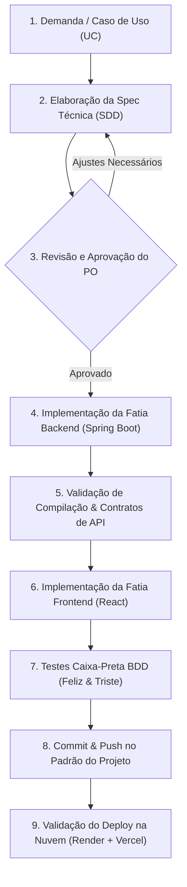

# CONTEXTO OPERACIONAL E GOVERNANÇA — SPEC-DRIVEN DEVELOPMENT (SDD)
## Plataforma Active Age — Telessaúde Geriátrica Integral
### Faculdade de Tecnologia de Diadema (Fatec Luigi Papaiz) — DSM 3º Semestre

---

### 1. Finalidade deste Documento

Este documento estabelece as **leis fundamentais de engenharia, governança e operação técnica** para a construção do projeto **Active Age** no 3º Semestre do Curso Superior de Tecnologia em Desenvolvimento de Software Multiplataforma.

Toda e qualquer contribuição no código-fonte, seja realizada por desenvolvedores humanos ou assistentes de Inteligência Artificial, deve obrigatoriamente submeter-se aos princípios e processos aqui definidos, sob a metodologia **Spec-Driven Development (SDD)**.

---

### 2. Papéis e Governança no Projeto

| Papel | Responsável | Atribuições |
|---|---|---|
| **Product Owner (PO) / Líder Técnico** | **Você (Guilherme)** | Definição de prioridades, validação de regras de negócio, aprovação formal das Especificações Técnicas (Specs), autorização de deploys e homologação dos testes de aceite. |
| **Arquiteto de Software & Engenheiro de Implementação** | **Antigravity (AI)** | Elaboração de Especificações Técnicas (Specs), implementação de backend/frontend, criação de contratos de API, garantia de conformidade arquitetural, escrita de testes e documentação. |

---

### 3. O Ciclo de Vida Obrigatório do SDD (Workflow)

É expressamente proibido codificar qualquer funcionalidade, refatoração ou alteração de arquitetura sem percorrer rigorosamente as etapas do fluxo abaixo:

#### Regras de Ouro da Governança:
1. **Nenhum código sem Spec prévia:** Antes de criar arquivos ou escrever classes, o contrato (DTO, rotas, regras de validação e critérios de aceite) deve ser aprovado pelo PO.
2. **Micro Tarefas com Escopo Fechado:** Grandes funcionalidades devem ser fatiadas em micro tarefas de entrega rápida, testável e incremental.
3. **Imutabilidade de Decisões Aprovadas:** Uma spec aprovada só pode sofrer alterações mediante justificativa técnica documentada e nova autorização do PO.

---

### 4. Stack Tecnológica Oficial do 3º Semestre (Travada)

A stack do 3º semestre foi definida para cumprir a ementa pedagógica oficial do curso da Fatec Diadema e **não deve ser alterada** sem autorização explícita:

| Camada | Tecnologia Oficial | Versão / Padrão | Justificativa Pedagógica & Técnica |
|---|---|---|---|
| **Linguagem Backend** | Java | **Java 21 LTS** | Tipagem estática robusta, Virtual Threads e suporte corporativo de longo prazo. |
| **Framework Backend** | Spring Boot | **3.x / 4.x Starter** | Módulos: Spring Web, Spring Security, Spring Data MongoDB, Jakarta Validation e Springdoc OpenAPI. |
| **Banco de Dados** | MongoDB (NoSQL) | **MongoDB Atlas (Nuvem)** | Armazenamento flexível orientado a documentos BSON/JSON, ideal para prontuários médicos dinâmicos. |
| **Linguagem Frontend** | TypeScript | **TypeScript 6.x** | Tipagem estática em tempo de compilação, eliminando erros comuns em runtime. |
| **Biblioteca Frontend** | React | **React 19.x** | Single Page Application (SPA) modular com renderização reativa e componentes funcionais. |
| **Bundler & Tooling** | Vite | **Vite 8.x** | Inicialização ultrarrápida, HMR (*Hot Module Replacement*) e proxy de desenvolvimento. |
| **Roteamento Frontend** | React Router | **React Router DOM v7** | Gerenciamento de rotas com suporte a layouts aninhados e rotas protegidas. |
| **Formulários & Schemas** | React Hook Form + Zod | **RHF 7.x + Zod 4.x** | Validação síncrona declarativa no cliente alinhada aos DTOs do backend. |
| **Estilização & Design** | Tailwind CSS | **Tailwind CSS v4** | Utility-first CSS com paleta de alto contraste e acessibilidade para idosos. |
| **Ícones** | Lucide React | **v1.x** | Ícones vetoriais leves e consistentes com semântica visual clara. |
| **Hospedagem Backend** | Render | **Docker Web Service** | Deploy em nuvem baseado em container multi-stage (`Dockerfile`). |
| **Hospedagem Frontend** | Vercel | **Vercel Edge** | Distribuição global de SPA com reescrita de rotas `/api/*` para o Render. |

---

### 5. Padrões de Código e Convenções

#### 5.1. Padrão de Commits (Conventional Commits em Português)
As mensagens de commit no Git devem seguir obrigatoriamente a convenção:
* `feat(escopo): descrição concisa da nova funcionalidade`
* `fix(escopo): correção de bug ou inconsistência`
* `docs(escopo): inclusão ou atualização de documentação técnica`
* `infra(escopo): configurações de deploy, docker, ci/cd ou variáveis`
* `refactor(escopo): refatoração de código sem alteração de funcionalidade`
* `test(escopo): adição ou melhoria de suítes de testes`

#### 5.2. Documentação no Código
* **Java:** Todo `@RestController`, `@Service`, modelo `@Document` e método de negócio deve conter **Javadoc** explicativo detalhando parâmetros, retorno e regras de negócio.
* **TypeScript / TSX:** Todos os componentes reutilizáveis, hooks customizados e utilitários devem conter anotações **TSDoc / JSDoc**.

#### 5.3. Acessibilidade e Interface Humano-Computador (IHC / WCAG 2.1)
* **Contraste:** Todo texto deve respeitar a taxa mínima de contraste de 4.5:1 (Nível AA).
* **Fontes:** Tamanho mínimo de fonte padrão para idosos: `text-base` (16px) e inputs grandes (`py-3`, `text-lg`).
* **Leitores de Tela:** Elementos de formulário e barras de progresso devem conter marcações semânticas ARIA (`role`, `aria-label`, `aria-current`, `sr-only`).
* **Diálogos e Modais de Feedback:** Proibição de diálogos nativos bloqueantes (`window.alert()`). Utilização obrigatória do componente acessível `FeedbackModal.tsx` com foco gerenciado via teclado (`ref.current.focus()`), fechamento por tecla `Escape`, alvos táteis mínimos de 48px e contraste WCAG AA.

---

### 6. Regras Inegociáveis de Segurança e Privacidade (LGPD & CFM)

1. **Criptografia de Senhas:** Nenhuma senha é salva ou trafegada em texto puro. Uso obrigatório do algoritmo **BCrypt** com salt randômico dinâmico.
2. **Sessão Segura sem LocalStorage:** O token JWT de autenticação **nunca** deve ser persistido em `localStorage` ou `sessionStorage` no frontend (vulnerável a ataques XSS). Deve trafegar exclusivamente encapsulado em **Cookie seguro**:
   * `httpOnly = true`
   * `secure = true`
   * `sameSite = Strict`
   * `path = "/"`
3. **Proteção Contra Força Bruta:** Endpoints de autenticação pública devem ser protegidos por controle de taxa de requisições (**Bucket4j**), tolerando no máximo 5 tentativas falhas a cada 15 minutos por e-mail.
4. **Controle de Acesso Baseado em Papéis (RBAC):** Toda rota privada deve ser protegida por filtro perimetral no Spring Security, segregando estritamente:
   * `ROLE_PACIENTE`: Acesso à busca, agendamento de consultas e seus próprios exames/receitas.
   * `ROLE_MEDICO`: Acesso ao consultório virtual, vitrine de horários e prontuários que atendeu.
   * `ROLE_ADMIN`: Moderação de usuários e aprovação de CRM.
5. **Consentimento Explícito (LGPD):** O cadastro de qualquer usuário exige o registro afirmativo (`termsAccepted = true`), associado à data/hora de criação para fins de auditoria legal.
6. **Imutabilidade Clínica:** Registros de evolução clínica e prontuário médico concluídos não podem sofrer comandos de alteração (`UPDATE`) ou exclusão (`DELETE`), respeitando as normas éticas do CFM.
7. **Segurança e Confidencialidade dos Documentos Médicos:** Os arquivos que compõem o Dossiê de Credenciamento do Médico (CRM, Diploma, Certidões, Comprovante ICP-Brasil e dados fiscais/bancários) são gravados em repositório privado, com bloqueio total de visualização direta sem autenticação. O acesso é restrito via RBAC a auditores (`ROLE_ADMIN`) e ao titular. Cada visualização, download ou alteração gera compulsoriamente um registro permanente na trilha de auditoria (`audit_logs`) com IP, timestamp e ID do auditor.
8. **Conformidade Estrita com a Resolução CFM nº 2.314/2022:** A prática de telemedicina na plataforma requer obrigatoriamente a comprovação prévia de Certificado Digital padrão ICP-Brasil (A1 ou A3) pelo médico para assinatura válida de documentos clínicos, e ciência de cadastramento da modalidade de telemedicina perante o CRM estadual. Nenhum médico tem permissão de abrir agenda ou atender antes da homologação integral do seu dossiê.
9. **Vedação Absoluta à Dicotomia e Split de Pagamento Direto:** O Código de Ética Médica e o CFM proíbem terminantemente a cobrança de comissões percentuais variáveis sobre consultas (dicotomia). A plataforma remunera-se unicamente via mensalidade fixa de licenciamento de software (SaaS) ou taxa administrativa fixa de serviço de TI por agendamento. O dinheiro da consulta é liquidado de forma direta na subconta do médico através de Split Direto em gateway regulado pelo BACEN, jamais transitando pela conta bancária corporativa do Active Age.
10. **Neutralidade de Busca e Conformidade com a Resolução CFM nº 2.336/2023:** A busca de médicos atua exclusivamente como catálogo informativo e neutro. É terminantemente proibido qualquer sistema de leilão de posições patrocinadas ou avaliação pública por notas/estrelas que mercantilizem a medicina ou exponham o paciente.
11. **Padrões de Certificação SBIS / CFM (NGS1 e NGS2):** O prontuário eletrônico e a emissão de documentos clínicos devem respeitar os requisitos de segurança NGS1 (autenticação forte, RBAC e trilhas de auditoria imutáveis com NTP) e NGS2 (assinatura digital ICP-Brasil com não-repúdio, validação padrão ITI e criptografia em repouso AES-256 no banco).
12. **Registro de Empresa no CRM e Direção Técnica Médica:** A pessoa jurídica mantenedora do Active Age deve possuir registro ativo perante o Conselho Regional de Medicina (CREMESP) e nomear formalmente um médico inscrito como Diretor Técnico Responsável.

---

### 7. Definition of Done (DoD — Critérios de Conclusão)

Uma micro tarefa só é considerada **CONCLUÍDA** quando todos os itens abaixo forem cumpridos:
- [ ] O código implementado atende fielmente à Especificação Técnica (Spec) aprovada.
- [ ] A compilação do backend Java roda com `BUILD SUCCESS` no Maven Wrapper.
- [ ] O frontend compila sem erros de tipagem TypeScript ou linters.
- [ ] Os testes funcionais de caixa-preta (caminhos felizes e tristes documentados no BDD) foram verificados.
- [ ] O código segue as convenções de Clean Code, com tratamento de exceções amigável.
- [ ] O commit foi registrado com mensagem no padrão Conventional Commits em português.
- [ ] O deploy contínuo em produção (Render e Vercel) foi concluído com sucesso e o serviço responde com status HTTP 200.

---

### 8. Mapa de Rastreabilidade dos Casos de Uso (Backlog SDD)

| Módulo | Casos de Uso (UC) | Descrição do Escopo | Status Atual |
|---|---|---|---|
| **M1: Fundação & Acesso** | UC01, UC02 | Cadastro de Paciente e Médico, Login Seguro, Rate Limit, Logout | **Concluído e Live** ✅ |
| **M2: Credenciamento, Moderação & Gestão de Perfil** | UC03, UC04, UC05, UC18 | Dossiê Médico Completo (4 Pilares), Fila de Auditoria do Admin (`audit_logs`), Gestão de Usuários e Gestão/Edição de Perfil & Avatar (RF014 / UC18) | **Concluído e Live** ✅ (Perfil em Andamento 🚧) |
| **M3: Vitrine & Agendamento** | UC08, UC09, UC10 | Vitrine de horários livres, busca inteligente e reserva de consultas sem double-booking | Especificação Pendente ⏳ |
| **M4: Prontuário & Documentos** | UC11, UC13, UC14, UC15, UC16 | Upload de exames prévios, prontuário imutável e emissão/download de receitas (PDF) | Especificação Pendente ⏳ |
| **M5: Teleconsulta & Finanças** | UC06, UC07, UC12, UC17 | Sala de teleconsulta segura, pagamento integrado de consulta e assinatura do médico | Especificação Pendente ⏳ |
| **M6: Deploy Avançado** | N/A | Monitoramento, testes integrados de carga e automação final | Em Andamento 🚧 |

---
*Documento aprovado e em vigor a partir de 21 de Outubro de 2026.*  
*Projeto Integrador Active Age — Fatec Diadema.*
