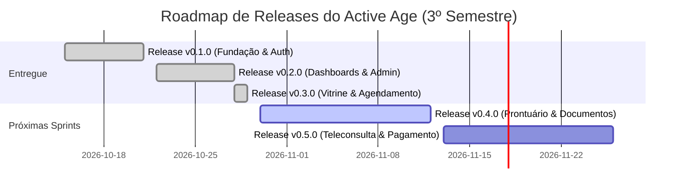

# PLANO DE RELEASE E ROADMAP DE SPRINTS
## Plataforma Active Age — Telessaúde Geriátrica Integral
### Faculdade de Tecnologia de Diadema (Fatec Luigi Papaiz) — DSM 3º Semestre
**Metodologia:** Spec-Driven Development (SDD) & Gestão Ágil (Scrum/Kanban)

---

### 1. Visão Geral do Release Plan

O **Plano de Release** formaliza o planejamento e as entregas incrementais do sistema **Active Age** ao longo do 3º Semestre letivo. O objetivo é estabelecer marcos de entrega funcionais, verificáveis e em ambiente de produção (Render + Vercel + MongoDB Atlas), permitindo que cada pacote de funcionalidades seja testado ponta a ponta antes da abertura da fase subsequente.

---

### 2. Release Atual: v0.1.0-alpha — Fundação, Identidade e Autenticação Segura

* **Status:** **Entregue e Operacional em Produção (Live)** ✅
* **Data da Release:** 21 de Outubro de 2026
* **Ambiente de Produção:**
  * **Frontend (Vercel):** Aplicação SPA em React 19 com proxy reverso e rewrite de rotas.
  * **Backend (Render):** [https://active-age-backend-mgyw.onrender.com](https://active-age-backend-mgyw.onrender.com) (Spring Boot 3 em container Docker).
  * **Banco de Dados (MongoDB Atlas):** Cluster em nuvem na coleção `users`.
* **Casos de Uso Cobertos:** **UC01** (Cadastrar-se na Plataforma) e **UC02** (Autenticar-se / Login).

#### 2.1. Funcionalidades Entregues nesta Release

| ID | Funcionalidade | Descrição da Entrega | Status |
|---|---|---|---|
| **REL-01** | **Cadastro de Paciente / Cuidador** | Formulário guiado em 3 etapas com máscaras de CPF e telefone, cálculo dinâmico de maioridade (18+ anos), consentimento obrigatório da LGPD e integração com a API Spring via `POST /api/auth/register-patient`. | Concluído ✅ |
| **REL-02** | **Cadastro de Médico Geriatra** | Formulário guiado em 3 etapas com máscaras de CRM e UF, termo de responsabilidade ética do CFM e persistência real no MongoDB via `POST /api/auth/register-doctor`. | Concluído ✅ |
| **REL-03** | **Autenticação Segura (Login)** | Validação de credenciais via hash BCrypt, emissão de token JWT stateless transportado via Cookie seguro (`HttpOnly`, `Secure`, `SameSite=Strict`), blindando a aplicação contra ataques XSS. | Concluído ✅ |
| **REL-04** | **Proteção contra Força Bruta (Rate Limiting)** | Algoritmo Token Bucket via **Bucket4j** na camada de serviço, bloqueando o e-mail por 15 minutos após 5 erros consecutivos de senha. | Concluído ✅ |
| **REL-05** | **Perfil do Usuário Autenticado** | Endpoint protegido `GET /api/auth/me` para resolução do perfil ativo a partir do cookie da sessão. | Concluído ✅ |
| **REL-06** | **Encerramento de Sessão (Logout)** | Endpoint `POST /api/auth/logout` que invalida o cookie seguro com `maxAge=0` no navegador. | Concluído ✅ |
| **REL-07** | **Navbar Reativa & Acessível** | Barra de navegação com alternância dinâmica: exibe *"Olá, Nome (Perfil)"* e botão *"Sair"* quando autenticado; botões de login/cadastro quando anônimo. | Concluído ✅ |
| **REL-08** | **Identidade Visual & Favicon Oficial** | Substituição dos assets do Vite pelo favicon personalizado (coração + eletrocardiograma terracota) e título semântico da aba. | Concluído ✅ |
| **REL-09** | **Documentação OpenAPI / Swagger** | Endpoints documentados e testáveis interativamente em `/swagger-ui/index.html` e `/v3/api-docs`. | Concluído ✅ |
| **REL-10** | **Sistema de Modais Acessíveis (IHC / WCAG)** | Componente reutilizável `FeedbackModal.tsx` substituindo alerts nativos bloqueantes. Suporte a variantes (sucesso, erro, alerta, info), ícones Lucide descritivos, backdrop blur e botões com alvos táteis ampliados (48px+) para geriatria. | Concluído ✅ |
| **REL-11** | **Validação Antecipada de E-mail (Etapa 1)** | Endpoint `GET /api/auth/check-email` e verificação assíncrona com feedback imediato no avanço da Etapa 1 dos cadastros, impedindo transição se o e-mail já existir. | Concluído ✅ |
| **REL-12** | **Controle de Visibilidade de Senha (IHC / WCAG)** | Alternância dinâmica (`Eye` / `EyeOff`) nos campos de senha (Login e Cadastros), permitindo ao público idoso auditar o que digitou. | Concluído ✅ |
| **REL-13** | **Tratador Global de Exceções (GlobalExceptionHandler)** | Classe `@RestControllerAdvice` mapeando `IllegalArgumentException` para HTTP 400 Bad Request e padronizando mensagens amigáveis em JSON, eliminando erros 500 indevidos. | Concluído ✅ |
| **REL-14** | **Acessibilidade de Erros & Conexão no ProgressBar (IHC / WCAG)** | Linha conectora de etapas corrigida no `ProgressBar.tsx` e inclusão de ícone `AlertCircle` em 100% das mensagens de validação. | Concluído ✅ |

#### 2.2. Critérios de Aceite Validados (Testes BDD)
- [x] Cadastro de paciente com e-mail duplicado bloqueado com mensagem amigável.
- [x] Transição da Etapa 1 bloqueada imediatamente se o e-mail já estiver cadastrado.
- [x] Paciente menor de 18 anos impedido de submeter o cadastro.
- [x] Cadastro de médico com CRM inválido impedido pelo schema de validação.
- [x] Senhas criptografadas com hash irreversível no MongoDB Atlas.
- [x] Login com 5 senhas erradas aciona trava de 15 minutos do Bucket4j.
- [x] Logout apaga a credencial e restabelece a Navbar no estado público.
- [x] Comunicação de sucesso/erro via modal acessível (`FeedbackModal`) com foco gerenciado e alvos táteis ampliados para geriatria (WCAG 2.1 AA).
- [x] Alternância de visualização de senhas nos campos de login e cadastro.
- [x] Linha conectora do ProgressBar visível com avanço dinâmico entre etapas.
- [x] Mensagens de erro de formulário acompanhadas por ícone visual `AlertCircle` (WCAG 2.1).
- [x] Falha de login tratada pelo `GlobalExceptionHandler` retornando HTTP 400 amigável em vez de 500.

---

### 3. Roadmap de Releases Futuras (Sprint Backlog)

A evolução do produto foi dividida em **5 Sprints incrementais**, garantindo foco e controle rigoroso de qualidade:

---

#### 📅 Sprint 2 — Release v0.2.0: Proteção de Rotas, Dashboards e Moderação (UC03, UC04, UC05) — [CONCLUÍDA ✅]
* **Objetivo:** Fornecer a área logada para Pacientes e Médicos, estruturar a guarda de rotas na SPA e criar o painel de moderação administrativa de CRM.
* **Status das Entregas:**
  - [x] **Micro Tarefa 2.1 (Concluída ✅):** Componente `ProtectedRoute.tsx` com validação de RBAC, Layout Administrativo (`AdminLayout.tsx`), Painel Inicial (`AdminDashboard.tsx`) e Seeding automático de usuário `ROLE_ADMIN` (`DataInitializer.java`).
  - [x] **Micro Tarefa 2.2 (Concluída ✅):** Módulo de Credenciamento Médico Integral (Dossiê Ético-Profissional em 4 Pilares: Habilitação, Regularidade Ética, Telemedicina ICP-Brasil Res. CFM nº 2.314/2022 e Dados Financeiros; Upload progressivo seguro com armazenamento isolado; Fila de Auditoria do Admin com conferência de checklist, visualizador seguro de documentos, trilha de auditoria `audit_logs` e aprovação/rejeição com justificativa obrigatória).
  - [x] **Micro Tarefa 2.3 (Concluída ✅):** Gestão de Usuários & Trilha de Auditoria Imutável (Listagem de Pacientes, Médicos e Admins com filtros por papel e status; Moderação com soft-lock e trava de auto-inativação; Painel de Trilha de Auditoria global em `audit_logs` com contadores 24h, filtros por tipo de evento e modal de inspeção detalhada em conformidade com CFM e SBIS NGS1).
  - [x] **Micro Tarefa 2.4 (Concluída ✅):** Dashboards Segregados de Paciente e Médico (`DashboardPaciente.tsx` com acessibilidade WCAG 2.1 AA, botões táteis ampliados para o público idoso e Banco Dinâmico de Dicas de Longevidade Ativa com base médica e rotação interativa SPEC-11G; `DashboardMedico.tsx` com banner regulatório condicional da Res. CFM nº 2.314/2022, métricas de consultório e degustação SaaS de 15 dias; Redirecionamento inteligente pós-login e Navbar reativa).

---

#### 📅 Sprint 3 — Release v0.3.0: Gestão de Perfil, Vitrine de Horários e Agendamento Concorrente (UC18, UC08, UC09, UC10) — [CONCLUÍDA ✅]
* **Objetivo:** Estruturar a gestão completa de perfil e identidade visual de Médicos e Pacientes, e implantar a vitrine de agendamentos com reserva atômica sem *double-booking*.
* **Entregas Previstas:**
  1. [x] **Módulo de Perfil Médico & Paciente (SPEC-06 / UC18 / RF014) — [CONCLUÍDO ✅]:** Edição de perfil com upload de foto de rosto (avatar), biografia profissional, áreas de foco geriátrico, valor da consulta (R$), duração estimada, endereço residencial do paciente e cadastro do cuidador familiar com contato de emergência.
  2. [x] **Vitrine de Busca Inteligente e Catálogo Neutro de Médicos Geriatras (SPEC-07 / UC08 / RF005 / RN004) — [CONCLUÍDO ✅]:** Busca textual inteligente por nome/RQE/bio, filtros clínicos por foco geriátrico (AGA, Demências, Quedas, Polifarmácia), filtro por Estado (UF do CRM), ordenação neutra e transparente (Res. CFM nº 2.336/2023), cards informativos com foto oficial, RQE, duração e honorários, modal de detalhes com currículo Lattes e integração direta ao Dashboard do Paciente.
  3. [x] **Gestão da Agenda Médica & Grade de Disponibilidade (SPEC-09 / UC10 / RF006, RF007, RN001, RN008) — [CONCLUÍDO ✅]:** Entidade `DoctorScheduleSlot` no MongoDB Atlas com índice único anti-colisão, geração em lote de turnos com pausas técnicas (CFM/SBGG 50 min), slots avulsos, alternância de bloqueio e trava para médicos sem homologação de CRM.
  4. [x] **Agendamento Concorrente de Teleconsulta sem Double-Booking (SPEC-10 / UC09 / RN001, RN002) — [CONCLUÍDO ✅]:** Paciente seleciona slot livre na vitrine, reserva atômica na coleção `appointments` com congelamento de status `OCUPADO`, página de Minhas Consultas (`/paciente/consultas`) e política de cancelamento ético com antecedência de 24h com reciclagem do slot para `LIVRE`.
  5. [x] **Médico Teste e Paciente Teste com Automação Contínua, Foto de Perfil e 17 Pioneiros (SPEC-11B / SPEC-11E / SPEC-11F / UC01, UC08, UC09, UC10) — [CONCLUÍDO ✅]:** Médico padrão (`medico@teste.com` / `123456`) e Paciente padrão Dona Maria (`paciente@teste.com` / `123456`) com foto de perfil humanizada (`avatarUrl`), geração automatizada de grade ampla de horários livres matutina a noturna (08h às 22h), consultas ativas confirmadas garantidas tanto para hoje (`LocalDate.now()`) com readequação dinâmica contra expiração quanto para amanhã (`LocalDate.now().plusDays(1)`), fuso horário oficial de Brasília (`America/Sao_Paulo`), 2 exames prévios no GridFS e sincronização horária via Spring `@Scheduled`.
  6. [x] **Rastreabilidade de Teleconsultas em Trilha de Auditoria & Métricas Admin (SPEC-11C / UC04, UC05, UC09) — [CONCLUÍDO ✅]:** Registro de eventos `APPOINTMENT_CREATED` e `APPOINTMENT_CANCELLED` na coleção imutável `audit_logs`, endpoint seguro `GET /api/admin/stats` e dashboard administrativo dinâmico com volumetria de teleconsultas em conformidade com CFM e LGPD.
  7. [x] **Padronização Universal das Fotos dos Médicos Homenageados com Retratos Históricos Reais (SPEC-11D / UC08, UC09) — [CONCLUÍDO ✅]:** Substituição de 100% das fotos genéricas do Unsplash por retratos históricos reais de domínio público e arquivos oficiais (Wikimedia Commons, NASA, Tekniska Museet, MIT, LinuxCon e IBM Archives) com proteção anti-hotlink no frontend.
  8. [x] **Banco Dinâmico de Dicas de Longevidade Ativa & Bem-Estar (SPEC-11G / UC01, UC18) — [CONCLUÍDO ✅]:** Catálogo de 12 intervenções geriátricas baseadas em evidências médicas (SBGG, OMS, Harvard, The Lancet, EWGSOP2) com seleção randômica a cada carregamento e botão de alternância manual para estímulo cognitivo do idoso.
  9. [x] **Reorganização de UX dos Dashboards com Priorização Visual de Consultas Agendadas (SPEC-11H / UC01, UC09, UC10, UC12) — [CONCLUÍDO ✅]:** No Dashboard do Paciente, o card da próxima consulta com botão direto "Entrar na Sala Virtual" é reposicionado no topo imediato (logo após a mensagem de boas-vindas). No Dashboard do Médico, a fila de pacientes do dia é promovida para antes das ferramentas clínicas do consultório quando houver consultas hoje (`todayAppointments.length > 0`), mantendo o empty state no rodapé quando a grade estiver livre.
  10. [x] **Remoção de Sintomas Prévios no Agendamento e Centralização da Anamnese na Teleconsulta (SPEC-11I / UC01, UC09, UC10, UC12, UC14) — [CONCLUÍDO ✅]:** Fluxo de agendamento simplificado sem digitação de sintomas prévios pelo idoso (preparando a interface para o futuro gateway de pagamento com split direto), e exclusão de sintomas pré-preenchidos no semeador, mantendo o relato clínico restrito ao cockpit da teleconsulta perante o médico.
  11. [x] **Correção da Janela Temporal da Agenda Médica e Dinamização Universal de Contadores (SPEC-11J / UC01, UC09, UC10, UC12) — [CONCLUÍDO ✅]:** Correção do cálculo da janela temporal da agenda médica para iniciar em 00:00:00 da data local de hoje (evitando que horários anteriores à hora corrente sejam omitidos na busca e na aba "Consultas Agendadas"), criação do endpoint `GET /api/doctor/stats`, dinamização dos contadores de atendimentos, pacientes únicos e dias de SaaS no Dashboard Médico e badges em tempo real nas abas de filtro da agenda.

---

#### 📅 Sprint 4 — Release v0.4.0: Cockpit Integrado de Teleconsulta, Prontuário Ético Imutável, Exames e Prescrições Digitais (SPEC-12 / UC12, UC13, UC14, UC15, UC16) — [CONCLUÍDA ✅]
* **Objetivo:** Concluir com chave de ouro as entregas do **3º Semestre**, implementando a sala de teleconsulta demonstrativa com cockpit clínico integrado para o médico (visualização de exames, prontuário com trava de imutabilidade e emissão de receitas/atestados) e área de documentos para o idoso.
* **Entregas Realizadas:**
  1. [x] **Submissão e Gestão de Exames Prévios pelo Paciente no Cofre de Saúde (SPEC-08 / UC11 / RF008 / RN007) — [CONCLUÍDO ✅]:** Upload de laudos laboratoriais e exames de imagem em PDF/JPG/PNG com persistência em nuvem via MongoDB GridFS, categorização clínica, data do exame, anotações, visualização inline e exclusão segura.
  2. [x] **Cockpit Integrado de Teleconsulta Responsivo (SPEC-12 / UC12-Demo) — [CONCLUÍDO ✅]:** Sala de atendimento em `/teleconsulta/:appointmentId` com split-screen no computador e layout vertical adaptado no celular, controles de microfone, câmera, timer e encerramento.
  3. [x] **Visualização Médica de Exames do Idoso na Sala Virtual (SPEC-12 / UC13) — [CONCLUÍDO ✅]:** Aba do cockpit permitindo ao médico examinar laudos e arquivos anexados pelo paciente no GridFS em tempo real sem sair da chamada.
  4. [x] **Prontuário Ético Eletrônico com Avaliação Geriátrica Ampla e Imutabilidade (SPEC-12 / UC14 / RN003) — [CONCLUÍDO ✅]:** Anamnese clínica, AGA (estado cognitivo, risco de quedas, independência funcional, suporte familiar), CID-11 e conduta com assinatura digital, geração de hash SHA-256 e bloqueio definitivo contra alterações pós-finalização.
  5. [x] **Emissão e Impressão Timbrada de Receitas e Atestados ICP-Brasil (SPEC-12 / UC15 / RN006) — [CONCLUÍDO ✅]:** Emissão médica de Receitas, Pedidos de Exames e Atestados com código de validação único `AA-2026-XXXXXX` e modal oficial para impressão e exportação em PDF.
  6. [x] **Painel de Documentos do Paciente e Validador Público (SPEC-12 / UC16) — [CONCLUÍDO ✅]:** Página `/paciente/documentos` para o idoso e cuidador acessarem suas receitas e página pública `/validar-documento` para farmácias e laboratórios conferirem a autenticidade documental perante o CRM.
  7. [x] **Reformulação da Teleconsulta: Card Único de Prontuário para IA, Template Clean P&B e Fluxo Seguro de Encerramento (SPEC-12B / UC12, UC14, UC15, UC16) — [CONCLUÍDO ✅]:**
     - Sincronização em tempo real (polling de 4s) de receitas e atestados emitidos na própria sala para o paciente;
     - Seção dedicada de documentos na visão do idoso com empty state amigável ("Nenhum documento emitido até o momento nesta sessão");
     - Remoção do botão de encerrar do paciente, substituído por "Sair da Sala" com navegação segura para o dashboard sem desativar a teleconsulta;
     - Encerramento oficial da consulta (`AppointmentStatus.REALIZADA`) vinculado exclusivamente à finalização e assinatura digital do prontuário pelo médico;
     - Card Único de Prontuário no cockpit médico com dados do paciente no topo, espaço amplo para relatório clínico unificado, banner preparatório para IA (Copiloto Active Age) e mini-seletores da AGA;
     - Formulário de prescrição limpo sem textos mockados pré-preenchidos, utilizando placeholders contextuais;
     - Redesenho do template de impressão de documentos em Preto e Branco puro e clean (`DocumentPrintModal.tsx`) preparado para Gov.br e ICP-Brasil;
     - Acesso e impressão de receitas e atestados diretamente a partir do card de consulta no histórico de atendimentos do paciente (`MinhasConsultas.tsx`).

  8. [x] **Simplificação do Prontuário Clínico & Detalhamento Arquitetural de IA e Assinatura Digital no Backlog Futuro (SPEC-12C / UC12, UC14, UC15, UC16) — [CONCLUÍDO ✅]:**
     - Remoção do card de IA e da seção de parâmetros geriátricos (AGA) da interface do médico em `TeleconsultaRoom.tsx`, promovendo um Card Único de Prontuário super limpo e focado no relatório da consulta;
     - Preservação dos valores padrão do prontuário no estado interno sem quebrar a validação dos DTOs do backend;
     - Especificação detalhada da Assinatura Digital Avançada (Gov.br níveis Prata/Ouro e Certificados ICP-Brasil em Nuvem/PSC com carimbo do tempo ACT) no `BACKLOG_FUNCIONALIDADES_FUTURAS.md`;
     - Especificação detalhada do Copiloto de Inteligência Artificial no Prontuário Clínico (Speech-to-Text em tempo real via WebRTC, modelo SOAP, sugestão de CID-11 e salvaguardas éticas do CFM) no `BACKLOG_FUNCIONALIDADES_FUTURAS.md`.
  9. [x] **Baixa Automática de Consultas Finalizadas, Bloqueio de Reingresso e Acesso aos Prontuários pelo Médico (SPEC-13 / UC12, UC14, UC15, UC16) — [CONCLUÍDO ✅]:**
     - Baixa definitiva da consulta no Dashboard do Paciente assim que finalizada pelo médico, removendo do topo e impedindo retorno para vídeo chamada ativa;
     - Ajuste no semeador de testes (`DoctorScheduleAutomationService.java`) para respeitar consultas `REALIZADA` hoje, evitando recriação em loop de consultas de hoje;
     - Tela de "Teleconsulta Concluída" em `TeleconsultaRoom.tsx` quando o atendimento estiver realizado, com bloqueio de câmera/microfone, dados da consulta e documentos para download/impressão;
     - Exibição de consultas realizadas na fila do dia do médico (`DashboardMedico.tsx`) com badge azul "Realizada";
     - Novo componente `MedicalRecordViewModal.tsx` permitindo ao médico consultar o prontuário finalizado, relatório clínico, hash SHA-256 e reimprimir receitas.
   10. [x] **Central de Prontuários & Prescrições Digitais no Dashboard do Médico (SPEC-14 / UC14, UC15, UC16) — [CONCLUÍDO ✅]:**
      - Ativação do Card 3 ('Prontuário & ICP-Brasil') no `DashboardMedico.tsx`, substituindo o aviso estático por modal funcional de gerenciamento;
      - Novo componente `DoctorRecordsManagerModal.tsx` com busca reativa por paciente/data, filtros de status ('Todas', 'Realizadas', 'Agendadas');
      - Visualização do Prontuário Clínico auditado (`MedicalRecordViewModal`) e reimpressão de receitas oficiais em modelo limpo P&B (`DocumentPrintModal`);
      - Endpoint backend `GET /api/doctor/appointments` ordenado cronologicamente decrescente para histórico integral do médico.

---

#### 📅 4º Semestre — DevOps, CI/CD Industrial & Microsserviços Distribuídos — [EM DESENVOLVIMENTO ATIVO 🚀]
* **Objetivo:** Implementação de esteira industrial de CI/CD e desacoplamento de microsserviços distribuídos:
  1. [x] **Pipeline de CI/CD Industrial no GitHub Actions (SPEC-15 / ISW-033) — [CONCLUÍDO ✅]:**
     - Workflow com 9 Pilares, matriz paralela (Backend Java 21 / Frontend React 19), 37 testes automatizados JUnit 5/Mockito, cobertura Jacoco (XML/HTML), linter oxlint, scanner DevSecOps com Trivy CLI, validação de container Docker multi-stage e GitHub Step Summary executivo.
  2. [x] **Blindagem de Testes Automatizados & Expansão JaCoCo (SPEC-15B / ISW-033) — [CONCLUÍDO ✅]:**
     - Expansão da suíte para 180 testes unitários e de integração HTTP (MockMvc) cobrindo 100% dos controllers REST (14 controllers), serviços e camada de exceções (0 falhas, 0 erros);
     - Salto de cobertura JaCoCo de 48% para 84% em instruções e de 24% para 56% em branches (100% das 45 classes cobertas);
     - Otimização do tempo de execução com isolamento e mock de beans pesados no contexto de teste.
  3. [x] **Ajustes de Usabilidade: Foto da Paciente, Modais Responsivos e Limpeza no Admin (SPEC-15C) — [CONCLUÍDO ✅]:**
     - Retrato humanizado e acolhedor da paciente de teste Dona Maria (Wikimedia Commons) atualizado com resiliência no `DoctorScheduleAutomationService` e suíte expandida para 181 testes automatizados (0 falhas);
     - Criação do custom hook `useBodyScrollLock` e blindagem responsiva universal de todos os modais da aplicação (`max-h-[92vh]`, `overflow-y-auto` e bloqueio de scroll bleed no body);
     - Limpeza da seção estática redundante de infraestrutura em `AdminDashboard.tsx`, otimizando a densidade de informação visual.
  4. [x] **Microsserviço de Teleconsulta Real com WebRTC Nativo e Servidor de Sinalização (SPEC-16 / UC12) — [CONCLUÍDO / LIVE ✅]:**
     - **Micro Tarefa 16.1 [CONCLUÍDA ✅]:** Fundação do microsserviço `4-Semestre/ms-teleconsulta-signaling/` em Node.js LTS, TypeScript, Express, Socket.io, Dockerfile multi-stage, healthcheck (`GET /health`) e testes unitários Vitest.
     - **Micro Tarefa 16.2 [CONCLUÍDA ✅]:** Hub de sinalização WebRTC com isolamento de salas por `appointmentId`, trava de 2 participantes (CFM/LGPD), roteamento de SDP Offer/Answer e ICE Candidates e 10 testes automatizados (SPEC-16.2).
     - **Micro Tarefa 16.3 [CONCLUÍDA ✅]:** Cliente WebRTC no Frontend React 19 (`TeleconsultaRoom.tsx`) com hook `useWebRTC.ts`, feeds de vídeo remoto e local PiP, sincronização de mute e STUN Google (SPEC-16.3).
     - **Micro Tarefa 16.4 [CONCLUÍDA ✅]:** Resiliência de rede com ICE restart, reconexão automática, fallback acessível de permissões de hardware (cadeado 🔒) com `retryMedia` e esteira de CI/CD industrial com escaneamento Docker Trivy (SPEC-16.4).
  5. [ ] **Microsserviço de Gateway de Pagamento com Split Direto regulado pelo BACEN (SPEC-17 / UC06 / RN005) — [PRÓXIMO MARCO]:**
     - Rateio automático de honorários diretamente na subconta médica sem dicotomia (Res. CFM nº 2.314/2022).
  6. [ ] **Orquestração de Infraestrutura Distribuída (SPEC-18):**
     - Docker Compose unificado integrando o Core do 3º Semestre com os microsserviços do 4º Semestre.

---

#### 📅 5º Semestre — Aplicativo Mobile Multiplataforma, Mensageria & Saúde 4.0 — [FUTURO]
* **Objetivo:** Desenvolvimento do ecossistema mobile e mensageria avançada:
  1. **Aplicativo Mobile Multiplataforma (React Native / Expo):** Focado no idoso e cuidador familiar (acessibilidade, receitas offline e botão SOS).
  2. **Microsserviço de Mensageria & Notificações Assíncronas (RabbitMQ / Redis):** E-mails transacionais de recuperação de senha e alertas de consulta por WhatsApp/SMS.
  3. **Ingestão de Wearables & Nuvem Avançada:** Sensores de queda, frequência cardíaca e séries temporais.

---

### 4. Critérios de Transição de Release (Gateways de Qualidade)

Para que uma nova Release seja promovida para produção, ela deve obrigatoriamente cumprir:
1. **Spec Aprovada:** Todas as funcionalidades da Sprint devem ter suas especificações técnicas pré-aprovadas pelo PO.
2. **Testes Caixa-Preta BDD:** Todos os cenários (caminhos felizes e tristes) devem ser documentados e homologados.
3. **Build e Testes Automatizados:** O pipeline de compilação do Maven e do Vite deve rodar sem falhas.
4. **Deploy em Produção Homologado:** O backend no Render e o frontend na Vercel devem estar comunicando-se com status HTTP 200.

---
*Plano de Release aprovado para execução contínua.*  
*Projeto Integrador Active Age — Fatec Diadema 2026.*
