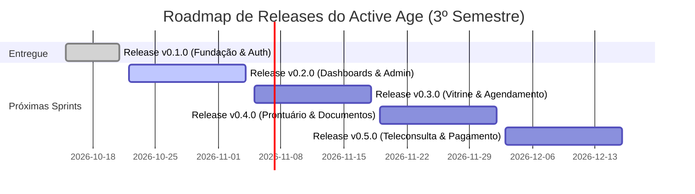

# PLANO DE RELEASE E ROADMAP DE SPRINTS
## Plataforma Active Age — Telessaúde Geriátrica Integral
### Faculdade de Tecnologia de Diadema (Fatec Luigi Papaiz) — DSM 3º Semestre
**Metodologia:** Spec-Driven Development (SDD) & Gestão Ágil (Scrum/Kanban)

---

### 1. Visão Geral do Release Plan

O **Plano de Release** formaliza o planejamento e as entregas incrementais do sistema **Active Age** ao longo do 3º Semestre letivo. O objetivo é estabelecer marcos de entrega funcionais, verificáveis e em ambiente de produção (Render + Vercel + MongoDB Atlas), permitindo que cada pacote de funcionalidades seja testado ponta a ponta antes da abertura da fase subsequente.

---

### 2. Release Atual: v0.1.0-alpha — Fundação, Identidade e Autenticação Segura

* **Status:** **Entregue e Operacional em Produção (Live)** ✅
* **Data da Release:** 21 de Outubro de 2026
* **Ambiente de Produção:**
  * **Frontend (Vercel):** Aplicação SPA em React 19 com proxy reverso e rewrite de rotas.
  * **Backend (Render):** [https://active-age-backend-mgyw.onrender.com](https://active-age-backend-mgyw.onrender.com) (Spring Boot 3 em container Docker).
  * **Banco de Dados (MongoDB Atlas):** Cluster em nuvem na coleção `users`.
* **Casos de Uso Cobertos:** **UC01** (Cadastrar-se na Plataforma) e **UC02** (Autenticar-se / Login).

#### 2.1. Funcionalidades Entregues nesta Release

| ID | Funcionalidade | Descrição da Entrega | Status |
|---|---|---|---|
| **REL-01** | **Cadastro de Paciente / Cuidador** | Formulário guiado em 3 etapas com máscaras de CPF e telefone, cálculo dinâmico de maioridade (18+ anos), consentimento obrigatório da LGPD e integração com a API Spring via `POST /api/auth/register-patient`. | Concluído ✅ |
| **REL-02** | **Cadastro de Médico Geriatra** | Formulário guiado em 3 etapas com máscaras de CRM e UF, termo de responsabilidade ética do CFM e persistência real no MongoDB via `POST /api/auth/register-doctor`. | Concluído ✅ |
| **REL-03** | **Autenticação Segura (Login)** | Validação de credenciais via hash BCrypt, emissão de token JWT stateless transportado via Cookie seguro (`HttpOnly`, `Secure`, `SameSite=Strict`), blindando a aplicação contra ataques XSS. | Concluído ✅ |
| **REL-04** | **Proteção contra Força Bruta (Rate Limiting)** | Algoritmo Token Bucket via **Bucket4j** na camada de serviço, bloqueando o e-mail por 15 minutos após 5 erros consecutivos de senha. | Concluído ✅ |
| **REL-05** | **Perfil do Usuário Autenticado** | Endpoint protegido `GET /api/auth/me` para resolução do perfil ativo a partir do cookie da sessão. | Concluído ✅ |
| **REL-06** | **Encerramento de Sessão (Logout)** | Endpoint `POST /api/auth/logout` que invalida o cookie seguro com `maxAge=0` no navegador. | Concluído ✅ |
| **REL-07** | **Navbar Reativa & Acessível** | Barra de navegação com alternância dinâmica: exibe *"Olá, Nome (Perfil)"* e botão *"Sair"* quando autenticado; botões de login/cadastro quando anônimo. | Concluído ✅ |
| **REL-08** | **Identidade Visual & Favicon Oficial** | Substituição dos assets do Vite pelo favicon personalizado (coração + eletrocardiograma terracota) e título semântico da aba. | Concluído ✅ |
| **REL-09** | **Documentação OpenAPI / Swagger** | Endpoints documentados e testáveis interativamente em `/swagger-ui/index.html` e `/v3/api-docs`. | Concluído ✅ |
| **REL-10** | **Sistema de Modais Acessíveis (IHC / WCAG)** | Componente reutilizável `FeedbackModal.tsx` substituindo alerts nativos bloqueantes. Suporte a variantes (sucesso, erro, alerta, info), ícones Lucide descritivos, backdrop blur e botões com alvos táteis ampliados (48px+) para geriatria. | Concluído ✅ |
| **REL-11** | **Validação Antecipada de E-mail (Etapa 1)** | Endpoint `GET /api/auth/check-email` e verificação assíncrona com feedback imediato no avanço da Etapa 1 dos cadastros, impedindo transição se o e-mail já existir. | Concluído ✅ |
| **REL-12** | **Controle de Visibilidade de Senha (IHC / WCAG)** | Alternância dinâmica (`Eye` / `EyeOff`) nos campos de senha (Login e Cadastros), permitindo ao público idoso auditar o que digitou. | Concluído ✅ |
| **REL-13** | **Tratador Global de Exceções (GlobalExceptionHandler)** | Classe `@RestControllerAdvice` mapeando `IllegalArgumentException` para HTTP 400 Bad Request e padronizando mensagens amigáveis em JSON, eliminando erros 500 indevidos. | Concluído ✅ |
| **REL-14** | **Acessibilidade de Erros & Conexão no ProgressBar (IHC / WCAG)** | Linha conectora de etapas corrigida no `ProgressBar.tsx` e inclusão de ícone `AlertCircle` em 100% das mensagens de validação. | Concluído ✅ |

#### 2.2. Critérios de Aceite Validados (Testes BDD)
- [x] Cadastro de paciente com e-mail duplicado bloqueado com mensagem amigável.
- [x] Transição da Etapa 1 bloqueada imediatamente se o e-mail já estiver cadastrado.
- [x] Paciente menor de 18 anos impedido de submeter o cadastro.
- [x] Cadastro de médico com CRM inválido impedido pelo schema de validação.
- [x] Senhas criptografadas com hash irreversível no MongoDB Atlas.
- [x] Login com 5 senhas erradas aciona trava de 15 minutos do Bucket4j.
- [x] Logout apaga a credencial e restabelece a Navbar no estado público.
- [x] Comunicação de sucesso/erro via modal acessível (`FeedbackModal`) com foco gerenciado e alvos táteis ampliados para geriatria (WCAG 2.1 AA).
- [x] Alternância de visualização de senhas nos campos de login e cadastro.
- [x] Linha conectora do ProgressBar visível com avanço dinâmico entre etapas.
- [x] Mensagens de erro de formulário acompanhadas por ícone visual `AlertCircle` (WCAG 2.1).
- [x] Falha de login tratada pelo `GlobalExceptionHandler` retornando HTTP 400 amigável em vez de 500.

---

### 3. Roadmap de Releases Futuras (Sprint Backlog)

A evolução do produto foi dividida em **5 Sprints incrementais**, garantindo foco e controle rigoroso de qualidade:

---

#### 📅 Sprint 2 — Release v0.2.0: Proteção de Rotas, Dashboards e Moderação (UC03, UC04, UC05) — [CONCLUÍDA ✅]
* **Objetivo:** Fornecer a área logada para Pacientes e Médicos, estruturar a guarda de rotas na SPA e criar o painel de moderação administrativa de CRM.
* **Status das Entregas:**
  - [x] **Micro Tarefa 2.1 (Concluída ✅):** Componente `ProtectedRoute.tsx` com validação de RBAC, Layout Administrativo (`AdminLayout.tsx`), Painel Inicial (`AdminDashboard.tsx`) e Seeding automático de usuário `ROLE_ADMIN` (`DataInitializer.java`).
  - [x] **Micro Tarefa 2.2 (Concluída ✅):** Módulo de Credenciamento Médico Integral (Dossiê Ético-Profissional em 4 Pilares: Habilitação, Regularidade Ética, Telemedicina ICP-Brasil Res. CFM nº 2.314/2022 e Dados Financeiros; Upload progressivo seguro com armazenamento isolado; Fila de Auditoria do Admin com conferência de checklist, visualizador seguro de documentos, trilha de auditoria `audit_logs` e aprovação/rejeição com justificativa obrigatória).
  - [x] **Micro Tarefa 2.3 (Concluída ✅):** Gestão de Usuários & Trilha de Auditoria Imutável (Listagem de Pacientes, Médicos e Admins com filtros por papel e status; Moderação com soft-lock e trava de auto-inativação; Painel de Trilha de Auditoria global em `audit_logs` com contadores 24h, filtros por tipo de evento e modal de inspeção detalhada em conformidade com CFM e SBIS NGS1).
  - [x] **Micro Tarefa 2.4 (Concluída ✅):** Dashboards Segregados de Paciente e Médico (`DashboardPaciente.tsx` com acessibilidade WCAG 2.1 AA e botões táteis ampliados para o público idoso; `DashboardMedico.tsx` com banner regulatório condicional da Res. CFM nº 2.314/2022, métricas de consultório e degustação SaaS de 15 dias; Redirecionamento inteligente pós-login e Navbar reativa).

---

#### 📅 Sprint 3 — Release v0.3.0: Gestão de Perfil, Vitrine de Horários e Agendamento Concorrente (UC18, UC08, UC09, UC10) — [CONCLUÍDA ✅]
* **Objetivo:** Estruturar a gestão completa de perfil e identidade visual de Médicos e Pacientes, e implantar a vitrine de agendamentos com reserva atômica sem *double-booking*.
* **Entregas Previstas:**
  1. [x] **Módulo de Perfil Médico & Paciente (SPEC-06 / UC18 / RF014) — [CONCLUÍDO ✅]:** Edição de perfil com upload de foto de rosto (avatar), biografia profissional, áreas de foco geriátrico, valor da consulta (R$), duração estimada, endereço residencial do paciente e cadastro do cuidador familiar com contato de emergência.
  2. [x] **Vitrine de Busca Inteligente e Catálogo Neutro de Médicos Geriatras (SPEC-07 / UC08 / RF005 / RN004) — [CONCLUÍDO ✅]:** Busca textual inteligente por nome/RQE/bio, filtros clínicos por foco geriátrico (AGA, Demências, Quedas, Polifarmácia), filtro por Estado (UF do CRM), ordenação neutra e transparente (Res. CFM nº 2.336/2023), cards informativos com foto oficial, RQE, duração e honorários, modal de detalhes com currículo Lattes e integração direta ao Dashboard do Paciente.
  3. [x] **Gestão da Agenda Médica & Grade de Disponibilidade (SPEC-09 / UC10 / RF006, RF007, RN001, RN008) — [CONCLUÍDO ✅]:** Entidade `DoctorScheduleSlot` no MongoDB Atlas com índice único anti-colisão, geração em lote de turnos com pausas técnicas (CFM/SBGG 50 min), slots avulsos, alternância de bloqueio e trava para médicos sem homologação de CRM.
  4. [x] **Agendamento Concorrente de Teleconsulta sem Double-Booking (SPEC-10 / UC09 / RN001, RN002) — [CONCLUÍDO ✅]:** Paciente seleciona slot livre na vitrine, reserva atômica na coleção `appointments` com congelamento de status `OCUPADO`, página de Minhas Consultas (`/paciente/consultas`) e política de cancelamento ético com antecedência de 24h com reciclagem do slot para `LIVRE`.

---

#### 📅 Sprint 4 — Release v0.4.0: Prontuário Ético Eletrônico e Documentos Digitais (UC11, UC13, UC14, UC15, UC16)
* **Objetivo:** Implementar o núcleo clínico da plataforma com conformidade legal do CFM e cofre digital vitalício de saúde.
* **Entregas Previstas:**
  1. [x] **Submissão e Gestão de Exames Prévios pelo Paciente no Cofre de Saúde (SPEC-08 / UC11 / RF008 / RN007) — [CONCLUÍDO ✅]:** Upload de laudos laboratoriais e exames de imagem em PDF/JPG/PNG com persistência em nuvem via MongoDB GridFS, categorização clínica, data do exame, anotações, visualização inline e exclusão segura.
  2. Médico visualiza histórico de exames anexados pelo paciente durante o atendimento (UC13).
  3. Registro de Prontuário Eletrônico (Anamnese, Diagnóstico e Conduta) com trava de **imutabilidade** após finalizado (UC14 / RN003).
  4. Emissão de Receitas, Pedidos de Exames e Atestados em formato PDF assinado (UC15).
  5. Download de documentos médicos gerados diretamente pelo painel do paciente (UC16).

---

#### 📅 Sprint 5 — Release v0.5.0: Teleconsulta Integrada e Fluxo Financeiro (UC06, UC07, UC12, UC17)
* **Objetivo:** Integrar a sala de videoconferência nativa para a consulta médica e acoplar a gestão de pagamentos por consulta e assinatura recorrente do médico.
* **Entregas Previstas:**
  1. Sala de teleconsulta integrada no navegador com áudio/vídeo seguro e link exclusivo (UC12).
  2. Processamento de pagamento da consulta no momento da confirmação do agendamento (UC06 / RN005).
  3. Gestão de cobrança de mensalidade SaaS para manutenção do consultório virtual do médico (UC07 / RN004).
  4. Módulo de avaliação pós-consulta e feedback do paciente (UC17).

---

### 4. Critérios de Transição de Release (Gateways de Qualidade)

Para que uma nova Release seja promovida para produção, ela deve obrigatoriamente cumprir:
1. **Spec Aprovada:** Todas as funcionalidades da Sprint devem ter suas especificações técnicas pré-aprovadas pelo PO.
2. **Testes Caixa-Preta BDD:** Todos os cenários (caminhos felizes e tristes) devem ser documentados e homologados.
3. **Build e Testes Automatizados:** O pipeline de compilação do Maven e do Vite deve rodar sem falhas.
4. **Deploy em Produção Homologado:** O backend no Render e o frontend na Vercel devem estar comunicando-se com status HTTP 200.

---
*Plano de Release aprovado para execução contínua.*  
*Projeto Integrador Active Age — Fatec Diadema 2026.*
