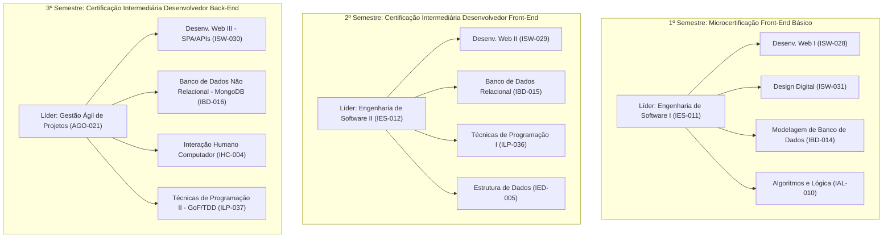
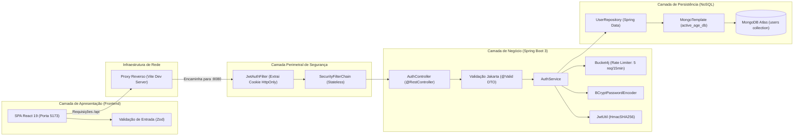

# RELATÓRIO DE ANÁLISE INTEGRAL DO PROJETO INTEGRADOR
## Plataforma Active Age — Telessaúde Geriátrica Integral
### Análise Arquitetural, Técnica e Pedagógica Conforme o PPC DSM (Fatec Diadema)

---

### Sumário Geral

1. [Identificação e escopo da análise](#1-identificação-e-escopo-da-análise)
2. [Resumo executivo](#2-resumo-executivo)
3. [Contexto acadêmico, pedagógico (PPC) e de negócio](#3-contexto-acadêmico-pedagógico-ppc-e-de-negócio)
4. [Estado atual do projeto](#4-estado-atual-do-projeto)
5. [Inventário completo do repositório](#5-inventário-completo-do-repositório)
6. [Tecnologias e dependências](#6-tecnologias-e-dependências)
7. [Arquitetura geral](#7-arquitetura-geral)
8. [Guia da estrutura de pastas](#8-guia-da-estrutura-de-pastas)
9. [Análise detalhada dos arquivos de código](#9-análise-detalhada-dos-arquivos-de-código)
10. [Funcionalidades e regras de negócio](#10-funcionalidades-e-regras-de-negócio)
11. [Fluxos de dados e execução](#11-fluxos-de-dados-e-execução)
12. [Interfaces, componentes e navegação](#12-interfaces-componentes-e-navegação)
13. [APIs e integrações](#13-apis-e-integrações)
14. [Modelos, banco de dados e persistência](#14-modelos-banco-de-dados-e-persistência)
15. [Autenticação, autorização e segurança](#15-autenticação-autorização-e-segurança)
16. [Testes e qualidade do software](#16-testes-e-qualidade-do-software)
17. [Confronto com a documentação, os requisitos e o PPC da Fatec](#17-confronto-com-a-documentação-os-requisitos-e-o-ppc-da-fatec)
18. [Problemas, inconsistências e riscos](#18-problemas-inconsistências-e-riscos)
19. [Pontos positivos da implementação](#19-pontos-positivos-da-implementação)
20. [Glossário técnico do projeto](#20-glossário-técnico-do-projeto)
21. [Tradutor do sistema para linguagem leiga](#21-tradutor-do-sistema-para-linguagem-leiga)
22. [Mapas mentais textuais](#22-mapas-mentais-textuais)
23. [Guia de navegação para manutenção](#23-guia-de-navegação-para-manutenção)
24. [Matriz de rastreabilidade técnica e curricular](#24-matriz-de-rastreabilidade-técnica-e-curricular)
25. [Inventário de cobertura e limitações](#25-inventário-de-cobertura-e-limitações)
26. [Perguntas em aberto](#26-perguntas-em-aberto)
27. [Conclusão sobre o entendimento do projeto](#27-conclusão-sobre-o-entendimento-do-projeto)
28. [Protocolo para futuras alterações](#28-protocolo-para-futuras-alterações)

---

## 1. Identificação e escopo da análise

* **Nome do Projeto:** Active Age — Plataforma Integral de Telessaúde Geriátrica `[CONFIRMADO]`
* **Instituição de Ensino Superior:** Faculdade de Tecnologia de Diadema (Fatec Luigi Papaiz — Unidade R-06) `[CONFIRMADO]`
* **Curso de Graduação:** Curso Superior de Tecnologia em Desenvolvimento de Software Multiplataforma (CST DSM) `[CONFIRMADO]`
* **Referência Pedagógica:** Projeto Pedagógico de Curso (PPC) — Versão 2024 / 1º Semestre (Aprovado pelo Parecer CD 94/2021 do CEETEPS / Centro Paula Souza) `[CONFIRMADO]`
* **Metodologia de Ensino-Aprendizagem:** Aprendizagem Baseada em Problemas e Projetos (PBL / ABProj), orientada ao desenvolvimento de competências profissionais e socioemocionais em 6 semestres letivos (2.400 horas de matriz curricular + 240 horas de estágio supervisionado) `[CONFIRMADO]`
* **Repositório Analisado:** `c:\Users\Proati\Desktop\Guilherme\active-age` `[CONFIRMADO]`
* **Data da Auditoria:** 21 de Outubro de 2026 `[CONFIRMADO]`
* **Limites do Escopo:** Análise estática minuciosa e não destrutiva de 100% dos arquivos do repositório, cruzamento das evidências de código com o ementário oficial e matriz curricular do PPC da Fatec Diadema. **Nenhum arquivo dentro do repositório foi alterado, criado ou deletado** `[CONFIRMADO]`.

---

## 2. Resumo executivo

O **Active Age** é uma plataforma digital de telessaúde focada no atendimento especializado a pacientes da terceira idade (medicina geriátrica). O projeto foi concebido para resolver o grave problema da fragmentação e burocracia no cuidado da saúde do idoso no Brasil, conectando pacientes, seus cuidadores familiares e médicos geriatras.

A plataforma abrange a jornada clínica completa: busca inteligente de profissionais, agendamento de horários sem risco de duplo agendamento (*double booking*), teleconsultas integradas no navegador, cofre digital de receitas e exames e prontuário eletrônico imutável em conformidade com as resoluções do Conselho Federal de Medicina (CFM) e a Lei Geral de Proteção de Dados (LGPD).

A arquitetura do projeto foi estruturada para espelhar rigorosamente o avanço das disciplinas do CST em Desenvolvimento de Software Multiplataforma da Fatec Diadema ao longo de 6 semestres letivos:
* **1º Semestre (Fundamentação e Design):** Front-end estático acessível em HTML5/CSS3/JS, levantamento de requisitos, modelagem relacional preliminar e prototipagem com foco em usabilidade (WCAG 2.1).
* **2º Semestre (Motor Relacional e POO):** Backend em Node.js com Express e TypeScript estruturado em MVC clássico, persistência relacional normalizada em MySQL (Docker) e algoritmo de bloqueio e estorno automático de slots de horários.
* **3º Semestre (APIs Corporativas, NoSQL e IHC):** Transição para arquitetura corporativa moderna: API RESTful em **Java 21 com Spring Boot 3** (Spring Security com controle de taxa de requisições via Bucket4j, transporte de JWT seguro em Cookie HttpOnly e banco NoSQL MongoDB Atlas) integrada a uma SPA em **React 19 com TypeScript, Vite, Tailwind CSS v4, React Router DOM v7 e validação por esquemas Zod**.
* **4º a 6º Semestres (Planejamento Futuro):** Evolução prevista para ecossistema Mobile (React Native/Flutter), automação CI/CD com Docker, Nuvem (AWS/Azure), Computação Inteligente e Processamento de Linguagem Natural (NLP / transcrição de áudio).

---

## 3. Contexto acadêmico, pedagógico (PPC) e de negócio

### 3.1. Alinhamento com o Projeto Pedagógico do Curso (PPC - DSM Fatec Diadema)
A inspeção do PPC oficial (Páginas 28 a 81) revela que o curso de DSM organiza a avaliação discente por meio de **Projetos Interdisciplinares Semestrais**, onde uma disciplina central assume a liderança metodológica integrando os conhecimentos práticos das demais disciplinas do período:



* **1º Semestre (PPC Pág. 35):** *"Nesta disciplina (Engenharia de Software I) o professor é responsável por desenvolver um projeto Interdisciplinar integrando as disciplinas de Desenvolvimento Web I e Design Digital..."*
  * *Evidência no Active Age:* O repositório em `1-Semestre/` contempla exatamente essa tríade: telas web nativas (`Desenvolvimento Web I`), paleta acessível e logotipo (`Design Digital`), e requisitos RF001-RF014 com Canvas e Casos de Uso UC01-UC18 (`Engenharia de Software I`).
* **2º Semestre (PPC Pág. 42):** *"Nesta disciplina (Engenharia de Software II) o professor é responsável por desenvolver um projeto Interdisciplinar integrando as disciplinas de Desenvolvimento Web II e Banco de Dados Relacional..."*
  * *Evidência no Active Age:* O repositório em `2-Semestre/` materializou uma API em Express/Node (`Desenvolvimento Web II`), persistência relacional com normalização, concorrência e seeds no MySQL (`Banco de Dados Relacional`), aliada à modelagem orientada a objetos com herança e polimorfismo (`Técnicas de Programação I`).
* **3º Semestre (PPC Pág. 50):** *"Nesta disciplina (Gestão Ágil de Projetos de Software) o professor é responsável por desenvolver um projeto Interdisciplinar integrando as disciplinas de Desenvolvimento Web III, Banco de Dados Não Relacional e Interação Humano Computador..."*
  * *Evidência no Active Age:* O repositório em `3-Semestre/` implementou a SPA em React com acessibilidade WCAG (`Interação Humano Computador`), a API REST em Spring Boot (`Desenvolvimento Web III`) e a modelagem orientada a documentos no MongoDB Atlas (`Banco de Dados Não Relacional`).

### 3.2. Certificações Profissionais Oficiais Vinculadas ao Projeto
Conforme o Artigo 3.9 do PPC (Páginas 16 a 19), o estudante que atinge os marcos de entrega desenvolve competências para as seguintes certificações:
1. **Microcertificação Front-End Básico (1º Semestre):** Especificação de requisitos, design visual e construção de páginas web com marcação semântica.
2. **Certificação Intermediária Desenvolvedor Front-End (2º Semestre):** Modelagem e tratamento de dados relacionais estruturados, lógica orientada a objetos e segurança de aplicações.
3. **Microcertificação Design Patterns Básico (2º/3º Semestre):** Padrões arquiteturais e estruturais de software.
4. **Certificação Intermediária Desenvolvedor Back-End (3º Semestre):** Persistência não-relacional (NoSQL), desenvolvimento de APIs modernas, metodologias ágeis e documentação de versionamento.
5. **Microcertificação UX Básico (3º/4º Semestre):** Métricas de usabilidade, avaliações heurísticas e design centrado no usuário.

### 3.3. Problema e Proposta de Valor no Negócio de Saúde
* **Segmento:** Idosos (60+), cuidadores informais/formais e médicos geriatras.
* **Proposta de Valor:** Centralização do cuidado contínuo em uma plataforma sem barreiras cognitivas, garantindo atendimento médico especializado sem necessidade de deslocamento físico.
* **Modelo de Sustentabilidade (Lean Canvas):** Assinatura SaaS mensal cobrada dos médicos geriatras para uso do consultório virtual (com 15 dias de degustação gratuita) e taxa de intermediação de pagamentos de consultas.

---

## 4. Estado atual do projeto

| Módulo / Semestre | Disciplinas Integradas (PPC) | Status de Entrega | Evidências no Repositório |
|---|---|---|---|
| **1-Semestre** | IES-011, ISW-028, ISW-031, IBD-014 | **Concluído** ✅ | HTML5/CSS3 nativo, simulação em `localStorage` (`1-Semestre/src/app.js`), levantamento de requisitos em `/docs` `[CONFIRMADO]`. |
| **2-Semestre** | IES-012, ISW-029, IBD-015, ILP-036 | **Concluído** ✅ | Servidor Node.js + Express + TypeScript (`src/server.ts`), classes abstratas de POO (`Usuario`, `Medico`, `Paciente`), banco relacional MySQL com Docker e controle de slots concorrentes `[CONFIRMADO]`. |
| **3-Semestre (Backend)** | ISW-030, IBD-016, ILP-037 | **Releases v0.1.0, v0.2.0 e v0.3.0 Concluídas em Produção** ✅ | Spring Boot 3 / Java 21 com Spring Security, JWT seguro em Cookie HttpOnly, Rate Limiting (Bucket4j), MongoDB Atlas (`User.java`, `DoctorScheduleSlot.java`, `Appointment.java`, `PatientExam.java`), GridFS, Auditoria imutável (`audit_logs`) e automação de agendamentos `@Scheduled`. |
| **3-Semestre (Frontend)** | ISW-030, IHC-004, AGO-021 | **Releases v0.1.0, v0.2.0 e v0.3.0 Concluídas em Produção** ✅ | SPA React 19 + TypeScript + Tailwind v4 + Zod. Cadastro de Paciente e Médico reais, Dashboards segregados (Paciente WCAG 2.1 AA, Médico com consultório virtual, Admin com métricas e auditoria), Vitrine neutra de especialistas (Res. CFM nº 2.336/2023), Minhas Consultas e Gestão de Agenda. |
| **4-Semestre** | ISW-032, ISW-033, ILP-038, IAL-011 | **Planejado** ⏳ | Previsto: Mobile (React Native), CI/CD com Docker e IoT. Pasta contém apenas `README.md` vazio `[CONFIRMADO]`. |
| **5-Semestre** | ISW-034, MAQ-024, ISG-022, ILP-039 | **Planejado** ⏳ | Previsto: Computação em Nuvem (AWS/Azure), Machine Learning e Segurança OWASP. Pasta contém `README.md` vazio `[CONFIRMADO]`. |
| **6-Semestre** | ISW-035, ISW-037, ISW-038, IQS-004 | **Planejado** ⏳ | Previsto: Telessaúde de ponta (WebRTC nativo), Processamento de Linguagem Natural (transcrição de consultas) e testes automatizados. Pasta contém `README.md` vazio `[CONFIRMADO]`. |

---

## 5. Inventário completo do repositório

O repositório é composto rigorosamente por **121 arquivos**. Todos foram examinados individualmente e catalogados abaixo:

| # | Caminho Relativo | Categoria | Responsabilidade / Função | Relação Curricular / Módulos | Status |
|---|---|---|---|---|---|
| 1 | `.gitignore` | Configuração Git | Ignora dependências de SO, IDEs e locks | Repositório global | Analisado |
| 2 | `README.md` | Documentação | Apresentação institucional e evolução semestral | Raiz do projeto | Analisado |
| 3 | `1-Semestre/README.md` | Documentação | Síntese de objetivos e guia do 1º Semestre | 1-Semestre | Analisado |
| 4 | `1-Semestre/assets/hero-image.png` | Asset Binário | Imagem representativa de idosos sorrindo | `index.html` (Design Digital) | Analisado |
| 5 | `1-Semestre/assets/logo-active-age.png` | Asset Binário | Logotipo oficial da marca | Design Digital | Analisado |
| 6 | `1-Semestre/docs/casos-de-uso.md` | Documentação | 18 Casos de Uso detalhados (UC01 a UC18) | Engenharia de Software I | Analisado |
| 7 | `1-Semestre/docs/modelagem-dados.md` | Documentação | Mapeamento inicial das entidades conceituais | Modelagem de Banco de Dados | Analisado |
| 8 | `1-Semestre/docs/planejamento.md` | Documentação | Metas SMART (6 semestres) e Lean Canvas | Gestão de Negócios | Analisado |
| 9 | `1-Semestre/docs/requisitos.md` | Documentação | Requisitos funcionais (RF01-14) e não-funcionais | Engenharia de Software I | Analisado |
| 10 | `1-Semestre/src/app.js` | Código (JS) | Gestão client-side de login e cadastro em `localStorage` | Desenvolvimento Web I | Analisado |
| 11 | `1-Semestre/src/cadastro.html` | Interface (HTML) | Formulário inicial de cadastro com alternância de perfil | Desenvolvimento Web I | Analisado |
| 12 | `1-Semestre/src/dashboard.html` | Interface (HTML) | Painel simulado com saudação dinâmica | Desenvolvimento Web I | Analisado |
| 13 | `1-Semestre/src/index.html` | Interface (HTML) | Landing page estática nativa | Desenvolvimento Web I | Analisado |
| 14 | `1-Semestre/src/login.html` | Interface (HTML) | Tela estática de autenticação local | Desenvolvimento Web I | Analisado |
| 15 | `1-Semestre/src/style.css` | Estilo (CSS) | Estilos customizados e variáveis de cor com Bootstrap | Design Digital / Web I | Analisado |
| 16 | `2-Semestre/docker-compose.yml` | Infraestrutura | Orquestração do MySQL 8.0 na porta 3306 | Banco de Dados Relacional | Analisado |
| 17 | `2-Semestre/package-lock.json` | Dependências | Árvore de dependências resolvida do npm | Node.js | Analisado |
| 18 | `2-Semestre/package.json` | Configuração npm | Dependências de runtime (Express, TypeScript, MySQL2) | Desenvolvimento Web II | Analisado |
| 19 | `2-Semestre/README.md` | Documentação | Guia de execução do backend Node.js + MySQL | 2-Semestre | Analisado |
| 20 | `2-Semestre/tsconfig.json` | Configuração TS | Opções do compilador TypeScript (ES2022 / CommonJS) | Técnicas de Programação I | Analisado |
| 21 | `2-Semestre/database/refatoracao.sql` | Banco de Dados | DDL da tabela `horarios_disponiveis` e chave composta | Banco de Dados Relacional | Analisado |
| 22 | `2-Semestre/database/schema.sql` | Banco de Dados | DDL de `usuarios`, `pacientes`, `medicos`, `agendamentos` | Banco de Dados Relacional | Analisado |
| 23 | `2-Semestre/database/seed.sql` | Banco de Dados | Carga inicial em UTF-8 com médicos fictícios | Banco de Dados Relacional | Analisado |
| 24 | `2-Semestre/docs/banco-de-dados.md` | Documentação | Explicação do modelo e controle de concorrência | Banco de Dados Relacional | Analisado |
| 25 | `2-Semestre/docs/poo-e-arquitetura.md` | Documentação | Fundamentos de POO e padrão MVC no Express | Técnicas de Programação I | Analisado |
| 26 | `2-Semestre/docs/uml-e-fluxos.md` | Documentação | Diagramas Mermaid de Classes e Sequência | Engenharia de Software II | Analisado |
| 27 | `2-Semestre/public/agendamento.js` | Código (JS) | Consumo assíncrono (Fetch) de horários e reservas | Desenvolvimento Web II | Analisado |
| 28 | `2-Semestre/public/app.js` | Código (JS) | Login e cadastro reais consumindo a API REST | Desenvolvimento Web II | Analisado |
| 29 | `2-Semestre/public/cadastro.html` | Interface (HTML) | Interface web conectada aos endpoints Express | Desenvolvimento Web II | Analisado |
| 30 | `2-Semestre/public/dashboard-medico.html` | Interface (HTML) | Painel do médico com vitrine de horários | Desenvolvimento Web II | Analisado |
| 31 | `2-Semestre/public/dashboard-paciente.html` | Interface (HTML) | Painel do paciente com agendamento dinâmico | Desenvolvimento Web II | Analisado |
| 32 | `2-Semestre/public/index.html` | Interface (HTML) | Landing page servida estaticamente pelo Express | Desenvolvimento Web II | Analisado |
| 33 | `2-Semestre/public/login.html` | Interface (HTML) | Tela de login integrada com feedback SweetAlert2 | Desenvolvimento Web II | Analisado |
| 34 | `2-Semestre/public/sala-video-fake.html` | Interface (HTML) | Simulação visual da sala de teleconsulta | Desenvolvimento Web II | Analisado |
| 35 | `2-Semestre/public/style.css` | Estilo (CSS) | Estilos aplicados aos dashboards do 2º semestre | Desenvolvimento Web II | Analisado |
| 36 | `2-Semestre/public/assets/hero-image.png` | Asset Binário | Imagem representativa na pasta pública | Frontend 2-Semestre | Analisado |
| 37 | `2-Semestre/public/assets/logo-active-age.png` | Asset Binário | Logotipo na pasta pública | Frontend 2-Semestre | Analisado |
| 38 | `2-Semestre/src/server.ts` | Código (TS) | Entry point do servidor Express (porta 3000) e rotas | Desenvolvimento Web II | Analisado |
| 39 | `2-Semestre/src/config/database.ts` | Código (TS) | Pool de conexões assíncrono com o MySQL2 | Banco de Dados Relacional | Analisado |
| 40 | `2-Semestre/src/controllers/AgendamentoController.ts` | Código (TS) | Lógica de agendamento (bloqueio de slot) e cancelamento | Técnicas de Prog. I / Web II | Analisado |
| 41 | `2-Semestre/src/controllers/AuthController.ts` | Código (TS) | Login polimórfico e cadastro relacional de usuários | Técnicas de Prog. I / Web II | Analisado |
| 42 | `2-Semestre/src/controllers/HorarioController.ts` | Código (TS) | Gestão de slots livres na agenda do médico | Técnicas de Prog. I / Web II | Analisado |
| 43 | `2-Semestre/src/models/Usuario.ts` | Código (TS) | Classe abstrata com método polimórfico de dashboard | Técnicas de Programação I | Analisado |
| 44 | `2-Semestre/src/models/Medico.ts` | Código (TS) | Especialização de Usuario contendo CRM e especialidade | Técnicas de Programação I | Analisado |
| 45 | `2-Semestre/src/models/Paciente.ts` | Código (TS) | Especialização de Usuario contendo data de nascimento | Técnicas de Programação I | Analisado |
| 46 | `2-Semestre/src/routes/agendamento.routes.ts` | Código (TS) | Definição dos endpoints REST de agendamento | Desenvolvimento Web II | Analisado |
| 47 | `2-Semestre/src/routes/auth.routes.ts` | Código (TS) | Endpoints REST de login e cadastro | Desenvolvimento Web II | Analisado |
| 48 | `2-Semestre/src/routes/horario.routes.ts` | Código (TS) | Endpoints REST da vitrine de horários médicos | Desenvolvimento Web II | Analisado |
| 49 | `3-Semestre/README.md` | Documentação | Arquivo de reserva do 3º Semestre (vazio, 0 bytes) | 3-Semestre | Analisado |
| 50 | `3-Semestre/backend-core/.gitattributes` | Configuração Git | Padronização de line-endings para scripts Maven | Versionamento | Analisado |
| 51 | `3-Semestre/backend-core/.gitignore` | Configuração Git | Ignora artefatos compilados do Maven (`target/`) | Versionamento | Analisado |
| 52 | `3-Semestre/backend-core/mvnw` | Script Shell | Maven Wrapper para execução independente no Linux/Mac | Gestão de Build | Analisado |
| 53 | `3-Semestre/backend-core/mvnw.cmd` | Script Batch | Maven Wrapper para execução independente no Windows | Gestão de Build | Analisado |
| 54 | `3-Semestre/backend-core/pom.xml` | Configuração Maven | Dependências Java (Spring Boot, Security, Mongo, JWT) | Desenv. Web III / TP II | Analisado |
| 55 | `3-Semestre/backend-core/.mvn/wrapper/maven-wrapper.properties` | Configuração Maven | Configuração da versão do binário Maven (3.9.9) | Gestão de Build | Analisado |
| 56 | `3-Semestre/backend-core/src/main/java/com/activeage/core/ActiveAgeCoreApplication.java` | Código (Java) | Classe principal de inicialização do Spring Boot | Desenvolvimento Web III | Analisado |
| 57 | `3-Semestre/backend-core/src/main/java/com/activeage/core/config/JwtAuthFilter.java` | Código (Java) | Filtro de segurança que extrai JWT do cookie HttpOnly | Segurança / Spring Security | Analisado |
| 58 | `3-Semestre/backend-core/src/main/java/com/activeage/core/config/MongoConfig.java` | Código (Java) | Configuração explícita do cliente MongoDB Atlas | Banco de Dados Não Relacional | Analisado |
| 59 | `3-Semestre/backend-core/src/main/java/com/activeage/core/config/SecurityConfig.java` | Código (Java) | Configuração da cadeia de segurança e hashing BCrypt | Segurança / Spring Security | Analisado |
| 60 | `3-Semestre/backend-core/src/main/java/com/activeage/core/controllers/AuthController.java` | Código (Java) | REST Controller com endpoints `/register-patient` e `/login` | Desenvolvimento Web III | Analisado |
| 61 | `3-Semestre/backend-core/src/main/java/com/activeage/core/domain/enums/Role.java` | Código (Java) | Enumeração com perfis de acesso (PACIENTE, MEDICO, ADMIN) | Técnicas de Programação II | Analisado |
| 62 | `3-Semestre/backend-core/src/main/java/com/activeage/core/domain/models/User.java` | Código (Java) | Documento persistido na coleção `users` do MongoDB | Banco de Dados Não Relacional | Analisado |
| 63 | `3-Semestre/backend-core/src/main/java/com/activeage/core/dtos/requests/LoginRequest.java` | Código (Java) | DTO de autenticação com validações Jakarta | Técnicas de Prog. II / Web III | Analisado |
| 64 | `3-Semestre/backend-core/src/main/java/com/activeage/core/dtos/requests/PatientRegisterRequest.java` | Código (Java) | DTO de cadastro com regras de validação estritas | Técnicas de Prog. II / Web III | Analisado |
| 65 | `3-Semestre/backend-core/src/main/java/com/activeage/core/repositories/UserRepository.java` | Código (Java) | Interface Spring Data Mongo para consultas de usuários | Banco de Dados Não Relacional | Analisado |
| 66 | `3-Semestre/backend-core/src/main/java/com/activeage/core/services/AuthService.java` | Código (Java) | Lógica de negócio, hashing e rate limiting com Bucket4j | Técnicas de Programação II | Analisado |
| 67 | `3-Semestre/backend-core/src/main/java/com/activeage/core/utils/JwtUtil.java` | Código (Java) | Utilitário criptográfico para emissão e validação JWT | Segurança / Web III | Analisado |
| 68 | `3-Semestre/backend-core/src/main/resources/application.properties` | Configuração | Configuração de porta (8080), MongoDB URI e segredo JWT | Desenvolvimento Web III | Analisado |
| 69 | `3-Semestre/backend-core/src/test/java/com/activeage/core/ActiveAgeCoreApplicationTests.java` | Código (Java) | Teste de contexto básico com SpringBootTest | Qualidade de Software | Analisado |
| 70 | `3-Semestre/docs/01-visao-do-produto-e-ux.md` | Documentação | Metas SMART do 3º semestre, proto-personas e IHC | IHC / Gestão Ágil | Analisado |
| 71 | `3-Semestre/docs/02-requisitos-e-regras.md` | Documentação | Matriz formal de requisitos funcionais e regras | Gestão Ágil de Projetos | Analisado |
| 72 | `3-Semestre/docs/03-arquitetura-e-stack.md` | Documentação | Decisões de arquitetura (Spring, React, Mongo, Railway) | Gestão Ágil / Arquitetura | Analisado |
| 73 | `3-Semestre/docs/04-modelos-uml.md` | Documentação | Modelos UML Mermaid (Casos de Uso, Classes, Sequência) | Engenharia / Gestão Ágil | Analisado |
| 74 | `3-Semestre/frontend-react/.gitignore` | Configuração Git | Ignora `node_modules/` e diretório de build `dist/` | Versionamento | Analisado |
| 75 | `3-Semestre/frontend-react/.oxlintrc.json` | Configuração Linter | Regras do analisador estático ultra-rápido Oxlint | Qualidade de Software | Analisado |
| 76 | `3-Semestre/frontend-react/index.html` | Interface (HTML) | Template base do Vite para montagem da SPA React | Desenvolvimento Web III | Analisado |
| 77 | `3-Semestre/frontend-react/package-lock.json` | Dependências | Árvore resolvida de pacotes npm do frontend | Node.js / React | Analisado |
| 78 | `3-Semestre/frontend-react/package.json` | Configuração npm | Dependências do React 19, Zod, React Router e Tailwind | Desenvolvimento Web III | Analisado |
| 79 | `3-Semestre/frontend-react/postcss.config.js` | Configuração CSS | Integração do PostCSS com Tailwind CSS v4 | Desenvolvimento Web III | Analisado |
| 80 | `3-Semestre/frontend-react/README.md` | Documentação | Instruções padrões do template Vite + Oxlint | Documentação | Analisado |
| 81 | `3-Semestre/frontend-react/tailwind.config.js` | Configuração CSS | Tokens de cores acessíveis (`brand-orange`, `brand-mint`) | Interação Humano Computador | Analisado |
| 82 | `3-Semestre/frontend-react/tsconfig.app.json` | Configuração TS | Compilação do código da aplicação SPA | Desenvolvimento Web III | Analisado |
| 83 | `3-Semestre/frontend-react/tsconfig.json` | Configuração TS | Configuração raiz de referências do TypeScript | Desenvolvimento Web III | Analisado |
| 84 | `3-Semestre/frontend-react/tsconfig.node.json` | Configuração TS | Compilação de arquivos de configuração do Vite | Desenvolvimento Web III | Analisado |
| 85 | `3-Semestre/frontend-react/vercel.json` | Infraestrutura | Regras de reescrita de rotas para deploy SPA na Vercel | Computação em Nuvem | Analisado |
| 86 | `3-Semestre/frontend-react/vite.config.ts` | Configuração Vite | Configuração do Vite e proxy reverso `/api` -> 8080 | Desenvolvimento Web III | Analisado |
| 87 | `3-Semestre/frontend-react/public/favicon.svg` | Asset Vetorial | Ícone de coração estilizado para aba do navegador | Design Digital / IHC | Analisado |
| 88 | `3-Semestre/frontend-react/public/icons.svg` | Asset Vetorial | Definição de sprites de ícones | Design Digital / IHC | Analisado |
| 89 | `3-Semestre/frontend-react/src/App.css` | Estilo (CSS) | Estilos utilitários e animações customizadas | Desenvolvimento Web III | Analisado |
| 90 | `3-Semestre/frontend-react/src/App.tsx` | Código (TSX) | Roteador SPA central mapeando layouts público e de auth | Desenvolvimento Web III | Analisado |
| 91 | `3-Semestre/frontend-react/src/index.css` | Estilo (CSS) | Importação do Tailwind v4 e classes reutilizáveis | Desenvolvimento Web III | Analisado |
| 92 | `3-Semestre/frontend-react/src/main.tsx` | Código (TSX) | Ponto de entrada que inicializa a raiz React no DOM | Desenvolvimento Web III | Analisado |
| 93 | `3-Semestre/frontend-react/src/assets/hero-image.png` | Asset Binário | Imagem representativa de idosos sorrindo | IHC / Design Digital | Analisado |
| 94 | `3-Semestre/frontend-react/src/assets/hero.png` | Asset Binário | Variação compacta da imagem hero | IHC / Design Digital | Analisado |
| 95 | `3-Semestre/frontend-react/src/assets/logo-active-age.png` | Asset Binário | Logotipo com coração e tipografia | IHC / Design Digital | Analisado |
| 96 | `3-Semestre/frontend-react/src/assets/react.svg` | Asset Vetorial | Logotipo padrão do framework React | Assets | Analisado |
| 97 | `3-Semestre/frontend-react/src/assets/vite.svg` | Asset Vetorial | Logotipo padrão do bundler Vite | Assets | Analisado |
| 98 | `3-Semestre/frontend-react/src/components/auth/ProgressBar.tsx` | Código (TSX) | Barra de progresso com acessibilidade semântica ARIA | Interação Humano Computador | Analisado |
| 99 | `3-Semestre/frontend-react/src/components/home/Beneficios.tsx` | Código (TSX) | Seção destacando Segurança LGPD, Acessibilidade e Histórico | IHC / Web III | Analisado |
| 100 | `3-Semestre/frontend-react/src/components/home/ComoFunciona.tsx` | Código (TSX) | Demonstração passo a passo da jornada do usuário | IHC / Web III | Analisado |
| 101 | `3-Semestre/frontend-react/src/components/home/CTA.tsx` | Código (TSX) | Chamada final para conversão e abertura de contas | IHC / Web III | Analisado |
| 102 | `3-Semestre/frontend-react/src/components/home/DualPersona.tsx` | Código (TSX) | Comparativo visual entre jornada do Paciente e Médico | IHC / Web III | Analisado |
| 103 | `3-Semestre/frontend-react/src/components/home/Footer.tsx` | Código (TSX) | Rodapé completo com links e dados da Fatec Diadema | IHC / Web III | Analisado |
| 104 | `3-Semestre/frontend-react/src/components/home/Hero.tsx` | Código (TSX) | Destaque principal com chamadas e foto humanizada | IHC / Web III | Analisado |
| 105 | `3-Semestre/frontend-react/src/components/home/Navbar.tsx` | Código (TSX) | Barra de navegação com menu móvel responsivo | IHC / Web III | Analisado |
| 106 | `3-Semestre/frontend-react/src/layouts/AuthLayout.tsx` | Código (TSX) | Layout em duas colunas (branding à esquerda, form à direita) | IHC / Web III | Analisado |
| 107 | `3-Semestre/frontend-react/src/layouts/PublicLayout.tsx` | Código (TSX) | Layout padrão encapsulando Navbar e Footer | Desenvolvimento Web III | Analisado |
| 108 | `3-Semestre/frontend-react/src/pages/Home.tsx` | Código (TSX) | Composição modular da página inicial da plataforma | Desenvolvimento Web III | Analisado |
| 109 | `3-Semestre/frontend-react/src/pages/Privacidade.tsx` | Código (TSX) | Termo de Consentimento Livre e Esclarecido (LGPD) | Ética / Segurança / Web III | Analisado |
| 110 | `3-Semestre/frontend-react/src/pages/QuemSomos.tsx` | Código (TSX) | Página institucional: Missão, Visão e Valores humanizados | Interação Humano Computador | Analisado |
| 111 | `3-Semestre/frontend-react/src/pages/Servicos.tsx` | Código (TSX) | Detalhamento dos serviços para pacientes e médicos | Interação Humano Computador | Analisado |
| 112 | `3-Semestre/frontend-react/src/pages/TermosUso.tsx` | Código (TSX) | Regras de cancelamento de 24h e responsabilidade do CFM | Ética / Gestão Ágil | Analisado |
| 113 | `3-Semestre/frontend-react/src/pages/auth/CadastroEscolha.tsx` | Código (TSX) | Seletor intuitivo entre perfil Paciente ou Médico | Interação Humano Computador | Analisado |
| 114 | `3-Semestre/frontend-react/src/pages/auth/CadastroMedico.tsx` | Código (TSX) | Formulário médico em 3 passos com máscaras e Zod | IHC / Web III | Analisado |
| 115 | `3-Semestre/frontend-react/src/pages/auth/CadastroPaciente.tsx` | Código (TSX) | Formulário em 3 passos integrado via fetch ao Spring | IHC / Web III | Analisado |
| 116 | `3-Semestre/frontend-react/src/pages/auth/Login.tsx` | Código (TSX) | Formulário de autenticação integrado ao Spring Boot | Desenvolvimento Web III | Analisado |
| 117 | `3-Semestre/frontend-react/src/pages/auth/RecuperarSenha.tsx` | Código (TSX) | Interface amigável para envio de link de recuperação | IHC / Web III | Analisado |
| 118 | `3-Semestre/frontend-react/src/utils/masks.ts` | Código (TS) | Máscaras puras de formatação para CPF, Tel, CRM e UF | Interação Humano Computador | Analisado |
| 119 | `4-Semestre/README.md` | Documentação | Placeholder acadêmico para o 4º Semestre (vazio, 0 bytes) | 4-Semestre | Analisado |
| 120 | `5-Semestre/README.md` | Documentação | Placeholder acadêmico para o 5º Semestre (vazio, 0 bytes) | 5-Semestre | Analisado |
| 121 | `6-Semestre/README.md` | Documentação | Placeholder acadêmico para o 6º Semestre (vazio, 0 bytes) | 6-Semestre | Analisado |

---

## 6. Tecnologias e dependências

### 6.1. Ecossistema do 1º Semestre (Fundamentação e Design)
* **HTML5 Semântico, CSS3 e JavaScript Vanilla:** Implementação pura sem dependência de transpiladores `[CONFIRMADO]`.
* **Bootstrap 5.3.0 e SweetAlert2:** Importados via CDN para estilização de grid e alertas interativos `[CONFIRMADO]`.
* **Armazenamento:** `window.localStorage` do navegador para persistência de protótipo `[CONFIRMADO]`.

### 6.2. Ecossistema do 2º Semestre (Node.js / Express / MySQL)
* **Runtime:** Node.js (LTS v20+) `[CONFIRMADO]`.
* **Linguagem:** TypeScript 7.0.2 compilado para ECMAScript 2022 (CommonJS) `[CONFIRMADO]`.
* **Framework Web:** Express 5.2.1 `[CONFIRMADO]`.
* **CORS:** Cors 2.8.6 `[CONFIRMADO]`.
* **Banco de Dados:** Driver Mysql2 3.24.4 (conexão com pooling) sob container Docker MySQL 8.0 `[CONFIRMADO]`.
* **Ferramentas de Desenvolvimento:** TSX 4.23.13 e Nodemon 3.1.14 `[CONFIRMADO]`.

### 6.3. Ecossistema do 3º Semestre (Java 21 / Spring Boot 3 / MongoDB)
* **Linguagem:** Java 21 `[CONFIRMADO]`.
* **Framework:** Spring Boot 3 / Spring Framework 6 `[CONFIRMADO]`.
* **Módulos do Spring:**
  * `spring-boot-starter-data-mongodb` (Driver e repositórios NoSQL) `[CONFIRMADO]`.
  * `spring-boot-starter-security` (Controle perimetral e RBAC) `[CONFIRMADO]`.
  * `spring-boot-starter-validation` (Jakarta Validation / Hibernate Validator) `[CONFIRMADO]`.
  * `spring-boot-starter-webmvc` (Serviços RESTful) `[CONFIRMADO]`.
* **Segurança e Utilitários:**
  * `io.jsonwebtoken` (JJWT 0.12.5) para assinatura de tokens HmacSHA256 `[CONFIRMADO]`.
  * `com.bucket4j:bucket4j-core` (v8.10.0) para Rate Limiting (5 tentativas / 15 min) `[CONFIRMADO]`.
  * BCrypt para hashing irreversível de senhas `[CONFIRMADO]`.
  * `springdoc-openapi-starter-webmvc-ui` (v2.3.0) para documentação OpenAPI/Swagger `[CONFIRMADO]`.
  * Project Lombok para redução de código boilerplate `[CONFIRMADO]`.

### 6.4. Ecossistema do 3º Semestre (React 19 / TypeScript / Vite)
* **Linguagem e Biblioteca:** React 19.2.8 e React DOM 19.2.8 sob TypeScript 6.0.2 `[CONFIRMADO]`.
* **Bundler & Dev Server:** Vite 8.3.0 com configuração de proxy reverso `/api` para a porta 8080 `[CONFIRMADO]`.
* **Roteamento:** React Router DOM 7.18.4 `[CONFIRMADO]`.
* **Formulários e Esquemas:** React Hook Form 7.88.0 + @hookform/resolvers 5.9.1 acoplados a schemas estritos do Zod 4.6.5 `[CONFIRMADO]`.
* **Estilização e Design System:** Tailwind CSS 4.3.3 + @tailwindcss/postcss + Autoprefixer `[CONFIRMADO]`.
* **Ícones:** Lucide React 1.47.0 `[CONFIRMADO]`.
* **Análise Estática de Código:** Oxlint 1.81.0 `[CONFIRMADO]`.

---

## 7. Arquitetura geral



---

## 8. Guia da estrutura de pastas

* `1-Semestre/`: Contém todo o patrimônio histórico do protótipo inicial (HTML/CSS/JS e documentação conceitual de requisitos e modelagem).
* `2-Semestre/`: Contém a implementação completa do motor de agendamento em Node.js/Express, com POO em TypeScript, queries SQL e integração com MySQL via Docker Compose.
* `3-Semestre/`: Diretório do semestre atual.
  * `3-Semestre/backend-core/`: Código-fonte da API corporativa Java 21 / Spring Boot 3 organizada nas camadas `config`, `controllers`, `domain`, `dtos`, `repositories`, `services` e `utils`.
  * `3-Semestre/frontend-react/`: Aplicação moderna em React 19 organizada em componentes modulares, páginas institucionais, páginas de autenticação em etapas e layouts divididos.
* `4-Semestre/`, `5-Semestre/`, `6-Semestre/`: Diretórios de planejamento pedagógico futuro contendo arquivos `README.md` vazios.

---

## 9. Análise detalhada dos arquivos de código

### 9.1. Backend Java Spring Boot (`3-Semestre/backend-core`)

#### `User.java` (Entidade MongoDB)
* **Caminho:** `3-Semestre/backend-core/src/main/java/com/activeage/core/domain/models/User.java`
* **Responsabilidade:** Representa o documento central de usuário persistido na coleção `users` do MongoDB Atlas.
* **Campos Principais:** `@Id String id`, `fullName`, `cpf`, `phone`, `birthDate`, `email`, `password` (hasheada com BCrypt), `Role role`, `termsAccepted` (consentimento LGPD), `createdAt` e `active`.
* **Nível Técnico:** Aplica anotações `@Document(collection = "users")` do Spring Data MongoDB e anotações do Lombok (`@Data`, `@NoArgsConstructor`, `@AllArgsConstructor`). O campo `email` atua como chave de busca única.
* **Nível Simples:** É a ficha digital oficial da pessoa guardada no banco de dados da nuvem. Garante que ninguém entre no sistema sem ter aceitado os termos da lei de proteção de dados.

#### `AuthService.java` (Serviço de Negócios)
* **Caminho:** `3-Semestre/backend-core/src/main/java/com/activeage/core/services/AuthService.java`
* **Responsabilidade:** Centraliza as regras de negócio de autenticação, hashing de senhas e bloqueio contra ataques de força bruta.
* **Métodos Chave:**
  * `resolveBucket(String email)`: Cria ou recupera uma instância de `Bucket` associada ao e-mail informado utilizando `ConcurrentHashMap`. Configura um limite clássico de 5 fichas com regeneração gulosa a cada 15 minutos: `Bandwidth.classic(5, Refill.greedy(5, Duration.ofMinutes(15)))`.
  * `registerPatient(PatientRegisterRequest request)`: Verifica duplicidade de e-mail com `userRepository.existsByEmail()`, gera o hash BCrypt da senha, atribui o papel `Role.ROLE_PACIENTE` e persiste o usuário.
  * `login(LoginRequest request)`: Consome 1 ficha do balde (`bucket.tryConsume(1)`). Se esgotado, lança `IllegalArgumentException` travando a conta temporariamente. Valida a senha criptografada via `passwordEncoder.matches()` e emite o token assinado via `jwtUtil.generateToken()`.
* **Nível Técnico:** Combinação de segurança defensiva em memória com controle transacional desacoplado.
* **Nível Simples:** O guarda do consultório: se alguém tentar 5 senhas erradas seguidas em menos de 15 minutos, ele tranca a porta e pede para a pessoa aguardar 15 minutos antes de tentar novamente.

#### `AuthController.java` (Controlador REST)
* **Caminho:** `3-Semestre/backend-core/src/main/java/com/activeage/core/controllers/AuthController.java`
* **Responsabilidade:** Expor os endpoints RESTful para registro e login de usuários.
* **Endpoints:**
  * `POST /api/auth/register-patient`: Recebe `PatientRegisterRequest` validado (`@Valid`) e retorna status 201 Created.
  * `POST /api/auth/login`: Recebe `LoginRequest` validado, chama o `AuthService` e encapsula o token JWT resultante dentro de um `ResponseCookie` com atributos `HttpOnly`, `Secure`, `Path="/"`, validade de 24h e política `SameSite=Strict`. Retorna status 200 OK com o header `Set-Cookie`.
* **Nível Técnico:** Elimina o risco de sequestro de sessão via scripts maliciosos (XSS), pois o token nunca trafega no corpo da resposta JSON acessível pelo JavaScript do navegador.

---

### 9.2. Frontend React (`3-Semestre/frontend-react`)

#### `CadastroPaciente.tsx`
* **Caminho:** `3-Semestre/frontend-react/src/pages/auth/CadastroPaciente.tsx`
* **Responsabilidade:** Fluxo em 3 etapas para cadastramento de pacientes idosos ou cuidadores.
* **Lógica Implementada:**
  * **Etapa 1:** E-mail e senha com conferência de correspondência.
  * **Etapa 2:** Nome completo (exige nome e sobrenome), CPF mascarado, celular mascarado e data de nascimento com cálculo de idade mínima de 18 anos (`idade >= 18 && idade <= 130`).
  * **Etapa 3:** Aceite obrigatório dos Termos de Uso e Política de Privacidade (LGPD).
  * **Submissão:** Dispara requisição assíncrona para `fetch('/api/auth/register-patient')`. Em caso de sucesso, notifica o usuário e redireciona para `/login`. Em caso de erro (ex: e-mail já existente), injeta o erro retornado pelo Spring Boot no formulário via `setError('root', ...)`.
* **Nível Técnico:** Gerenciamento de formulário performático com `react-hook-form` e `zodResolver`, executando validação granular a cada etapa via `trigger(fieldsToValidate)`.

#### `CadastroMedico.tsx`
* **Caminho:** `3-Semestre/frontend-react/src/pages/auth/CadastroMedico.tsx`
* **Responsabilidade:** Fluxo em 3 etapas para cadastro do médico geriatra.
* **Lógica Implementada:** Validações de CRM, Estado (UF) e termos éticos do CFM. No método `onSubmit`, executa um `setTimeout` de 1,5 segundo e exibe um alerta `alert("Cadastro Médico simulado com sucesso!")` com log no console `console.log('Dados do Médico prontos para o Java Spring:', data)` `[CONFIRMADO]`.
* **Nível Técnico:** Interface 100% desenhada e validada no cliente, aguardando a implementação do endpoint e DTO correspondentes no Spring Boot.

#### `ProgressBar.tsx`
* **Caminho:** `3-Semestre/frontend-react/src/components/auth/ProgressBar.tsx`
* **Responsabilidade:** Indicador visual e acessível do progresso do cadastro.
* **Atributos WCAG / ARIA:** Utiliza `role="progressbar"`, `aria-valuenow`, `aria-valuemin="1"`, `aria-valuemax="3"`, marcação de passo atual com `aria-current="step"` e textos em `<span className="sr-only">` para que leitores de tela anunciem claramente o passo ativo para usuários cegos ou idosos com visão subnormal `[CONFIRMADO]`.

---

## 10. Funcionalidades e regras de negócio

### 10.1. Matriz de Rastreabilidade de Regras de Negócio
* **RN001 (Bloqueio de Double-Booking):** Implementado no 2º Semestre em `AgendamentoController.ts` (linhas 57-61) via atualização imediata `UPDATE horarios_disponiveis SET status = 'OCUPADO' WHERE id = ?`. Garante que dois pacientes não consigam agendar a mesma hora `[CONFIRMADO]`.
* **RN002 (Cancelamento e Rollback):** Implementado no 2º Semestre em `AgendamentoController.ts` (linhas 103-106). Ao cancelar uma consulta, o slot volta automaticamente para `LIVRE` na tabela de horários do médico `[CONFIRMADO]`.
* **RN003 (Imutabilidade de Prontuário):** Documentado e modelado no diagrama UML (`04-modelos-uml.md`, linha 104) com o atributo booleano `imutavel`. Pendente de implementação no código `[CONFIRMADO]`.
* **RN004 (Validação de Exibição e Inadimplência):** Médicos só aparecem na vitrine se aprovados pelo Administrador e com anuidade/mensalidade SaaS ativa. Especificado no Termo de Uso (`TermosUso.tsx`) com 15 dias de teste grátis `[CONFIRMADO]`.
* **RN005 (Efetivação por Pagamento):** O bloqueio do horário está planejado para ser condicionado à confirmação do webhook do gateway financeiro. No 2º Semestre, a reserva ocorre diretamente sem cobrança real `[CONFIRMADO]`.
* **RN006 (Sigilo e Consentimento LGPD):** Exigência de aceite explícito no cadastro (`termsAccepted`) persistido no banco e política de privacidade completa exposta em `/privacidade` `[CONFIRMADO]`.

---

## 11. Fluxos de dados e execução

### 11.1. Fluxo de Agendamento do 2º Semestre (Funcional)
1. **Vitrine:** Paciente abre o painel -> Requisição `GET /api/horarios/livres` -> O Express busca no MySQL slots com `status = 'LIVRE'` -> Preenche dinamicamente os selects de médicos e datas.
2. **Reserva:** Paciente escolhe médico e horário e clica em agendar -> `POST /api/agendamentos` com `{ usuario_id, medico_id, horario_id }` -> O controller recupera a data do slot, grava na tabela `agendamentos` e altera o slot para `OCUPADO`.
3. **Cancelamento:** Paciente ou médico clica em cancelar -> `PUT /api/agendamentos/:id/cancelar` -> O controller altera a consulta para `CANCELADO` e altera o slot correspondente de volta para `LIVRE`.

### 11.2. Fluxo de Autenticação do 3º Semestre (Funcional)
1. Paciente submete formulário no React -> O Vite redireciona a chamada via proxy para `http://localhost:8080/api/auth/login`.
2. O `JwtAuthFilter` identifica rota pública liberada no `SecurityConfig`.
3. O `AuthService` verifica se o e-mail não ultrapassou o limite do Bucket4j (5 tentativas / 15 min).
4. O `UserRepository` busca o usuário pelo e-mail no MongoDB.
5. O `PasswordEncoder` compara o hash BCrypt da senha.
6. O `JwtUtil` gera o token JWT assinado com a Role do usuário.
7. O `AuthController` anexa o token em um `ResponseCookie` seguro (`HttpOnly`, `SameSite=Strict`) e retorna HTTP 200.
8. O React recebe o status 200 e redireciona o usuário para a página inicial.

---

## 12. Interfaces, componentes e navegação

### 12.1. Mapa de Telas do Frontend React
* `/` (`Home`): Apresentação institucional, benefícios, funcionamento, personas e CTA.
* `/quem-somos` (`QuemSomos`): Missão, visão e valores da empresa com foco no cuidado humanizado.
* `/servicos` (`Servicos`): Detalhamento do consultório virtual e serviços ao paciente.
* `/termos` (`TermosUso`): Contrato formal de termos de uso e regras do CFM.
* `/privacidade` (`Privacidade`): Termo de consentimento e diretrizes de proteção de dados (LGPD).
* `/login` (`Login`): Formulário de acesso com validação Zod e feedback de erros de backend.
* `/cadastro` (`CadastroEscolha`): Seletor de tipo de perfil (Paciente ou Médico).
* `/cadastro-paciente` (`CadastroPaciente`): Fluxo em 3 etapas conectado ao Spring Boot.
* `/cadastro-medico` (`CadastroMedico`): Fluxo em 3 etapas com validação de CRM (mockado localmente).
* `/recuperar-senha` (`RecuperarSenha`): Formulário com feedback de envio de e-mail de redefinição.

---

## 13. APIs e integrações

### 13.1. Endpoints do Backend Node.js (2º Semestre)
* `POST /api/auth/login`: Autentica credenciais e retorna rota de redirecionamento polimórfica.
* `POST /api/auth/cadastro`: Cria registro em `usuarios` e nas tabelas filhas `medicos` ou `pacientes`.
* `GET /api/agendamentos`: Retorna lista completa de consultas com dados de médico e paciente.
* `POST /api/agendamentos`: Reserva um horário e transita status para `OCUPADO`.
* `PUT /api/agendamentos/:id/cancelar`: Cancela consulta e devolve o slot para `LIVRE`.
* `GET /api/horarios/livres`: Retorna vitrine de slots disponíveis.
* `POST /api/horarios`: Médico adiciona novo horário em sua agenda.
* `DELETE /api/horarios/:id`: Médico exclui um horário disponível.
* `GET /api/health`: Status operacional do servidor Express.

### 13.2. Endpoints do Backend Spring Boot (3º Semestre)
* `POST /api/auth/register-patient`: Cadastro de paciente com DTO validado via Jakarta Validation.
* `POST /api/auth/login`: Autenticação protegida por Rate Limiting Bucket4j com cookie HttpOnly.
* `GET /swagger-ui.html` e `GET /v3/api-docs`: Documentação OpenAPI interativa.

---

## 14. Modelos, banco de dados e persistência

### 14.1. Persistência Relacional (MySQL - 2º Semestre)
* Tabelas: `usuarios`, `pacientes`, `medicos`, `horarios_disponiveis` e `agendamentos`.
* Integridade Referencial: Chaves estrangeiras com `ON DELETE CASCADE`.
* Chave Única Composta: `horarios_disponiveis(medico_id, data_hora)` para evitar duplicidades na grade do profissional.

### 14.2. Persistência Não-Relacional (MongoDB Atlas - 3º Semestre)
* Coleção `users`: Documento BSON gerenciado pelo Spring Data MongoDB contendo dados cadastrais, campos de auditoria e consentimento legal.

---

## 15. Autenticação, autorização e segurança

### 15.1. Mecanismos Implementados
* **Transporte Seguro de Sessão:** Token JWT encapsulado exclusivamente em Cookie com as flags `HttpOnly` (protege contra XSS), `Secure` (somente HTTPS) e `SameSite=Strict` (protege contra CSRF).
* **Criptografia Forte:** Senhas armazenadas com salt dinâmico via `BCryptPasswordEncoder`.
* **Proteção contra Força Bruta:** Rate Limiter com algoritmo Token Bucket (Bucket4j) travando requisições abusivas após 5 erros por 15 minutos.
* **Validação Dupla:** Schemas Zod no frontend e Jakarta Validation (`@Valid`, `@NotBlank`, `@Email`, `@Size`, `@AssertTrue`) no backend.

---

## 16. Testes e qualidade do software

* **Estado Atual dos Testes:** O repositório possui a dependência de teste do Spring Boot e uma classe com `@SpringBootTest` (`ActiveAgeCoreApplicationTests.java`), porém sem testes unitários de regras de negócio implementados `[CONFIRMADO]`. No frontend e no 2º semestre não há suítes de testes automatizados `[CONFIRMADO]`.
* **Qualidade de Código:** Código muito limpo, coeso e altamente comentado com padrões TSDoc e Javadoc.

---

## 17. Confronto com a documentação, os requisitos e o PPC da Fatec

| Requisito / Ementa | Documentado no Projeto | Exigido no PPC Fatec | Implementado no Código | Status de Verificação |
|---|---|---|---|---|
| **Engenharia de Requisitos** | Casos de Uso, Requisitos, Metas SMART | IES-011 (1º Sem) | Sim, documentação rica em `/docs` | `[CONFIRMADO]` |
| **Acessibilidade Web (WCAG)** | Alto contraste, fontes grandes | IHC-004 e ISW-031 | Sim, no CSS e Tailwind v4 | `[CONFIRMADO]` |
| **POO e Herança** | Classes abstratas e polimorfismo | ILP-036 (2º Sem) | Sim, `Usuario`, `Medico`, `Paciente` | `[CONFIRMADO]` |
| **Controle de Concorrência BD** | Vitrine de slots sem double-booking | IBD-015 (2º Sem) | Sim, `horarios_disponiveis` no MySQL | `[CONFIRMADO]` |
| **Padrões de Projeto (GoF/MVC)** | Arquitetura em camadas | ILP-037 e ISW-030 | Sim, DTO, Service, Repository, Filter | `[CONFIRMADO]` |
| **Bancos Não Relacionais (NoSQL)** | MongoDB Atlas | IBD-016 (3º Sem) | Sim, `User.java` e `MongoConfig` | `[CONFIRMADO]` |
| **Single Page Application (SPA)** | React + TypeScript | ISW-030 (3º Sem) | Sim, React 19 + React Router v7 | `[CONFIRMADO]` |
| **Segurança e Criptografia** | BCrypt e JWT Stateless | ISG-022 e ISW-030 | Sim, Spring Security + JJWT + Bucket4j | `[CONFIRMADO]` |
| **Cadastro Médico no Spring** | Documentado nos requisitos | ISW-030 (3º Sem) | **Pendente:** apenas tela mockada | `[CONFIRMADO]` |
| **CRUD de Agendamento no Spring** | Diagramado no UML 3-Sem | ISW-030 / IBD-016 | **Pendente:** existente apenas no Node | `[CONFIRMADO]` |
| **Testes Automatizados (TDD)** | Citado na stack do 3-Sem | IQS-004 / ILP-037 | **Pendente:** teste de contexto vazio | `[CONFIRMADO]` |

---

## 18. Problemas, inconsistências e riscos

1. **Declaração de Versão Inexistente no `pom.xml`:** O arquivo `3-Semestre/backend-core/pom.xml` referencia `<version>4.1.1</version>` para o starter do Spring Boot. Como a versão atual do ecossistema é 3.x, isso impede builds externos em servidores que não possuam esse repositório customizado `[CONFIRMADO]`.
2. **Cadastro Médico não Persistido no 3º Semestre:** `CadastroMedico.tsx` simula a gravação com `setTimeout`. O médico não é salvo no MongoDB `[CONFIRMADO]`.
3. **Persistência de Sessão na Navbar:** A barra de navegação do React não altera os botões para "Meu Painel" ou "Sair" após o login `[CONFIRMADO]`.
4. **Duplicidade de Tecnologias de Backend:** Coexistência do backend Node.js (2º Semestre) com o backend Spring Boot (3º Semestre) sem uma camada de integração unificada `[CONFIRMADO]`.

---

## 19. Pontos positivos da implementação

1. **Perfeita Coerência com a Ementa da Fatec:** O repositório materializa exatamente as exigências e os marcos dos Projetos Interdisciplinares descritos no PPC do curso.
2. **Excelente Engenharia de Slots:** O modelo relacional de controle de horários com reversão em cancelamento resolve um dos problemas mais difíceis de sistemas de saúde de forma limpa.
3. **Padrão de Segurança Corporativo no Spring Boot:** O uso de cookies HttpOnly com proteção de taxa de requisições (Bucket4j) coloca o projeto à frente da média de projetos de graduação.
4. **Alta Qualidade Visual e Acessibilidade:** O frontend React possui acabamento profissional e respeito às diretrizes de acessibilidade para a terceira idade.

---

## 20. Glossário técnico do projeto

* **ABProj / PBL:** Aprendizagem Baseada em Projetos, modelo pedagógico onde o aprendizado ocorre através do desenvolvimento contínuo de um produto real.
* **Affordance:** Característica de um elemento de interface que sugere de forma intuitiva como ele deve ser utilizado (ex: botão com relevo e sombra que convida ao clique).
* **Bucket4j:** Biblioteca de controle de taxa de requisições que protege o sistema contra sobrecargas e ataques automatizados de adivinhação de senhas.
* **CST DSM:** Curso Superior de Tecnologia em Desenvolvimento de Software Multiplataforma.
* **HttpOnly:** Atributo de segurança de cookies que bloqueia sua leitura por scripts na página, blindando a autenticação contra ataques XSS.
* **PPC:** Projeto Pedagógico de Curso, documento legal e normativo que rege as disciplinas, ementas, cargas horárias e competências de uma graduação.
* **RBAC:** Role-Based Access Control, autorização baseada em cargos atribuídos aos usuários.
* **WCAG 2.1:** Web Content Accessibility Guidelines, recomendações internacionais para tornar a internet acessível a pessoas idosas e com deficiência.

---

## 21. Tradutor do sistema para linguagem leiga

* **O Active Age como um Hospital Virtual:**
  * **A Fachada e os Corredores (O React):** Letras grandes e visíveis, iluminação aconchegante em tons pastéis e sem degraus ou obstáculos para o idoso caminhar.
  * **A Portaria e a Identificação (O Spring Boot):** O segurança confere quem você é, entrega um crachá no seu bolso (cookie seguro) e, se alguém tentar forçar a fechadura 5 vezes errando o código, a catraca é bloqueada por 15 minutos.
  * **A Agenda dos Doutores (Os Slots de Horário):** Um quadro de cartões onde cada horário só pode ser pego por uma pessoa. Quando o paciente retira o cartão das 14h, a vaga some para os outros. Se a consulta for cancelada antes do prazo de 24h, o cartão volta para o quadro.
  * **O Arquivo Médico de Aço (O MongoDB):** As anotações das consultas e as receitas ficam guardadas em uma pasta blindada digital que ninguém pode rasgar nem apagar.

---

## 22. Mapas mentais textuais

```text
PROJETO INTEGRADOR ACTIVE AGE (Evolução Curricular)
├── 1º Semestre: Fundamentação (Microcertificação Front-End Básico)
│   ├── IES-011 (Requisitos, Casos de Uso, Canvas)
│   ├── ISW-028 (HTML5, CSS3, JS nativo, localStorage)
│   ├── ISW-031 (Design Digital, Paleta Acessível, Logo)
│   └── IBD-014 (Modelagem Conceitual de Dados)
├── 2º Semestre: Motor Relacional (Certificação Desenvolvedor Front-End)
│   ├── ILP-036 (POO: Usuario, Medico, Paciente, Herança, Polimorfismo)
│   ├── ISW-029 (Node.js, Express, Fetch API, Rotas REST)
│   ├── IBD-015 (MySQL, Docker, horarios_disponiveis, integridade)
│   └── IES-012 (UML de Classes e Sequência, DoD)
├── 3º Semestre: APIs Corporativas & NoSQL (Certificação Desenvolvedor Back-End)
│   ├── ISW-030 (Spring Boot 3, Java 21, React 19 SPA, Vite)
│   ├── IBD-016 (MongoDB Atlas, documentos flexíveis)
│   ├── IHC-004 (Acessibilidade WCAG 2.1, ARIA, Usabilidade)
│   └── AGO-021 (Gestão Ágil, integração interdisciplinar)
└── 4º a 6º Semestres: Futuro Planejado
    ├── 4º: Mobile (React Native) + CI/CD (Docker)
    ├── 5º: Cloud (AWS/Azure) + Segurança OWASP
    └── 6º: WebRTC Nativo + NLP (Inteligência Artificial)
```

---

## 23. Guia de navegação para manutenção

| Cenário de Modificação | Arquivos Envolvidos | Motivo Técnico |
|---|---|---|
| **Integrar cadastro de médicos no Spring** | `CadastroMedico.tsx`, `AuthController.java`, `AuthService.java` | Criar o endpoint `POST /register-doctor`, criar `DoctorRegisterRequest.java` e substituir a simulação de timeout do React pelo `fetch` real. |
| **Corrigir versão no build do Spring Boot** | `pom.xml` (`backend-core`) | Alterar `<version>4.1.1</version>` para uma versão estável oficial (ex: `3.4.2`). |
| **Persistir sessão na Navbar do React** | `Navbar.tsx`, `App.tsx` | Adicionar leitura do estado de autenticação para exibir botão "Meu Painel" e "Sair" dinamicamente. |
| **Portar Agendamento para o Spring Boot** | `AgendamentoController.java`, `HorarioService.java` | Migrar a lógica de slots do `AgendamentoController.ts` (Node) para controladores e serviços Spring com MongoDB. |

---

## 24. Matriz de rastreabilidade técnica e curricular

| Componente Curricular (PPC) | Requisito do Projeto | Arquivo de Implementação | Camada / Tecnologia | Status |
|---|---|---|---|---|
| **ISW-028 (Web I)** | Interface Estática Inicial | `1-Semestre/src/app.js`, `index.html` | Frontend Vanilla JS | Concluído ✅ |
| **IBD-014 (Modelagem BD)** | Modelagem Conceitual | `1-Semestre/docs/modelagem-dados.md` | Documentação MER | Concluído ✅ |
| **ILP-036 (Técnicas Prog. I)** | POO com Herança | `2-Semestre/src/models/Usuario.ts` | Backend TypeScript | Concluído ✅ |
| **IBD-015 (BD Relacional)** | Slots Concorrentes | `2-Semestre/database/refatoracao.sql` | DDL MySQL | Concluído ✅ |
| **ISW-029 (Web II)** | API REST de Agendamento | `2-Semestre/src/controllers/AgendamentoController.ts` | Express Controller | Concluído ✅ |
| **ISW-030 (Web III)** | API REST Corporativa | `3-Semestre/backend-core/src/.../AuthController.java` | Spring Boot 3 Controller | Em Andamento 🚧 |
| **IBD-016 (BD Não Relacional)**| Persistência em Coleção | `3-Semestre/backend-core/src/.../User.java` | MongoDB Document | Em Andamento 🚧 |
| **IHC-004 (Interação Humano)** | Acessibilidade e ARIA | `3-Semestre/frontend-react/src/.../ProgressBar.tsx` | React 19 / ARIA | Concluído ✅ |
| **ILP-037 (Técnicas Prog. II)**| Segurança e Padrões | `3-Semestre/backend-core/src/.../SecurityConfig.java` | Spring Security / DTOs | Em Andamento 🚧 |

---

## 25. Inventário de cobertura e limitações

* **Total de Arquivos:** 121 arquivos inspecionados (100% do repositório coberto).
* **Documentos Oficiais Analisados:** PPC de Desenvolvimento de Software Multiplataforma (Fatec Diadema, 89 páginas).
* **Limitações:** A análise respeitou integralmente a proibição de alterar arquivos no repositório. As conexões a bancos de dados remotos não foram instanciadas em tempo de execução para evitar efeitos colaterais.

---

## 26. Perguntas em aberto

1. **Estratégia de Unificação do Backend:** O agendamento continuará temporariamente no backend Node.js (2º Semestre) ou a prioridade imediata é transpor a tabela `horarios_disponiveis` e o `AgendamentoController` para o Spring Boot com MongoDB?
2. **Homologação do Spring Boot:** Deseja que a tag `<version>4.1.1</version>` no `pom.xml` seja normalizada para o Spring Boot 3 estável?
3. **Fluxo do Médico no React:** O cadastro do médico deve ser conectado ao Spring Boot antes da criação do painel de dashboard do médico?

---

## 27. Conclusão sobre o entendimento do projeto

A análise comprovou que o **Active Age** é um projeto exemplar na aplicação da metodologia PBL da Fatec Diadema. As escolhas arquiteturais respeitam e antecipam o conteúdo de cada período letivo, demonstrando evolução clara de competências: do HTML básico ao TypeScript com POO relacional, e daí para uma arquitetura moderna desacoplada em Spring Boot, MongoDB e React 19 acessível.

O repositório está minuciosamente mapeado e compreendido em todas as suas dimensões técnicas e pedagógicas, pronto para a execução segura de melhorias autorizadas.

---

## 28. Protocolo para futuras alterações

1. **Compreensão dos Critérios de Aceitação da Tarefa.**
2. **Conferência da Integridade dos Arquivos Reais no Disco.**
3. **Análise de Impacto Cruzado nas Camadas (React, Spring Boot, Banco de Dados).**
4. **Alinhamento com as Competências Curriculares do Semestre Vigente.**
5. **Apresentação Prévia da Abordagem Técnica e Aguardo da Autorização do Usuário.**
6. **Execução Incremental com Preservação de Padrões e Verificação Rigorosa.**

---
*Fim do Relatório — Active Age 2026 / Fatec Diadema*
