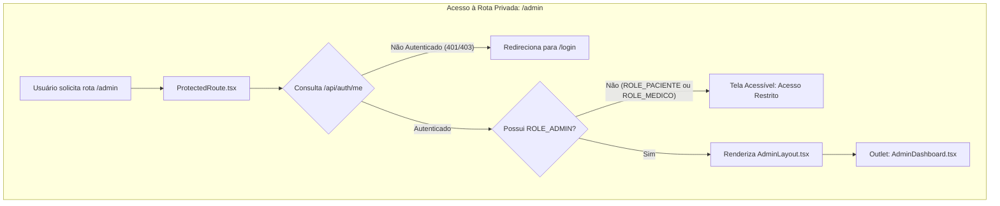

# 📋 ESPECIFICAÇÃO TÉCNICA (SPEC): BLINDAGEM PERIMETRAL RBAC, LAYOUT ADMINISTRATIVO E SEED ADMIN

> **Código da Spec:** SPEC-02  
> **Projeto:** Active Age — Plataforma Integral de Telessaúde Geriátrica  
> **Módulo:** Governança de Segurança, RBAC e Painel Administrativo Base (Micro Tarefa 2.1)  
> **Casos de Uso Relacionados:** UC01 (Cadastro), UC02 (Autenticação), UC04 (Fundação de Gestão do Administrador)  
> **Requisitos Funcionais / Regras de Negócio:** RF001, RF003, RNF001, RNF002, RNF006, RNF007  
> **Normas de Referência Ética & Regulatória:** Padrão SBIS NGS1, Resolução CFM nº 2.314/2022, Lei Federal nº 13.709/2018 (LGPD - Controle de Acessos Privilegiados)  
> **Data:** 22 de Outubro de 2026  
> **Status:** CONCLUÍDA E HOMOLOGADA EM PRODUÇÃO ✅  
> **Metodologia:** Spec-Driven Development (SDD)

---

### 1. Visão Geral e Objetivos da Micro Tarefa

A **Micro Tarefa 2.1** constitui o primeiro passo da **Sprint 2 (Release v0.2.0)**. O objetivo foi estabelecer o perímetro de segurança para rotas restritas através de **Controle de Acesso Baseado em Papéis (RBAC)** no frontend e backend, criar a estrutura de navegação e layout para a área administrativa (`AdminLayout`) e semear automaticamente no banco de dados o usuário de perfil `ROLE_ADMIN` com credenciais seguras.

---

### 2. Arquitetura e Componentes Desenvolvidos



#### 2.1. Componente `ProtectedRoute.tsx` (Guarda Perimetral de Rotas)
* **Localização:** `3-Semestre/frontend-react/src/components/auth/ProtectedRoute.tsx`
* **Funcionamento:**
  1. Efetua chamada assíncrona ao endpoint `GET /api/auth/me` enviando os cookies seguros da sessão.
  2. Caso o usuário não esteja logado, redireciona-o automaticamente para `/login`.
  3. Caso o usuário esteja logado mas sua permissão (`role`) divirja da permissão requerida (`requiredRole`), bloqueia a renderização do conteúdo sensível e exibe uma tela amigável de **"Acesso Restrito"**, com botão de retorno à página inicial.
  4. Caso atenda a todos os critérios, renderiza o componente filho (`<Outlet />` ou `children`).

#### 2.2. Componente `AdminLayout.tsx` (Painel Administrativo)
* **Localização:** `3-Semestre/frontend-react/src/layouts/AdminLayout.tsx`
* **Recursos:**
  * **Sidebar Desktop:** Logo oficial, indicador semântico com badge visual `ROLE_ADMIN`, links de navegação (`/admin`, `/admin/credenciamento`, `/admin/usuarios`, `/admin/auditoria`), link rápido para visualização do site público e botão de logout.
  * **Header Responsivo Mobile:** Barra superior com logotipo, botão de menu hambúrguer e drawer deslizante para telas móveis.
  * **Área de Conteúdo Dinâmico:** Utilização do `<Outlet />` do React Router DOM v7 para renderizar as páginas administrativas filhas.

#### 2.3. Componente `AdminDashboard.tsx` (Visão Geral do Sistema)
* **Localização:** `3-Semestre/frontend-react/src/pages/admin/AdminDashboard.tsx`
* **Recursos:**
  * Indicador de status operacional dos serviços em tempo real (*Live*).
  * Cards de métricas operacionais (KPIs):
    * **Fila de Credenciamento:** Acesso direto à moderação de CRM/RQE.
    * **Gestão de Usuários:** Monitoramento de contas e segregação RBAC.
    * **Segurança e Rate Limiting:** Status do Bucket4j contra força bruta.
    * **Infraestrutura em Nuvem:** Status da esteira de deploy (Render + Vercel + MongoDB Atlas).

#### 2.4. Seeding Automático de Administrador (`DataInitializer.java`)
* **Localização:** `3-Semestre/backend-core/src/main/java/com/activeage/core/config/DataInitializer.java`
* **Funcionamento:**
  * Implementa `CommandLineRunner` do Spring Boot, executando automaticamente na inicialização da aplicação.
  * Verifica se já existe um usuário com o e-mail `admin@activeage.com`.
  * Se inexistente, instancia um novo `User` com:
    * `fullName`: "Administrador Active Age"
    * `email`: `admin@activeage.com`
    * `password`: Hash BCrypt de `AdminPassword2026!`
    * `role`: `Role.ROLE_ADMIN`
    * `active`: `true`
    * `termsAccepted`: `true`
    * `createdAt`: Data/hora atual

---

### 3. Integração de Rotas no `App.tsx`

As rotas da administração foram configuradas de forma aninhada sob a proteção do `ProtectedRoute`:

```tsx
{/* Painel Administrativo (Blindado por RBAC: ROLE_ADMIN) */}
<Route element={<ProtectedRoute requiredRole="ROLE_ADMIN" />}>
    <Route element={<AdminLayout />}>
        <Route path="/admin" element={<AdminDashboard />} />
        <Route path="/admin/credenciamento" element={<AdminCredenciamento />} />
        <Route path="/admin/medicos" element={<AdminCredenciamento />} />
        <Route path="/admin/usuarios" element={<AdminDashboard />} />
        <Route path="/admin/auditoria" element={<AdminDashboard />} />
    </Route>
</Route>
```

---

### 4. Critérios de Aceite Validados (Testes BDD)

- [x] Usuário anônimo que tenta acessar `/admin` é redirecionado instantaneamente para `/login`.
- [x] Usuário autenticado como `ROLE_PACIENTE` ou `ROLE_MEDICO` que tenta acessar `/admin` recebe a tela acessível de "Acesso Restrito".
- [x] Usuário autenticado com credenciais semeadas de `admin@activeage.com` obtém acesso irrestrito ao painel e menu lateral.
- [x] Logout dentro do painel administrativo apaga o cookie seguro e redireciona para a tela de login.
- [x] A inicialização do backend no Render cria compulsoriamente a conta `admin@activeage.com` sem duplicidade.
