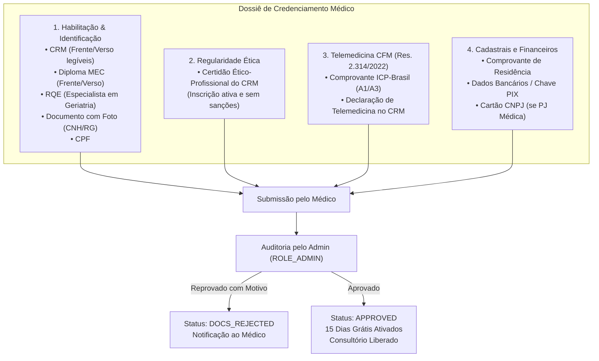
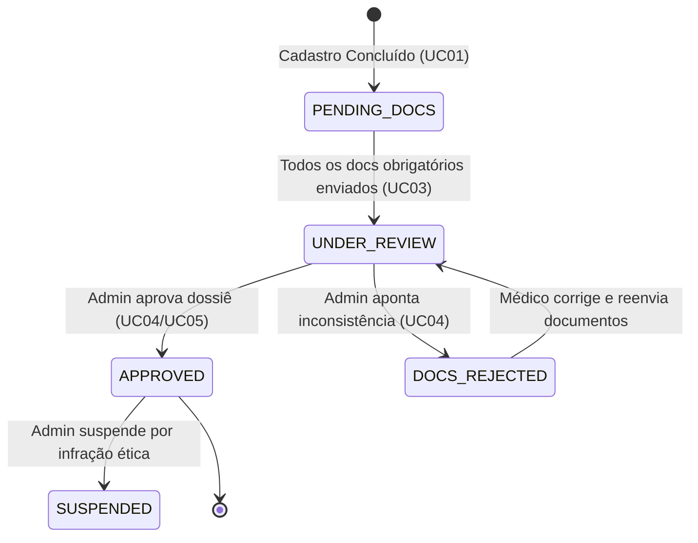

# 📋 ESPECIFICAÇÃO TÉCNICA (SPEC): CREDENCIAMENTO MÉDICO INTEGRAL (DOSSIÊ ÉTICO & AUDITORIA)

> **Código da Spec:** SPEC-03  
> **Projeto:** Active Age — Plataforma Integral de Telessaúde Geriátrica  
> **Módulo:** Credenciamento Médico, Dossiê Documental e Auditoria Administrativa (Micro Tarefa 2.2)  
> **Casos de Uso Relacionados:** UC03 (Upload do Dossiê Médico), UC04 (Fila e Auditoria de Credenciamento pelo Admin), UC05 (Homologação com Trilha de Auditoria)  
> **Requisitos Funcionais / Regras de Negócio:** RF001, RF003, RN004, RN006, RN007, RN008  
> **Normas de Referência Ética & Regulatória:** Resolução CFM nº 2.314/2022 (Telemedicina), Lei Federal nº 13.709/2018 (LGPD), Padrões ICP-Brasil  
> **Data:** 22 de Outubro de 2026  
> **Status:** CONCLUÍDA E HOMOLOGADA EM PRODUÇÃO ✅  
> **Metodologia:** Spec-Driven Development (SDD)

---

### 1. Contexto e Objetivos

No Active Age, a segurança clínica e a idoneidade profissional dos médicos geriatras constituem a espinha dorsal da plataforma. Em conformidade com a **Resolução CFM nº 2.314/2022**, a telemedicina exige habilitação ativa, assinatura qualificada via **Certificado Digital ICP-Brasil** e cadastro prévio junto ao Conselho Regional de Medicina.

A **Micro Tarefa 2.2** tem como objetivo implementar o fluxo completo de submissão do **Dossiê de Credenciamento** pelo médico geriatra e a **Fila de Auditoria Segura** no painel administrativo, garantindo que nenhum médico atenda teleconsultas ou prescreva sem antes ser rigorosamente auditado por um administrador credenciado, sob estrita trilha de auditoria imutável (`audit_logs`).

---

### 2. Os Quatro Pilares do Dossiê de Credenciamento

O processo de credenciamento organiza-se nos seguintes pilares documentais:



#### Tabela de Tipos de Documentos e Regras de Validação:

| Identificador do Documento | Pilar | Obrigatório? | Formatos Permitidos | Limite de Tamanho | Descrição e Finalidade |
|---|---|---|---|---|---|
| `CRM_CARD` | 1 | **Sim** | PDF, JPG, PNG | 10 MB | Cópia da carteira do CRM com número e UF legíveis. |
| `DIPLOMA` | 1 | **Sim** | PDF, JPG, PNG | 10 MB | Diploma de medicina reconhecido pelo MEC (frente e verso). |
| `RQE` | 1 | Opcional / Condicional | PDF, JPG, PNG | 10 MB | Registro de Qualificação de Especialista (para atuação como especialista). |
| `ID_DOCUMENT` | 1 | **Sim** | PDF, JPG, PNG | 10 MB | RG, CNH ou Passaporte para cruzamento cadastral. |
| `ETHICAL_CERTIFICATE` | 2 | **Sim** | PDF | 10 MB | Certidão de Regularidade Ético-Profissional emitida pelo CRM estadual. |
| `ICP_BRAZIL_CERT` | 3 | **Sim** | PDF, PNG, JPG | 10 MB | Comprovante de posse e validade de certificado ICP-Brasil (A1/A3). |
| `CRM_TELEMEDICINE_TERM`| 3 | **Sim** | PDF, PNG, JPG | 10 MB | Print/comprovante de declaração de prática de telemedicina no CRM. |
| `PROOF_OF_ADDRESS` | 4 | **Sim** | PDF, JPG, PNG | 10 MB | Comprovante de endereço recente (máximo 90 dias). |
| `BANK_DATA` | 4 | **Sim** (Formulário) | Dados textuais | N/A | Banco, Agência, Conta e Chave PIX em nome do médico/PJ. |
| `CNPJ_CARD` | 4 | Opcional | PDF, PNG, JPG | 10 MB | Cartão CNPJ para emissão de notas fiscais via PJ. |

---

### 3. Modelo de Estados do Credenciamento do Médico (Lifecycle)



* **`PENDING_DOCS`:** Pré-cadastro realizado. O médico não pode abrir agenda nem realizar atendimentos.
* **`UNDER_REVIEW`:** Médico submeteu os documentos obrigatórios; dossiê encontra-se na fila de auditoria do Admin.
* **`DOCS_REJECTED`:** Auditor reprovou um ou mais documentos. A justificativa técnica do auditor é exibida para correção.
* **`APPROVED`:** Dossiê homologado. 15 dias de teste grátis iniciados; consultório e vitrine liberados.
* **`SUSPENDED`:** Acesso suspenso por decisão administrativa ou interdição do CRM.

---

### 4. Segurança e Confidencialidade dos Documentos (RN007)

1. **Repositório Privado e Isolado:** Os arquivos enviados **jamais** serão salvos na pasta estática pública do servidor. Serão gravados em diretório seguro e isolado (`uploads/dossiers/{doctorId}/`) fora do web root.
2. **Acesso Perimetral Restrito (RBAC):** Os endpoints de download e visualização exigem token JWT ativo. Apenas usuários com `ROLE_ADMIN` ou o próprio médico titular podem acessar seus arquivos.
3. **Registro Automático na Trilha de Auditoria (`audit_logs`):** Cada vez que um administrador visualiza, faz download ou altera o status de um documento médico, o sistema grava automaticamente na coleção `audit_logs`:
   * `auditorId`: ID do administrador autenticado.
   * `auditorEmail`: E-mail do auditor.
   * `doctorId`: ID do médico titular do dossiê.
   * `action`: `"VIEW_DOCUMENT"`, `"APPROVE_DOSSIER"`, `"REJECT_DOSSIER"`.
   * `documentType`: Tipo do documento acessado (ex: `CRM_CARD`).
   * `ipAddress`: Endereço IP do solicitante.
   * `timestamp`: Carimbo de data/hora UTC.

---

### 5. Arquitetura e Contratos de API (Spring Boot 3)

#### 5.1. Novas Estruturas de Dados (MongoDB Atlas)

**Na entidade `User` (campos complementares para médicos):**
```java
// Em User.java
private DoctorDossierStatus dossierStatus; // PENDING_DOCS, UNDER_REVIEW, DOCS_REJECTED, APPROVED, SUSPENDED
private Map<String, DoctorDocumentInfo> documents; // Chave: documentType
private DoctorFinancialInfo financialInfo;
private String rejectionReason;
private LocalDateTime approvedAt;
private LocalDateTime trialExpiresAt;
```

**Novo Objeto Embutido `DoctorDocumentInfo`:**
```java
public class DoctorDocumentInfo {
    private String documentType;
    private String originalFileName;
    private String storedFileName;
    private String contentType;
    private long sizeBytes;
    private LocalDateTime uploadedAt;
    private DocumentStatus status; // UPLOADED, APPROVED, REJECTED
}
```

**Novo Objeto Embutido `DoctorFinancialInfo`:**
```java
public class DoctorFinancialInfo {
    private String bankName;
    private String agency;
    private String accountNumber;
    private String pixKey;
    private String pixKeyType; // CPF, CNPJ, EMAIL, PHONE, RANDOM
    private String cnpj; // Opcional se PJ
    private String corporateName; // Razão Social (opcional)
}
```

**Nova Coleção `audit_logs`:**
```java
@Document(collection = "audit_logs")
public class AuditLog {
    @Id
    private String id;
    private String userId;
    private String userEmail;
    private String userRole;
    private String action; // VIEW_DOCUMENT, REVIEW_DOSSIER, LOGIN, etc.
    private String targetUserId;
    private String details;
    private String ipAddress;
    private LocalDateTime timestamp;
}
```

---

#### 5.2. Endpoints do Médico (`ROLE_MEDICO`)

1. **Upload de Documento do Dossiê:**
   * **Rota:** `POST /api/doctor/documents/upload`
   * **Consome:** `multipart/form-data`
   * **Parâmetros:**
     * `documentType` (String): ex: `CRM_CARD`, `DIPLOMA`, `ETHICAL_CERTIFICATE`, etc.
     * `file` (MultipartFile): Arquivo binário (máx 10MB).
   * **Retorno HTTP:** `200 OK` com `DoctorDocumentInfo` ou `400 Bad Request` se arquivo ou tipo for inválido.

2. **Preenchimento de Informações Financeiras:**
   * **Rota:** `POST /api/doctor/financial-info`
   * **Consome:** `application/json` (`DoctorFinancialInfoRequest`)
   * **Retorno HTTP:** `200 OK`.

3. **Consulta de Status do Dossiê:**
   * **Rota:** `GET /api/doctor/dossier/status`
   * **Retorno HTTP:** `200 OK` contendo o status geral, checklist de itens enviados, pendências e motivo de rejeição (se houver).

4. **Submissão Final para Auditoria:**
   * **Rota:** `POST /api/doctor/dossier/submit`
   * **Regra:** Valida se todos os documentos obrigatórios e dados bancários foram preenchidos.
   * **Transição:** Transiciona de `PENDING_DOCS` ou `DOCS_REJECTED` para `UNDER_REVIEW`.

---

#### 5.3. Endpoints do Administrador (`ROLE_ADMIN`)

1. **Fila de Credenciamento Médico:**
   * **Rota:** `GET /api/admin/doctors/pending`
   * **Parâmetros Opcionais:** `status` (`UNDER_REVIEW`, `PENDING_DOCS`, `ALL`), `page`, `size`.
   * **Retorno HTTP:** `200 OK` (Lista de médicos com dados básicos, data de cadastro e quantidade de documentos enviados).

2. **Detalhamento do Dossiê de um Médico:**
   * **Rota:** `GET /api/admin/doctors/{id}/dossier`
   * **Retorno HTTP:** `200 OK` com perfil completo do médico, dados financeiros e lista de documentos para inspeção.

3. **Visualização/Stream Seguro de Documento:**
   * **Rota:** `GET /api/admin/doctors/{id}/documents/{docType}`
   * **Ação:** Valida permissão do Admin, busca arquivo binário no storage isolado, grava log em `audit_logs` e retorna stream `Content-Type: application/pdf` ou `image/*`.
   * **Retorno HTTP:** `200 OK` com os bytes do documento.

4. **Decisão de Auditoria (Aprovação ou Reprovação):**
   * **Rota:** `POST /api/admin/doctors/{id}/review`
   * **Corpo da Requisição (`DoctorReviewRequest`):**
     * `action`: `"APPROVE"` ou `"REJECT"`
     * `rejectionReason`: String (obrigatório se `"REJECT"`, mínimo de 10 caracteres).
   * **Efeitos:**
     * Se `APPROVE`: Status vira `APPROVED`, `trialExpiresAt = now + 15 dias`, gera log de auditoria.
     * Se `REJECT`: Status vira `DOCS_REJECTED`, grava `rejectionReason`, gera log de auditoria.

---

### 6. Interface do Usuário (Frontend React 19)

#### 6.1. Tela do Médico: `DossieCredenciamento.tsx`
* Localizada na rota protegida `/medico/credenciamento`.
* Visual dividido em abas ou cards com os 4 Pilares:
  1. Habilitação & Identificação
  2. Regularidade Ética
  3. Telemedicina (ICP-Brasil & CRM)
  4. Dados Financeiros & Repasse
* Cada item exibe badge de status: `Não Enviado (Cinza)`, `Enviado (Azul)`, `Aprovado (Verde)`, `Rejeitado (Vermelho)`.
* Feedback acessível via `FeedbackModal.tsx` em cada upload e na submissão final.

#### 6.2. Tela do Administrador: `AdminCredenciamento.tsx`
* Localizada na rota `/admin/credenciamento` dentro do `AdminLayout.tsx`.
* Tabela de médicos na fila com busca por nome ou CRM.
* Botão "Auditar Dossiê" que abre modal/visualizador completo (`AdminDossierModal.tsx`):
  * Inspeção visual integrada de PDFs e imagens via stream seguro.
  * Checklist de verificação de cada um dos 4 pilares.
  * Botões de ação rápida com alvos táteis ampliados:
    * Botão Verde: *"Homologar e Aprovar Médico"* (ativa os 15 dias de teste grátis).
    * Botão Vermelho: *"Reprovar / Solicitar Ajustes"* (abre campo de justificativa obrigatória).

---

### 7. Plano de Implementação em Micro Tarefas Incrementais

Para garantir a máxima testabilidade e cumprimento estrito do SDD:
1. **Passo 1 (Backend - Modelo & Storage):** Criação dos enums, DTOs, campos no `User`, entidade `AuditLog` e serviço de armazenamento seguro `FileStorageService`.
2. **Passo 2 (Backend - API do Médico):** Endpoints de upload de documentos, dados bancários e submissão do dossiê.
3. **Passo 3 (Backend - API do Admin & Trilha de Auditoria):** Endpoints de listagem da fila, visualização com log automático e aprovação/rejeição com justificativa.
4. **Passo 4 (Frontend - Dossiê do Médico):** Componente `DossieCredenciamento.tsx` com upload drag-and-drop, indicador de progresso e validações.
5. **Passo 5 (Frontend - Painel de Auditoria do Admin):** Componentes `AdminCredenciamento.tsx` e `AdminDossierModal.tsx` com visualizador seguro e checklist.
6. **Passo 6 (Testes & Deploy):** Execução do roteiro BDD, verificação de compilação sem warnings, commit convencional e validação no Render e Vercel.

---

### 8. Critérios de Aceite da Spec (DoD)

- [x] Médico consegue enviar arquivos dos 4 pilares e receber confirmação instantânea.
- [x] Arquivos são armazenados fora do escopo web público; tentativas de acesso direto retornam 403 ou 404.
- [x] Administrador consegue auditar cada documento individualmente em visualizador seguro.
- [x] Toda visualização de documento pelo Admin gera registro compulsório em `audit_logs` com IP e carimbo de data/hora.
- [x] Reprovação exige justificativa detalhada e notifica o médico para reenviar o item inconsistente.
- [x] Aprovação homologa o médico, ativa 15 dias de teste grátis e libera o consultório virtual.
- [x] Médico não homologado (`PENDING_DOCS` ou `UNDER_REVIEW`) é impedido de abrir agenda ou atender teleconsultas.
