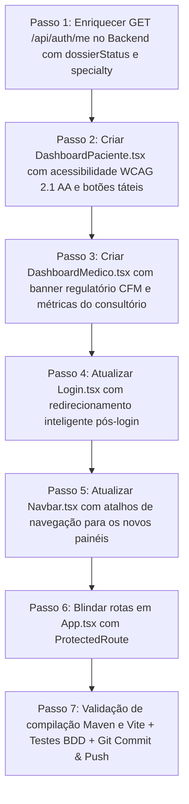

# ESPECIFICAÇÃO TÉCNICA (SPEC SDD) — MICRO TAREFA 2.4
## Dashboards Segregados de Paciente e Médico (`DashboardPaciente.tsx` e `DashboardMedico.tsx`)
### Active Age — Telessaúde Geriátrica Integral | Fatec Diadema — DSM 3º Semestre
**Status:** Submetida para Aprovação do PO (Guilherme) ⏳  
**Data:** 22 de Outubro de 2026  
**Casos de Uso Cobertos:** UC01, UC02, UC03, UC07, UC08, UC09, UC10, UC12, UC14, UC16 (Centralização dos Fluxos de Pacientes e Médicos)  
**Requisitos Atendidos:** RF001, RF002, RF003, RF004, RF008, RNF001, RNF002, RNF004 (Acessibilidade IHC/WCAG 2.1 AA), RNF007, RN007  
**Marcos Regulatórios:** Resolução CFM nº 2.314/2022 (Telemedicina Ética), Resolução CFM nº 2.336/2023 (Publicidade Médica Sem Autopromoção), Padrão SBIS/CFM NGS1 e Diretrizes de Acessibilidade Digital para Pessoas Idosas (W3C/WCAG 2.1 AA).

---

### 1. Contexto e Objetivos

Com a entrega bem-sucedida da fundação de autenticação (Release v0.1.0), da infraestrutura administrativa com RBAC (Micro Tarefa 2.1), do credenciamento ético-médico nos 4 pilares (Micro Tarefa 2.2) e da moderação de usuários com auditoria global (Micro Tarefa 2.3), o **Active Age** atinge a etapa culminante da **Sprint 2 (Release v0.2.0)**: **a segregação da experiência pós-login para Pacientes e Médicos**.

Atualmente, o fluxo pós-login redireciona todos os usuários para a página inicial pública (`/`). A **Micro Tarefa 2.4** visa estruturar os ambientes de trabalho e acolhimento específicos de cada ator:
1. **Painel do Paciente / Cuidador (`/paciente/dashboard`):** Uma interface com alto grau de acessibilidade ergonômica e cognitiva (IHC), com tipografia ampliada, botões táteis generosos, contraste calibrado (WCAG 2.1 AA), atalhos para agendamento, próximas consultas, cofre de saúde (exames/receitas) e acolhimento humanizado.
2. **Painel do Consultório Virtual do Médico (`/medico/dashboard`):** Uma central de comando profissional que:
   - Identifica o status regulatório do profissional (`dossierStatus`);
   - Exibe alerta impeditivo/educativo caso a documentação médica esteja pendente, em análise ou com necessidade de correção, direcionando com um clique para o Dossiê de Credenciamento;
   - Uma vez homologado (`APPROVED`), libera o gerenciamento do consultório virtual com indicadores de atendimentos, consultas do dia, status de assinatura (degustação gratuita de 15 dias) e atalhos para agenda, sala de teleconsulta e prontuário digital.
3. **Roteamento Inteligente & Navbar Reativa:** Atualização do `Login.tsx` para rotear automaticamente cada perfil ao seu respectivo dashboard e enriquecimento da `Navbar.tsx` para exibir atalho dinâmico para o painel conforme o papel autenticado.

---

### 2. Regras de Negócio e Princípios Arquiteturais

1. **Blindagem Perimetral RBAC:**
   - A rota `/paciente/dashboard` é estritamente restrita a usuários com `ROLE_PACIENTE` (ou administradores em auditoria).
   - A rota `/medico/dashboard` é estritamente restrita a médicos autenticados com `ROLE_MEDICO`.
   - Tentativas de acesso não autorizado por usuários anônimos redirecionam para `/login`, e tentativas de perfis cruzados redirecionam para a raiz ou para o respectivo painel permitido.
2. **Diretriz de Acessibilidade e IHC Geriátrico (WCAG 2.1 Nível AA):**
   - No painel do paciente, os botões primários de ação possuem altura mínima de 48px e área de toque expandida;
   - Fontes de texto ampliadas (mínimo de 16px para corpo de texto e 24px+ para títulos);
   - Proibição absoluta de feedbacks via `window.alert()` ou `confirm()`. Todas as interações utilizam o componente [`FeedbackModal.tsx`](../../frontend-react/src/components/common/FeedbackModal.tsx);
   - Mensagens claras e livres de jargões técnicos complexos, privilegiando clareza operacional para o idoso e seus cuidadores.
3. **Condicionamento Regulatório do Médico (Res. CFM nº 2.314/2022):**
   - O médico com dossiê `PENDING_DOCS`, `UNDER_REVIEW` ou `DOCS_REJECTED` visualiza no topo do dashboard um card informativo com badge de advertência, esclarecendo que os módulos de teleconsulta e agendamento público só serão destravados após a homologação formal pelo conselho/administrador da plataforma;
   - O card fornece botão de ação primário *"Completar / Revisar Documentos"* apontando para `/medico/credenciamento`.
4. **Alinhamento com o Modelo SaaS Ético:**
   - O painel médico exibe com transparência o período de degustação de 15 dias (conforme o modelo de negócios homologado no Lean Canvas do projeto), sem qualquer cobrança de comissões sobre o valor das consultas (atendimento integral à vedação de dicotomia do CFM).

---

### 3. Contratos de API & Expansões no Backend (Spring Boot 3)

#### 3.1. Enriquecimento do Endpoint de Sessão (`GET /api/auth/me`)
Para que o frontend conheça em tempo real os atributos médicos e de segurança sem requisições adicionais, o payload do endpoint existente `GET /api/auth/me` em `AuthController.java` é enriquecido com os seguintes campos:

```json
{
  "id": "67b93a1f8c4e...",
  "fullName": "Dra. Helena Carvalho",
  "email": "helena.med@activeage.com",
  "role": "ROLE_MEDICO",
  "crm": "123456",
  "ufCrm": "SP",
  "dossierStatus": "APPROVED",
  "specialty": "Geriatria",
  "active": true
}
```

#### 3.2. Endpoints de Resumo de Dashboard (Mock / Futura Integração com Sprints 3 e 4)
* **Paciente:** `GET /api/paciente/dashboard/summary` (Futuro ou fornecido via estado do perfil)
  - Próxima teleconsulta (data/hora, médico, especialidade, link da sala quando faltar < 10min);
  - Quantidade de consultas realizadas e documentos disponíveis no cofre;
* **Médico:** `GET /api/medico/dashboard/summary` (Futuro ou fornecido via estado do perfil)
  - Status do Dossiê e Assinatura;
  - Resumo de atendimentos do dia;
  - Total de pacientes assistidos e slots livres cadastrados.

---

### 4. Design de Interface e Experiência do Usuário (Frontend React 19)

#### 4.1. Dashboard do Paciente (`DashboardPaciente.tsx`)
Localizado em `src/pages/paciente/DashboardPaciente.tsx`:
* **Header de Acolhimento:**
  - Saudação personalizada com o primeiro nome do paciente em fonte grande e legível: *"Olá, Antônio! Que bom ter você aqui."*;
  - Data atual por extenso (ex: *"Quinta-feira, 22 de Outubro de 2026"*);
  - Tag visual amigável: *"Paciente Ativo — Active Age"*.
* **Cards de Ação Rápida (Grandes e Táteis):**
  1. **Agendar Teleconsulta:** Card verde/laranja com ícone de calendário, descrição acessível *"Encontre médicos geriatras e escolha o melhor dia e horário"* e botão *"Agendar Agora"*;
  2. **Minhas Consultas:** Card com ícone de relógio, indicando compromissos agendados e botão *"Ver Todas as Consultas"*;
  3. **Meu Cofre de Saúde:** Card com ícone de pasta/prontuário, contendo receitas, atestados e exames antigos para download;
  4. **Ajuda e Acompanhamento Familiar:** Card com ícone de suporte/coração para dúvidas de uso, conexão de cuidador e contato rápido.
* **Seção de Próximas Consultas:**
  - Estado vazio (*Empty State*) acolhedor com ilustração/ícone amigável e texto: *"Você não tem nenhuma consulta marcada para os próximos dias. Cuidar da sua saúde é simples e rápido."*;
  - Quando houver consulta: Card destacado com foto/avatar do médico, especialidade, data/horário e botão *"Acessar Sala de Espera"*.
* **Banner de Dica de Saúde Geriátrica:** Card informativo semanal sobre hidratação, mobilidade e bem-estar na terceira idade.

#### 4.2. Dashboard do Médico (`DashboardMedico.tsx`)
Localizado em `src/pages/medico/DashboardMedico.tsx`:
* **Header Profissional:**
  - *"Consultório Virtual — Dr(a). [Nome Completo]"*;
  - Badges informativas: CRM/UF, Especialidade e Status de Credenciamento.
* **Banner de Status Regulatório do CFM (Condicional):**
  - **Se `PENDING_DOCS`:** Alerta amarelo/âmbar informando que a documentação técnica (CRM, Diploma, ICP-Brasil) ainda precisa ser enviada, com botão *"Completar Dossiê"*;
  - **Se `UNDER_REVIEW`:** Alerta azul informando que o dossiê está sob conferência pela equipe de auditoria;
  - **Se `DOCS_REJECTED`:** Alerta vermelho com a justificativa apontada pelo auditor e botão para reenvio do item pendente;
  - **Se `APPROVED`:** Badge verde *"Credenciamento CFM Homologado"* com selo de aptidão técnica para telemedicina (Res. CFM nº 2.314/2022).
* **Métricas do Consultório Virtual:**
  - Card 1: Consultas de Hoje;
  - Card 2: Total de Pacientes Atendidos;
  - Card 3: Status da Assinatura SaaS (*"Período de Degustação Ativo — 15 dias gratuitos"*);
  - Card 4: Avaliação Média dos Pacientes.
* **Ações Operacionais do Médico:**
  - **Gestão de Horários e Agenda (Sprint 3):** Botão para cadastrar e bloquear horários de atendimento;
  - **Sala de Teleconsulta (Sprint 5):** Botão direto para entrar no consultório virtual criptografado;
  - **Prontuários e Documentos Digitais (Sprint 4):** Acesso rápido aos prontuários imutáveis e emissor de prescrições com certificado ICP-Brasil.
* **Agenda do Dia / Pacientes Agendados:** Tabela/Lista dos próximos pacientes com status de pagamento confirmado.

#### 4.3. Fluxo de Roteamento Pós-Login (`Login.tsx` & `App.tsx`)
1. No `Login.tsx`, após receber status `200 OK` do backend, efetua chamada assíncrona para `/api/auth/me`:
   - Se `role === 'ROLE_ADMIN'` ➔ `navigate('/admin')`
   - Se `role === 'ROLE_MEDICO'` ➔ se `dossierStatus === 'APPROVED'`, navega para `/medico/dashboard`; caso contrário, direciona com aviso para `/medico/credenciamento` ou exibe o dashboard com o banner de pendência ativado;
   - Se `role === 'ROLE_PACIENTE'` ➔ `navigate('/paciente/dashboard')`
2. Na `Navbar.tsx`, o botão com o nome do usuário autenticado torna-se um link clicável que direciona exatamente para o respectivo dashboard.

---

### 5. Plano Detalhado de Implementação (Passo a Passo)



1. **Passo 1 (Backend - Enriquecimento de Sessão):**
   - Atualizar `AuthController.java` no método `getProfile()` para expor `dossierStatus`, `specialty` e `active`.
   - Compilar o backend com `mvnw test-compile`.
2. **Passo 2 (Frontend - Tela do Paciente):**
   - Criar `3-Semestre/frontend-react/src/pages/paciente/DashboardPaciente.tsx` com interface inclusiva, ícones acolhedores da Lucide e cards funcionais.
3. **Passo 3 (Frontend - Tela do Médico):**
   - Criar `3-Semestre/frontend-react/src/pages/medico/DashboardMedico.tsx` com separação de estados de aprovação do CRM e ferramentas do consultório virtual.
4. **Passo 4 (Frontend - Roteamento Inteligente no Login):**
   - Atualizar a função `onSubmit` de `Login.tsx` para consultar `/api/auth/me` e despachar o usuário para a rota correta.
5. **Passo 5 (Frontend - Navbar Reativa com Atalho para o Painel):**
   - Atualizar `Navbar.tsx` para incluir botão/link direto *"Meu Painel"* ao lado do nome do usuário logado.
6. **Passo 6 (Frontend - Roteamento Seguro em `App.tsx`):**
   - Registrar as novas rotas protegidas:
     - `/paciente/dashboard` blindada com `requiredRole="ROLE_PACIENTE"`;
     - `/medico/dashboard` blindada com `requiredRole="ROLE_MEDICO"`.
7. **Passo 7 (Testes, Compilação e Entrega):**
   - Validar build sem falhas do Vite (`tsc -b && vite build`) e do Maven.
   - Atualizar o catálogo de specs e documentações oficiais.
   - Git Commit e Push na branch `main`.

---

### 6. Critérios de Aceite da Spec (DoD)

- [ ] Usuário com perfil `ROLE_PACIENTE` autenticado é redirecionado após o login para `/paciente/dashboard`.
- [ ] O `DashboardPaciente.tsx` apresenta interface de alta acessibilidade com fontes legíveis, botões táteis ampliados e atalhos para agendamento, consultas e cofre de saúde.
- [ ] Usuário com perfil `ROLE_MEDICO` autenticado é redirecionado após o login para `/medico/dashboard` ou `/medico/credenciamento`.
- [ ] O `DashboardMedico.tsx` exibe banner informativo claro caso o status do CRM esteja como `PENDING_DOCS`, `UNDER_REVIEW` ou `DOCS_REJECTED`, impedindo o uso clínico antes da homologação.
- [ ] O `DashboardMedico.tsx` com status `APPROVED` exibe métricas do consultório, status da assinatura (15 dias grátis) e atalhos para a agenda e teleconsulta.
- [ ] Tentativas de acessar `/paciente/dashboard` sem autenticação ou com papel indevido são barradas pelo `ProtectedRoute.tsx`.
- [ ] Tentativas de acessar `/medico/dashboard` sem autenticação ou com papel indevido são barradas pelo `ProtectedRoute.tsx`.
- [ ] O `Navbar.tsx` apresenta atalho direto *"Meu Painel"* para o usuário autenticado.
- [ ] Toda a compilação do TypeScript/Vite e do Spring Boot roda com zero erros.
