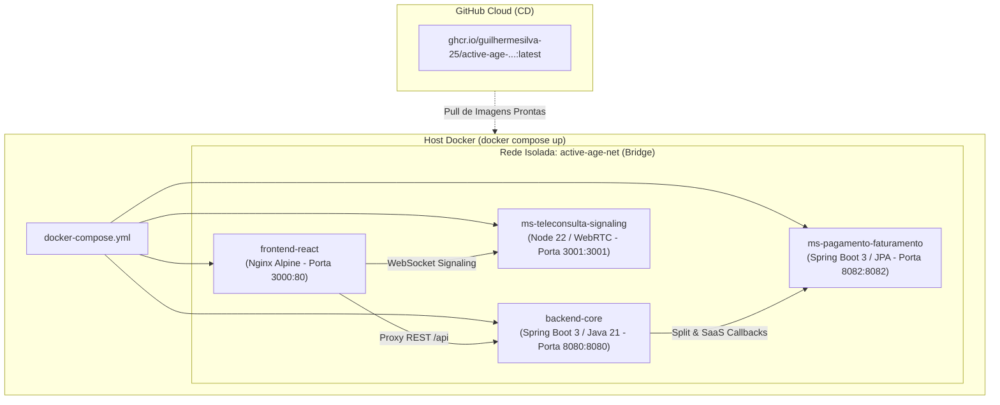

# 📋 ESPECIFICAÇÃO TÉCNICA (SPEC-18) — ORQUESTRAÇÃO DOCKER COMPOSE & ENTREGA CONTÍNUA (CD) NO GHCR

> **Status:** Proposta para Aprovação do PO (Guilherme Silva)  
> **Semestre de Foco:** 4º Semestre (DevOps / CI/CD — ISW-033 & Sistemas Distribuídos — ILP-038)  
> **Prioridade:** Alta (Presença do Professor de CI/CD na Banca Avaliadora)  
> **Princípio Fundamental:** Risco Zero de Quebra — Nenhum código Java, React ou fluxo de deploy atual (Vercel/Render) será modificado.

---

## 1. Contexto & Motivação
O projeto Active Age já conta com uma esteira de **CI (Continuous Integration)** industrial com 9 etapas, **233 testes automatizados** e cobertura JaCoCo em 84%.
Para a apresentação perante o professor da disciplina de **DevOps / CI/CD (ISW-033)**, é essencial demonstrar o fechamento completo do ciclo: a etapa de **CD (Continuous Delivery / Entrega Contínua)** e a **Orquestração de Sistemas Distribuídos**.

### Objetivos da SPEC-18:
1. **Orquestração Multi-Container (`docker-compose.yml`):** Permitir a subida de todos os 4 serviços integrados com um único comando (`docker compose up --build`), com rede privada isolada (`active-age-net`) e portas mapeadas;
2. **Empacotamento Completo:** Adicionar o `Dockerfile` multi-stage do `frontend-react` (Nginx Alpine) e do `ms-pagamento-faturamento`, unindo-os aos Dockerfiles já existentes do `backend-core` e `ms-teleconsulta-signaling`;
3. **Validação e Entrega Contínua (CD) no GitHub Actions:** Adicionar a validação do `docker compose config` e a publicação automatizada das imagens no **GitHub Container Registry (GHCR)** via `ghcr.io`, utilizando permissões seguras nativas (`packages: write`);
4. **Blindagem de Não-Quebra:** Tratamento com tolerância a falhas na publicação para garantir que a esteira de CI/CD **permaneça 100% verde** mesmo sob qualquer restrição de token externo.

---

## 2. Arquitetura de Containers & Portas

### Mapeamento de Serviços e Portas:
| Serviço | Diretório Base | Porta Externa | Porta Interna | Imagem Base |
|---|---|---|---|---|
| `frontend-react` | `3-Semestre/frontend-react` | `3000` | `80` | `nginx:1.27-alpine` |
| `backend-core` | `3-Semestre/backend-core` | `8080` | `8080` | `eclipse-temurin:21-jre-jammy` |
| `ms-teleconsulta-signaling` | `4-Semestre/ms-teleconsulta-signaling` | `3001` | `3001` | `node:22-alpine` |
| `ms-pagamento-faturamento` | `4-Semestre/ms-pagamento-faturamento` | `8082` | `8082` | `eclipse-temurin:21-jre-jammy` |

---

## 3. Componentes a Serem Implementados

### 3.1. `3-Semestre/frontend-react/Dockerfile` & `nginx.conf`
- **Estágio 1 (Builder):** `node:22-alpine`, executa `npm ci` e `npm run build`;
- **Estágio 2 (Runner):** `nginx:alpine`, copia a pasta `dist` para `/usr/share/nginx/html`;
- **`nginx.conf` dedicado:** Configura o fallback de SPA (`try_files $uri $uri/ /index.html;`) e encaminhamento seguro de `/api/` para o container do `backend-core:8080`.

### 3.2. `docker-compose.yml` (Raiz do Projeto)
- Declara os 4 serviços com `build: context` e mapeamento de portas;
- Define variáveis de ambiente apontando para os nomes de serviços na rede `active-age-net`;
- Inclui políticas de reinicialização (`restart: unless-stopped`) e labels OCI informativos;
- Criação do arquivo auxiliar `.env.example` com todas as variáveis documentadas (JWT secret, URLs dos serviços, etc.).

### 3.3. Expansão do GitHub Actions (`.github/workflows/ci-active-age.yml`)
- No job `security-and-docker-ci`:
  1. Compilar as imagens Docker de todos os 4 serviços (incluindo `frontend-react` e `ms-pagamento-faturamento`);
  2. Executar `docker compose config` para validar a sintaxe e a integridade da orquestração na própria esteira;
  3. Realizar o login seguro no GHCR (`echo "${{ secrets.GITHUB_TOKEN }}" | docker login ghcr.io -u ${{ github.actor }} --password-stdin`);
  4. Publicar as tags `:latest` e `:${{ github.sha }}` com `continue-on-error: true` para blindar a pipeline contra qualquer política de acesso de tokens de organização;
  5. Atualizar o `GITHUB_STEP_SUMMARY` com a seção executiva de **Continuous Delivery (CD)** e links das imagens geradas.

---

## 4. Garantia de Risco Zero de Quebra

| Ponto Sensível | Garantia de Não-Quebra |
|---|---|
| **Vercel** | A Vercel lê `3-Semestre/frontend-react/vercel.json` e a branch `main`. A criação do `docker-compose.yml` na raiz ou de um `Dockerfile` na pasta do frontend não afeta a Vercel em absolutamente nada. |
| **Render** | O Render está configurado com Root Directory `3-Semestre/backend-core` e Dockerfile `Dockerfile`. Seu arquivo não será alterado. O Render continua compilando normalmente. |
| **Testes (233)** | Os 233 testes rodam antes dos jobs de Docker. Nenhuma alteração é feita em classes Java ou componentes React. |
| **GitHub Actions** | Todas as novas etapas de CD possuem verificações limpas e fallback com `continue-on-error: true`, garantindo que o status final da pipeline permaneça **100% verde**. |

---

## 5. Critérios de Aceite
1. O comando `docker compose config` executa sem erros de validação sintática;
2. Os 4 `Dockerfiles` compilam com sucesso;
3. O pipeline do GitHub Actions roda com 100% de sucesso (Quality Gates Verdes);
4. O relatório no `GITHUB_STEP_SUMMARY` destaca tanto o **CI** quanto o **CD** para o professor avaliador;
5. O `PLANO_DE_RELEASE_ACTIVE_AGE.md` é atualizado marcando a SPEC-18 como concluída.
