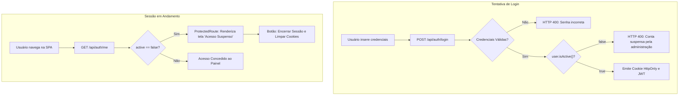

# ESPECIFICAÇÃO TÉCNICA (SPEC SDD) — CASO DE USO UC05
## Bloqueio Perimetral de Login e Revogação de Sessão para Contas Inativadas (Moderação)
### Active Age — Telessaúde Geriátrica Integral | Fatec Diadema — DSM 3º Semestre
**Status:** Aprovada pelo PO e Implementada com Sucesso ✅  
**Data:** 28 de Outubro de 2026  
**Casos de Uso Cobertos:** UC05 (Bloquear/Suspender Usuário — Moderação de Contas pelo Administrador)  
**Requisitos Atendidos:** RF001, RF003, RNF002, RNF006, RN006, RN007  
**Marcos Regulatórios:** SBIS/CFM (NGS1), LGPD (Art. 37)  

---

### 1. Contexto e Diagnóstico da Falha

No módulo de Gestão de Usuários (`/admin/usuarios`), o Administrador tem a faculdade de alternar o status da conta de qualquer usuário entre `active = true` e `active = false` (*soft-lock*), com registro imutável em `audit_logs`.

Contudo, durante os testes práticos de homologação, constatou-se que:
1. **Brecha no `AuthService.login`:** O método de login validava apenas credenciais de senha e o limitador de taxa (Bucket4j), permitindo que usuários inativados continuassem autenticando e recebendo cookies JWT válidos.
2. **Ausência de Guarda no `ProtectedRoute.tsx`:** Usuários que já estivessem autenticados no momento em que a moderação alterou o status para inativo continuavam navegando sem restrição.

---

### 2. Arquitetura da Solução (Defesa em Profundidade 360º)



---

### 3. Detalhamento das Alterações Técnicas

#### 3.1. Camada Backend (Spring Boot 3)
1. **`AuthService.java` (`login`):**
   - Inserir validação após checagem de senha:
     ```java
     if (!user.isActive()) {
         throw new IllegalArgumentException("Sua conta foi suspensa ou desativada pela administração da plataforma. Para mais esclarecimentos, entre em contato com o suporte.");
     }
     ```
2. **`AuthController.java` (`/api/auth/me`):**
   - Garantir que o payload de resposta inclua o status `active` atualizado diretamente do MongoDB.

#### 3.2. Camada Frontend (React 19 + TypeScript)
1. **`ProtectedRoute.tsx`:**
   - Adicionar propriedade `active?: boolean` na interface `UserProfile`.
   - Incluir verificação perimetral: se `currentUser && currentUser.active === false`, bloquear a rota e renderizar a tela de **"Acesso Suspenso"**, com:
     - Ícone `UserX` em destaque.
     - Mensagem explicativa sobre a suspensão administrativa.
     - Botão de logout para descarte do cookie seguro da máquina.
2. **`useAuthUser.ts`:**
   - Condicionar `isAuthenticated` a `user.active !== false`.
3. **`AdminDossierModal.tsx`:**
   - Ajustar homologação para propagar a ação `APPROVE` de forma síncrona, assegurando persistência e exibição do `FeedbackModal`.

---

### 4. Micro Tarefas de Implementação

- **Micro Tarefa 1 (Backend Core):**
  - Adicionar checagem de `user.isActive()` no `AuthService.java`.
- **Micro Tarefa 2 (Frontend SPA):**
  - Atualizar `UserProfile` e tela de bloqueio em `ProtectedRoute.tsx` e `useAuthUser.ts`.
  - Corrigir propagação da aprovação no `AdminDossierModal.tsx`.
- **Micro Tarefa 3 (Validação e Homologação):**
  - Validar arquivos e integridade de tipos.
  - Atualizar índice do catálogo de specs (`specs/README.md`).
- **Micro Tarefa 4 (Git & Push):**
  - Commitar e enviar as alterações para `origin/main`.

---

### 5. Critérios de Aceite Validados

- [x] Usuário com `active = false` tem seu login bloqueado no endpoint `POST /api/auth/login` com mensagem informativa de suspensão.
- [x] Usuário que já possui cookie seguro e sofre inativação é impedido de acessar páginas internas pelo `ProtectedRoute.tsx`, caindo na tela de "Acesso Suspenso".
- [x] O administrador não pode inativar a si mesmo (trava mantida intacta).
- [x] Toda inativação/reativação continua gerando log auditável em `audit_logs` (SBIS NGS1).
- [x] Homologação e aprovação de médicos no `AdminDossierModal` opera com sucesso e apresenta feedback acessível.
