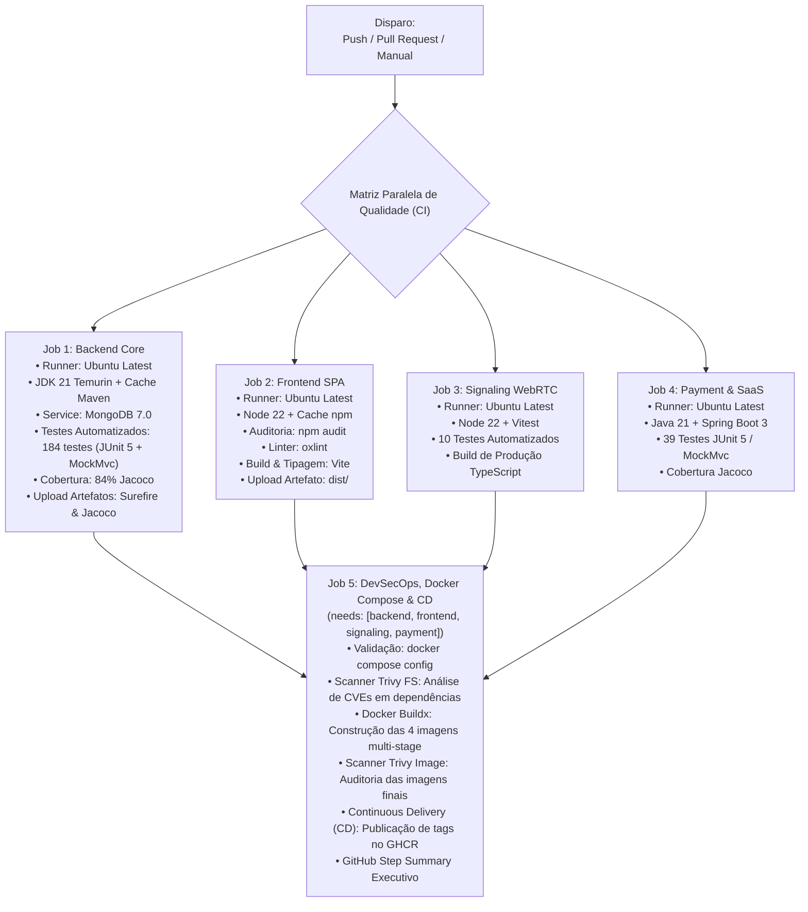

# 🛠️ DevOps, CI/CD Industrial & Orquestração Multi-Container — 4º Semestre
## Active Age — Plataforma Integral de Telessaúde Geriátrica
### Faculdade de Tecnologia de Diadema (Fatec Luigi Papaiz) — DSM 4º Semestre
**Disciplina:** Integração e Entrega Contínua (ISW-033) & Sistemas Distribuídos (ILP-038)  
**Tech Lead & PO:** Guilherme Silva | **Metodologia:** Spec-Driven Development (SDD)

---

### 1. Visão Geral deste Módulo

Esta pasta centraliza os artefatos de infraestrutura, containerização e esteiras de automação desenvolvidos no **4º Semestre**.

A pipeline industrial que executa no GitHub Actions reside na raiz do repositório em [`.github/workflows/ci-active-age.yml`](../../.github/workflows/ci-active-age.yml), e uma cópia de referência está espelhada aqui para fins didáticos e avaliação acadêmica da banca da Fatec.

---

### 2. Estrutura de Arquivos

* [`ci-active-age.template.yml`](./ci-active-age.template.yml): Espelho do workflow do GitHub Actions com matriz paralela, caching, Jacoco, Trivy, Docker e GHCR;
* [`docs-pipeline.md`](./docs-pipeline.md): Guia passo a passo de como interpretar a execução, métricas, relatórios Jacoco e Quality Gates (SPEC-15 & SPEC-18);
* [`docker-compose.yml`](../../docker-compose.yml): Orquestração raiz do ecossistema distribuído de microsserviços.

---

### 3. Matriz de Execução da Pipeline Completa (5 Jobs Paralelos + CD)



---

### 4. Como Executar os 4 Serviços com Docker Compose

```bash
# Na raiz do repositório:
cp .env.example .env
docker compose up --build
```

---
*Módulo de DevOps homologado para o 4º Semestre (ISW-033).*  
*Projeto Integrador Active Age — Fatec Diadema DSM 2026.*
