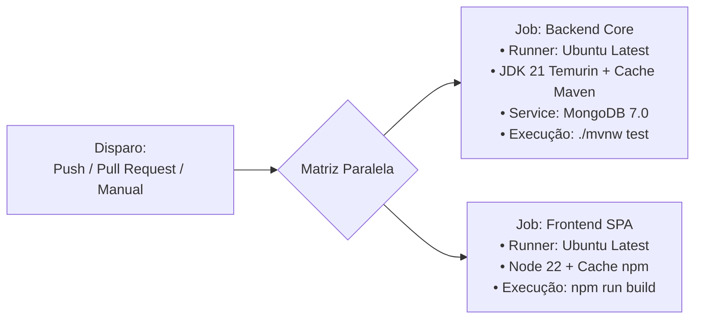

# 🛠️ DevOps & Automação CI/CD — 4º Semestre
## Active Age — Plataforma Integral de Telessaúde Geriátrica
### Faculdade de Tecnologia de Diadema (Fatec Luigi Papaiz) — DSM 4º Semestre
**Disciplina:** Integração e Entrega Contínua (ISW-033)  
**Tech Lead:** Guilherme Silva | **Metodologia:** Spec-Driven Development (SDD)

---

### 1. Visão Geral deste Módulo

Esta pasta centraliza os artefatos de infraestrutura, containerização e esteiras de automação desenvolvidos no **4º Semestre**.

A pipeline real que executa no GitHub Actions reside na raiz do repositório em [`.github/workflows/ci-active-age.yml`](../../.github/workflows/ci-active-age.yml), e uma cópia de referência está espelhada aqui para fins didáticos e avaliação acadêmica.

---

### 2. Estrutura de Arquivos

* [`ci-active-age.template.yml`](./ci-active-age.template.yml): Espelho do workflow do GitHub Actions com matriz paralela e caching;
* [`docs-pipeline.md`](./docs-pipeline.md): Guia passo a passo de como interpretar a execução, métricas e Quality Gates (gerado na SPEC-15);
* `docker-compose.infra.yml`: Orquestração local do ecossistema distribuído (em breve na SPEC-18).

---

### 3. Matriz de Execução da Pipeline Base (Micro Tarefa 15.2)

