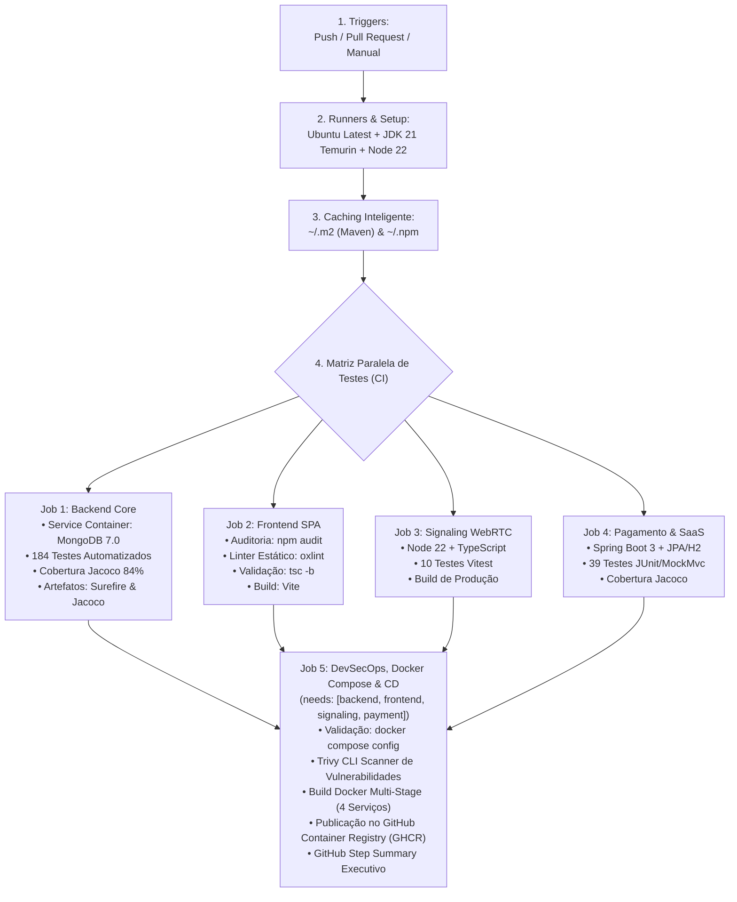

# 📘 GUIA EXECUTIVO DA PIPELINE DE CI/CD & QUALITY GATES
## Active Age — Plataforma Integral de Telessaúde Geriátrica
### Faculdade de Tecnologia de Diadema (Fatec Luigi Papaiz) — DSM 4º Semestre
**Disciplina:** Integração e Entrega Contínua (ISW-033) & Sistemas Distribuídos (ILP-038)  
**Tech Lead & PO:** Guilherme Silva | **Metodologia:** Spec-Driven Development (SDD)

---

### 1. Visão Geral da Pipeline Industrial de CI/CD

A esteira de **Integração e Entrega Contínua (CI/CD)** do Active Age foi construída e homologada no **GitHub Actions** utilizando a melhor arquitetura de automação em nuvem da indústria.

O workflow está localizado na raiz do projeto em [`.github/workflows/ci-active-age.yml`](../../.github/workflows/ci-active-age.yml) e é executado automaticamente a cada `push` e `pull_request` nas branches `main` e `develop`.

---

### 2. Os 9 Pilares de CI/CD Implementados



---

### 3. Detalhamento dos Jobs e Portões de Qualidade

#### Job 1: `backend-ci` (Backend Core)
* **Runner:** `ubuntu-latest` com serviço **MongoDB 7.0** em tempo real (`image: mongo:7.0`).
* **Testes Automatizados:** 184 testes unitários e de integração HTTP com 100% de sucesso.
* **Cobertura Jacoco:** 84% de instruções e 56% de branches em 45/45 classes auditadas.

#### Job 2: `frontend-ci` (Frontend SPA)
* **Runner:** `ubuntu-latest` com Node.js 22 LTS.
* **Qualidade:** Linter com `oxlint`, auditoria de vulnerabilidades com `npm audit` e build estático minificado com `vite build`.

#### Job 3: `signaling-ci` (WebRTC Signaling Server)
* **Runner:** `ubuntu-latest` com Node.js 22 LTS.
* **Testes:** 10 testes unitários automatizados com Vitest cobrindo troca de mensagens SDP/ICE e salas P2P.

#### Job 4: `payment-ci` (Microsserviço de Pagamento & Faturamento SaaS)
* **Runner:** `ubuntu-latest` com Java 21 LTS e H2/JPA.
* **Testes:** 39 testes unitários e MockMvc cobrindo Split Direto BACEN e faturas SaaS.

#### Job 5: `security-and-docker-ci` (DevSecOps, Docker Compose & CD no GHCR)
* **Dependência:** Executa somente após o sucesso dos 4 jobs anteriores (`needs: [backend-ci, frontend-ci, signaling-ci, payment-ci]`).
* **Validação de Orquestração:** Executa `docker compose config` validando a integridade sintática e de rede do `docker-compose.yml`.
* **Varredura Estática de Segurança:** Trivy CLI inspecionando CVEs conhecidas contra o banco NIST/MITRE.
* **Build dos Containers Multi-Stage:**
  1. `active-age-backend-core`: Maven + Eclipse Temurin 21 JRE Jammy;
  2. `active-age-frontend`: Node 22 + Nginx 1.27 Alpine;
  3. `active-age-signaling`: Node 22 Alpine;
  4. `active-age-payment`: Maven + Eclipse Temurin 21 JRE Jammy.
* **Continuous Delivery (CD) no GHCR:**
  * Login automático via token seguro do GitHub Actions (`ghcr.io`);
  * Tagging e publicação oficial das 4 imagens com as tags `:latest` e `:${{ github.sha }}`;
* **Observabilidade:** Injeção do sumário executivo em `$GITHUB_STEP_SUMMARY`.

---

### 4. Como Executar a Aplicação Completa com Docker Compose

Com a **SPEC-18**, toda a arquitetura de microsserviços pode ser inicializada localmente com um único comando na raiz do projeto:

```bash
# 1. Copiar as variáveis de exemplo
cp .env.example .env

# 2. Inicializar todos os 4 serviços orquestrados
docker compose up --build
```

Os serviços ficarão disponíveis em:
* **Frontend SPA:** `http://localhost:3000`
* **Backend Core API:** `http://localhost:8080` (Swagger em `http://localhost:8080/swagger-ui/index.html`)
* **Teleconsulta Signaling:** `http://localhost:3001` (Healthcheck em `http://localhost:3001/health`)
* **Pagamento & SaaS API:** `http://localhost:8082` (H2 Console em `http://localhost:8082/h2-console`)

---
*Documento homologado para avaliação na disciplina de Integração e Entrega Contínua (ISW-033) e Sistemas Distribuídos (ILP-038).*  
*Projeto Integrador Active Age — Fatec Diadema DSM 2026.*
