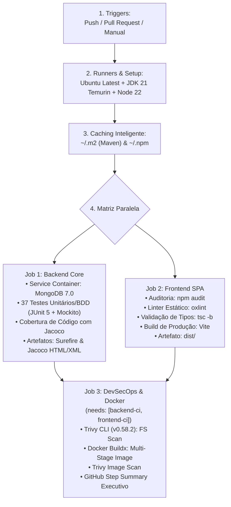

# 📘 GUIA EXECUTIVO DA PIPELINE DE CI/CD & QUALITY GATES
## Active Age — Plataforma Integral de Telessaúde Geriátrica
### Faculdade de Tecnologia de Diadema (Fatec Luigi Papaiz) — DSM 4º Semestre
**Disciplina:** Integração e Entrega Contínua (ISW-033) & Sistemas Distribuídos (ILP-038)  
**Tech Lead & PO:** Guilherme Silva | **Metodologia:** Spec-Driven Development (SDD)

---

### 1. Visão Geral da Pipeline Industrial

A esteira de **Integração Contínua (CI)** do Active Age foi construída e homologada no **GitHub Actions** utilizando a melhor arquitetura de automação em nuvem da indústria.

O workflow está localizado na raiz do projeto em [`.github/workflows/ci-active-age.yml`](../../.github/workflows/ci-active-age.yml) e é executado automaticamente a cada `push` e `pull_request` nas branches `main` e `develop`.

---

### 2. Os 9 Pilares Implementados



---

### 3. Detalhamento dos Jobs e Portões de Qualidade

#### Job 1: `backend-ci` (Backend Core)
* **Runner:** `ubuntu-latest`
* **Serviço de Banco de Dados:** Container em tempo real com **MongoDB 7.0** (`image: mongo:7.0`) na porta `27017` com healthcheck `mongosh ping`.
* **JDK:** Java 21 LTS (distribuição Eclipse Temurin) com cache do Maven (`~/.m2`).
* **Testes Automatizados:** 37 testes unitários e BDD cobrindo:
  * Agendamento concorrente e rollback ético (`AppointmentServiceTest`);
  * Autenticação e bloqueio perimetral de contas (`AuthServiceTest`);
  * Automação de grade e consultas com fuso horário de Brasília (`DoctorScheduleAutomationServiceTest`);
  * Gestão de turnos e slots (`DoctorScheduleServiceTest`);
  * Vitrine neutra de médicos Res. CFM nº 2.336/2023 (`DoctorServiceTest`);
  * Emissão de documentos com código ICP-Brasil (`MedicalDocumentServiceTest`);
  * Prontuário eletrônico imutável com hash SHA-256 (`MedicalRecordServiceTest`);
  * Cofre digital de exames no GridFS (`PatientExamServiceTest`).
* **Cobertura com Jacoco:** Geração automática de `jacoco.xml` e do relatório visual `target/site/jacoco/index.html`.
* **Artefatos Coletados:** `backend-surefire-reports` e `backend-jacoco-coverage` (retidos por 14 dias).

#### Job 2: `frontend-ci` (Frontend SPA)
* **Runner:** `ubuntu-latest`
* **Node.js:** Versão 22 LTS com cache do npm baseado no `package-lock.json`.
* **Auditoria de Dependências:** `npm audit --audit-level=critical`.
* **Análise Estática (Linter):** Execução do `oxlint` validando regras de React, acessibilidade e boas práticas em menos de 150ms.
* **Tipagem & Compilação:** `tsc -b && vite build` garantindo zero erros de tipagem TypeScript e minificação do pacote de produção.
* **Artefato Coletado:** `frontend-dist-artifact` (pasta `dist/` pronta para deploy).

#### Job 3: `security-and-docker-ci` (DevSecOps & Container Docker)
* **Dependência:** Só executa após o sucesso simultâneo dos Jobs 1 e 2 (`needs: [backend-ci, frontend-ci]`).
* **Instalação do Scanner:** Trivy CLI nativo (`v0.58.2`) instalado com permissões administrativas (`sudo`).
* **Varredura Estática de Segurança:** `trivy fs --offline-scan --scanners vuln --severity CRITICAL,HIGH .` inspecionando CVEs conhecidas contra o banco NIST/MITRE sem risco de rate-limit do Maven Central.
* **Build do Container Docker Multi-Stage:**
  * Baseado em `3-Semestre/backend-core/Dockerfile`;
  * Stage 1: Build Maven com OpenJDK 21;
  * Stage 2: Runtime leve com `eclipse-temurin:21-jre-jammy`.
* **Varredura da Imagem:** `trivy image --severity CRITICAL active-age-backend-core:ci`.
* **Observabilidade:** Injeção do sumário executivo em `$GITHUB_STEP_SUMMARY`.

---

### 4. Como Interpretar os Relatórios

1. **GitHub Step Summary:**
   * Acesse qualquer execução na aba **Actions**;
   * O relatório executivo aparece renderizado no topo com a tabela de status consolidada.
2. **Relatório de Cobertura Jacoco:**
   * Faça o download do artefato `backend-jacoco-coverage`;
   * Descompacte o arquivo ZIP e dê um duplo clique no arquivo `index.html`;
   * Navegue pelas classes para conferir a porcentagem exata de linhas e branches cobertas pelos testes.
3. **Relatórios dos Testes Surefire:**
   * Faça o download de `backend-surefire-reports`;
   * Cada arquivo `.txt` e `.xml` contém o tempo de execução e asserções de cada teste unitário.

---

### 5. Como Executar os Mesmos Comandos Localmente

No seu terminal local, você pode replicar exatamente os mesmos comandos da esteira:

```bash
# 1. Backend: Testes com Jacoco
cd 3-Semestre/backend-core
./mvnw test
# Relatório gerado em: target/site/jacoco/index.html

# 2. Frontend: Linter, Tipagem e Build
cd 3-Semestre/frontend-react
npm run lint
npm run build

# 3. Docker: Construir a imagem localmente
cd 3-Semestre/backend-core
docker build -t active-age-backend-core:local .
```

---

### 6. Configuração de Regras de Proteção de Branch (Branch Protection)

Para garantir que ninguém consiga fazer push direto na branch `main` sem que a esteira esteja 100% verde:

1. No repositório do GitHub, vá em **Settings** > **Branches**;
2. Clique em **Add branch protection rule**;
3. No campo *Branch name pattern*, digite: `main`;
4. Marque a opção: **"Require status checks to pass before merging"**;
5. Selecione os status checks:
   * `Backend Core (Java 21 / Spring Boot)`
   * `Frontend SPA (React 19 / TypeScript)`
   * `DevSecOps & Container Docker`
6. Salve a regra. A partir de então, o GitHub bloqueará qualquer código que não passe em todos os Quality Gates!

---
*Documento homologado para avaliação na disciplina de Integração e Entrega Contínua (ISW-033).*  
*Projeto Integrador Active Age — Fatec Diadema DSM 2026.*

