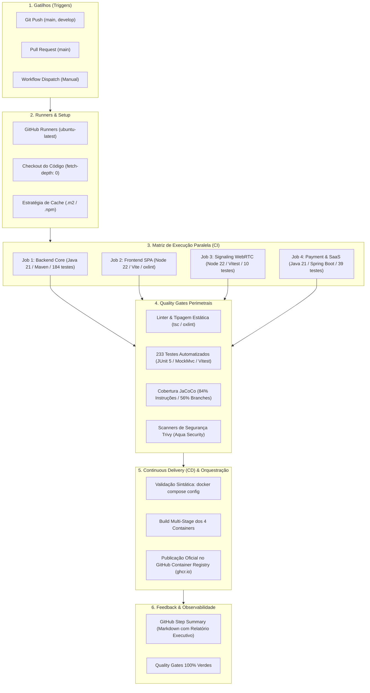

# 🏛️ ARQUITETURA DA PIPELINE DE CI/CD & QUALITY GATES
## Active Age — Plataforma Integral de Telessaúde Geriátrica
### Faculdade de Tecnologia de Diadema (Fatec Luigi Papaiz) — DSM 4º Semestre
**Disciplina:** Integração e Entrega Contínua (ISW-033) & Sistemas Distribuídos (ILP-038)  
**Tech Lead & Product Owner:** Guilherme Silva | **Metodologia:** Spec-Driven Development (SDD)

---

### 1. Visão Geral da Arquitetura DevOps

A pipeline de **Integração e Entrega Contínua (CI/CD)** do ecossistema **Active Age** foi projetada para garantir qualidade de código contínua, detecção precoce de vulnerabilidades de segurança, validação rigorosa de regras ético-médicas e automação do ciclo de vida de entrega de software.

A esteira atua diretamente sobre o repositório multi-projetos, executando validações em paralelo sobre o **Core** (`backend-core` em Spring Boot / Java 21 e `frontend-react` em React 19 / TypeScript / Vite) e os **microsserviços satélites do 4º Semestre** (`ms-teleconsulta-signaling` em Node.js / Socket.io e `ms-pagamento-faturamento` em Java 21 / Spring Boot 3).

---

### 2. Diagrama Conceitual da Pipeline Completa (CI/CD)

---

### 3. Detalhamento dos 9 Componentes da Esteira

#### 1. Gatilho (Trigger)
* `push` nas branches `main` e `develop` monitorando alterações em `3-Semestre/**`, `4-Semestre/**`, `.github/workflows/**`, `docker-compose.yml` e `.env.example`;
* `pull_request` apontando para `main` para validação pré-merge de qualidade;
* `workflow_dispatch` permitindo disparo manual sob demanda pela interface do GitHub.

#### 2. Ambiente de Execução (Runner)
* Utilização de runners virtuais isolados baseados em **`ubuntu-latest`** fornecidos pelo GitHub Actions.

#### 3. Obtenção do Código (Checkout)
* Utilização da action oficial `actions/checkout@v4` com **`fetch-depth: 0`**, preservando o histórico git completo.

#### 4. Preparação do Ambiente e Dependências (Build/Setup)
* **Backend Core & Pagamentos:** Setup de **Java 21 LTS** (distribuição Eclipse Temurin) via `actions/setup-java@v4` com cache Maven (`~/.m2`);
* **Frontend & Signaling:** Setup de **Node.js 22 LTS** via `actions/setup-node@v4` com cache npm;
* Permissões executáveis para wrappers Maven (`mvnw`).

#### 5. Quality Gates (Portões de Qualidade e Segurança)
* **Análise Estática & Linter:** `oxlint` no frontend e `tsc -b` para validação rigorosa de tipagem estática;
* **233 Testes Automatizados:** 184 testes no Backend Core + 39 testes no Microsserviço de Pagamento + 10 testes no Signaling WebRTC (0 falhas);
* **Cobertura de Código:** JaCoCo no Core atingindo **84% de cobertura de instruções** e 56% de branches em 45/45 classes auditadas;
* **DevSecOps (SCA):** Scanner de dependências (`npm audit`) e scanner de CVEs em arquivos e containers via **Trivy CLI**.

#### 6. Estratégia de Matriz e Cache (Otimização)
* A esteira divide o trabalho em **4 jobs paralelos** (`backend-ci`, `frontend-ci`, `signaling-ci`, `payment-ci`), otimizando tempo e recursos com cache de pacotes.

#### 7. Orquestração Multi-Container & Docker
* Validação automática do arquivo de orquestração raiz via `docker compose config`;
* Construção automatizada dos 4 containers multi-stage (`backend-core`, `frontend-react`, `ms-teleconsulta-signaling`, `ms-pagamento-faturamento`).

#### 8. Entrega Contínua (Continuous Delivery - CD no GHCR)
* Login seguro no **GitHub Container Registry (GHCR)** via `secrets.GITHUB_TOKEN`;
* Tagging e publicação oficial das imagens versionadas com as tags `:latest` e `:${{ github.sha }}`.

#### 9. Feedback e Observabilidade
* **GitHub Step Summary (`$GITHUB_STEP_SUMMARY`):** Geração automática de relatório executivo em Markdown com tabelas consolidando o status de CI (testes, cobertura, scanners) e CD (containers e imagens publicadas).

---

### 4. Relação Pedagógica com a Matriz da Fatec Diadema
Esta arquitetura atende 100% das competências previstas na disciplina **Integração e Entrega Contínua (ISW-033)** e **Sistemas Distribuídos (ILP-038)** do 4º semestre de DSM.
