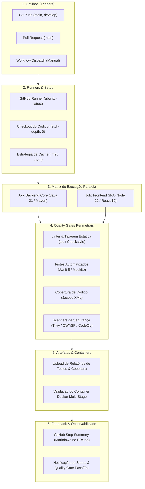

# 🏛️ ARQUITETURA DA PIPELINE DE CI/CD & QUALITY GATES
## Active Age — Plataforma Integral de Telessaúde Geriátrica
### Faculdade de Tecnologia de Diadema (Fatec Luigi Papaiz) — DSM 4º Semestre
**Disciplina:** Integração e Entrega Contínua (ISW-033) & Sistemas Distribuídos (ILP-038)  
**Tech Lead & Product Owner:** Guilherme Silva | **Metodologia:** Spec-Driven Development (SDD)

---

### 1. Visão Geral da Arquitetura DevOps

A pipeline de **Integração e Entrega Contínua (CI/CD)** do ecossistema **Active Age** foi projetada para garantir qualidade de código contínua, detecção precoce de vulnerabilidades de segurança, validação rigorosa de regras ético-médicas e automação do ciclo de vida de entrega de software.

A esteira atua diretamente sobre o repositório multi-projetos, executando validações em paralelo sobre o **Core construído no 3º Semestre** (`backend-core` em Spring Boot / Java 21 e `frontend-react` em React 19 / TypeScript / Vite) e preparando o ambiente para os **novos microsserviços do 4º Semestre**.

---

### 2. Diagrama Conceitual da Pipeline (9 Pilares)

---

### 3. Detalhamento dos 9 Componentes da Esteira

#### 1. Gatilho (Trigger)
* `push` nas branches `main` e `develop` quando houver alterações em:
  * `3-Semestre/**`
  * `4-Semestre/**`
  * `.github/workflows/**`
* `pull_request` apontando para `main` para validação pré-merge de qualidade;
* `workflow_dispatch` permitindo disparo manual sob demanda pela interface do GitHub para testes e homologação assistida.

#### 2. Ambiente de Execução (Runner)
* Utilização de runners virtuais isolados baseados em **`ubuntu-latest`** fornecidos pelo GitHub Actions, garantindo ambiente limpo e reprodutível a cada execução.

#### 3. Obtenção do Código (Checkout)
* Utilização da action oficial `actions/checkout@v4` com **`fetch-depth: 0`**, preservando o histórico git completo para cálculos de cobertura diferencial, scanners de segredos e métricas de qualidade.

#### 4. Preparação do Ambiente e Dependências (Build/Setup)
* **Backend:** Setup de **Java 21 LTS** (distribuição Eclipse Temurin) via `actions/setup-java@v4`;
* **Frontend:** Setup de **Node.js 22 LTS** via `actions/setup-node@v4`;
* Configuração do Maven Wrapper com permissões executáveis (`chmod +x ./mvnw`).

#### 5. Quality Gates (Portões de Qualidade e Segurança)
A esteira atua como um portão rígido de aceitação. Se qualquer um dos quality gates falhar, a pipeline é imediatamente interrompida (vermelho):
* **Análise Estática & Linter:** 
  * Verificação rigorosa de tipagem estática no frontend com TypeScript (`tsc -b`), impedindo bugs de compilação em runtime.
* **Testes Automatizados:** 
  * Execução dos testes unitários e de integração no backend com JUnit 5 e Mockito (`./mvnw test`), validando isolamento de regras de prontuário, auditoria e autenticação.
* **Cobertura de Código:** 
  * Geração do relatório XML via **Jacoco** (*Java Code Coverage*) no Maven, permitindo aferição do percentual de cobertura das classes de serviço.
* **Análise de Segurança (DevSecOps):** 
  * Scanner de dependências com `npm audit` no frontend;
  * Scanner de vulnerabilidades e CVEs conhecidas em bibliotecas e containers via **Trivy (Aqua Security)**.
* **Análise Avançada de Qualidade:** 
  * Estruturação preparada para auditoria estática SonarCloud / CodeQL.

#### 6. Estratégia de Matriz e Cache (Otimização)
* **Execução em Paralelo:** A esteira divide o trabalho em jobs simultâneos (`backend-core-validation` e `frontend-react-validation`), reduzindo pela metade o tempo total de espera;
* **Caching de Dependências:** 
  * Cache do repositório Maven local (`~/.m2/repository`);
  * Cache do gerenciador de pacotes npm (`~/.npm`);
  * Redução estimada do tempo de execução de ~5 minutos para **menos de 1 minuto e meio**.

#### 7. Geração e Publicação de Artefatos / Containers
* **Armazenamento de Relatórios:** Coleta dos relatórios de testes JUnit (`target/surefire-reports/`) e relatórios de cobertura Jacoco como artefatos baixáveis (`actions/upload-artifact@v4`);
* **Validação de Container Docker:** Execução do build do `Dockerfile` multi-stage do backend (`docker build -t active-age-backend-core:test .`), garantindo que a imagem de produção compila sem quebras antes do deploy no Render.

#### 8. Ambientes e Controle de Mudança (Continuous Delivery)
* Separação conceitual entre branches de integração (`develop`) e branch de entrega homologada (`main`);
* Travas para impedir merge se os Quality Gates não estiverem 100% verdes (*Branch Protection Rules*).

#### 9. Feedback e Observabilidade
* **GitHub Step Summary (`$GITHUB_STEP_SUMMARY`):** Ao término de cada execução, a pipeline gera automaticamente uma tabela visual formatada em Markdown no painel da Action informando:
  * Status da compilação do Backend e Frontend;
  * Quantidade de testes executados e aprovados;
  * Percentual de cobertura de código;
  * Status dos scanners de vulnerabilidades;
  * Tempo total de processamento.

---

### 4. Relação Pedagógica com a Matriz da Fatec Diadema
Esta arquitetura atende 100% das competências previstas na disciplina **Integração e Entrega Contínua (ISW-033)** do 4º semestre de DSM:
1. *Automação de ciclo de testes e builds*;
2. *Configuração de esteiras no GitHub Actions com runners em nuvem*;
3. *Implementação de testes de segurança estática (SAST) e análise de composição de software (SCA)*;
4. *Containerização e empacotamento com Docker multi-stage*;
5. *Relatórios executivos e métricas de qualidade de software*.
