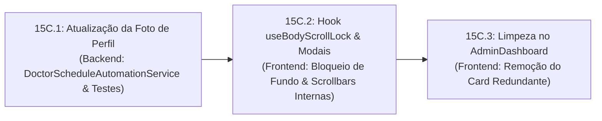

# ESPECIFICAÇÃO TÉCNICA SDD — SPEC-15C
## Ajustes de Usabilidade: Foto da Paciente, Blindagem de Rolagem dos Modais e Limpeza no Admin
### Plataforma Active Age — Telessaúde Geriátrica Integral
### Faculdade de Tecnologia de Diadema (Fatec Luigi Papaiz) — DSM 4º Semestre
**Líder Técnico & Product Owner (PO):** Guilherme Silva  
**Arquiteto & Engenheiro de Software:** Antigravity (AI)  
**Status da Spec:** Aguardando Aprovação do PO 📋  
**Data da Elaboração:** 05 de Novembro de 2026

---

### 1. Contexto & Diagnóstico dos Pontos de Melhoria

Durante testes de usabilidade práticos realizados pelo Tech Lead e colegas de classe, foram identificadas 3 oportunidades pontuais de aprimoramento na interface e na automação do sistema:

1. **Foto de Perfil da Paciente Teste (Dona Maria):**  
   A foto atual atribuída no semeador (`TEST_PATIENT_AVATAR_URL` em `DoctorScheduleAutomationService.java`) retrata uma senhora em um contexto culinário cortando um peixe grande com uma faca. Para um ambiente de telessaúde geriátrica humanizada, a imagem deve ser substituída por um retrato acolhedor, frontal, simpático e sorridente de uma senhora idosa em alta resolução.

2. **Rolagem e Responsividade Vertical de Modais (IHC / Acessibilidade):**  
   Em telas com resolução vertical menor (como notebooks de 1366x768 ou navegadores com zoom ampliado):
   - Modais como o de **Disponibilizar Horários** (`GerarHorariosModal.tsx`), o **FeedbackModal.tsx** e modais do painel administrativo não possuíam altura máxima calculada (`max-h-[90vh]`) ou rolagem interna (`overflow-y-auto`), fazendo com que o rodapé com os botões de ação ficasse cortado para fora da tela;
   - Ao tentar usar o scroll do mouse sobre o modal, a página de fundo sob o backdrop translúcido rolava descontroladamente (*background scroll bleed*).

3. **Card Redundante de Infraestrutura no Painel do Administrador:**  
   No [`AdminDashboard.tsx`](../../3-Semestre/frontend-react/src/pages/admin/AdminDashboard.tsx), existia uma seção estática intitulada *"Infraestrutura em Produção"* exibindo cartões como *"Servidor da Aplicação - Operacional"* e *"Armazenamento em Nuvem"*. Como pontuado com precisão pelo PO: se a infraestrutura do backend ou da nuvem cair, o próprio painel do administrador não carregará. Trata-se de uma redundância inútil que ocupa espaço nobre de tela.

---

### 2. Solução Arquitetural Detalhada

#### 2.1. Novo Retrato Humanizado da Paciente Dona Maria
* **Fonte:** Wikimedia Commons (Domínio Público / Licença Aberta CC BY 2.0).
* **Nova URL Oficial:**  
  `https://upload.wikimedia.org/wikipedia/commons/8/81/Smiling_senior_woman_with_curly_hair_portrait.jpg`  
  *(Retrato fotográfico de uma senhora idosa de cabelos cacheados sorrindo calorosamente).*
* **Resiliência no Semeador (`DoctorScheduleAutomationService.java`):**  
  Ajuste no método `ensureTestPatient()` para que, caso a paciente já exista no banco com a URL antiga contendo `1581579438747`, ela seja automaticamente atualizada para a nova foto amigável sem exigir reset manual do banco de dados MongoDB.

#### 2.2. Hook Universal `useBodyScrollLock` e Modais 100% Responsivos
* **Criação do Hook Reutilizável:** [`useBodyScrollLock.ts`](../../3-Semestre/frontend-react/src/hooks/useBodyScrollLock.ts)  
  Ao abrir qualquer modal (`isOpen === true`), o hook define `document.body.style.overflow = 'hidden'`, travando completamente o fundo. Ao fechar ou desmontar o componente, o estilo original é restaurado com segurança.
* **Blindagem de Altura e Rolagem Interna:**
  - `GerarHorariosModal.tsx`: Container com `max-h-[92vh] flex flex-col overflow-hidden` e área do formulário com `overflow-y-auto flex-1 overscroll-contain`. Botões de ação sempre acessíveis na viewport;
  - `FeedbackModal.tsx`: Adição de `max-h-[90vh] overflow-y-auto flex flex-col` e `overscroll-contain`;
  - `AdminAuditoria.tsx`: Modal de detalhes do log com `max-h-[90vh] overflow-y-auto flex flex-col`;
  - `AdminUsuarios.tsx`: Modal de alternância de status com `max-h-[90vh] overflow-y-auto flex flex-col`;
  - Todos os demais modais (`AgendarConsultaModal`, `DoctorDetailModal`, `UploadExamModal`, `MedicalRecordViewModal`, `DoctorRecordsManagerModal` e `DocumentPrintModal`) passam a utilizar o `useBodyScrollLock` para blindar o fundo opaco.

#### 2.3. Limpeza do Card de Infraestrutura no Admin
* Remoção completa da seção *"Infraestrutura em Produção"* em `AdminDashboard.tsx`.
* Remoção dos ícones não mais utilizados (`Server`, `Database`, `Globe`).
* O layout do painel agora flui diretamente das métricas de auditoria e credenciamento para a navegação operacional limpa.

---

### 3. Fatiamento em Micro Tarefas Testáveis (SDD)

#### 📌 Micro Tarefa 15C.1: Atualização da Foto de Perfil da Dona Maria
- Alterar `TEST_PATIENT_AVATAR_URL` em `DoctorScheduleAutomationService.java`;
- Atualizar a verificação em `ensureTestPatient()` para substituir a imagem antiga caso presente;
- Atualizar os testes unitários em `DoctorScheduleAutomationServiceTest.java`;
- Executar os testes automatizados do backend.

#### 📌 Micro Tarefa 15C.2: Blindagem Universal dos Modais
- Criar o custom hook `useBodyScrollLock.ts` em `3-Semestre/frontend-react/src/hooks/`;
- Aplicar o hook e as classes `max-h-[90vh] overflow-y-auto` em `GerarHorariosModal.tsx`, `FeedbackModal.tsx`, `AdminAuditoria.tsx` e `AdminUsuarios.tsx`;
- Validar que o fundo fica estático e a barra de rolagem interna do modal aparece suavemente em telas compactas.

#### 📌 Micro Tarefa 15C.3: Limpeza da Seção Redundante no AdminDashboard
- Remover o bloco de "Infraestrutura em Produção" e imports não utilizados em `AdminDashboard.tsx`;
- Validar compilação do frontend com `npm run build` (`tsc -b && vite build`) e `npm run lint`.

---

### 4. Critérios de Aceite

1. [ ] A foto de perfil da Dona Maria no Dashboard do Paciente, no Header e nas consultas exibe uma senhora simpática e sorridente (sem faca ou peixe).
2. [ ] Em qualquer resolução de tela (inclusive 1366x768 ou com zoom ativado), o modal de "Disponibilizar Horários" e os demais modais exibem barra de rolagem interna própria e todos os botões de ação ficam acessíveis.
3. [ ] Enquanto qualquer modal estiver aberto, a página ao fundo fica estática e não rola com o scroll do mouse.
4. [ ] O painel do administrador (`AdminDashboard.tsx`) não exibe mais os cards estáticos de infraestrutura.
5. [ ] Todos os 180 testes do backend e o build/linter do frontend continuam 100% verdes.

---
*Especificação elaborada em conformidade com as diretrizes do Tech Lead Guilherme Silva e governança SDD do Active Age.*
