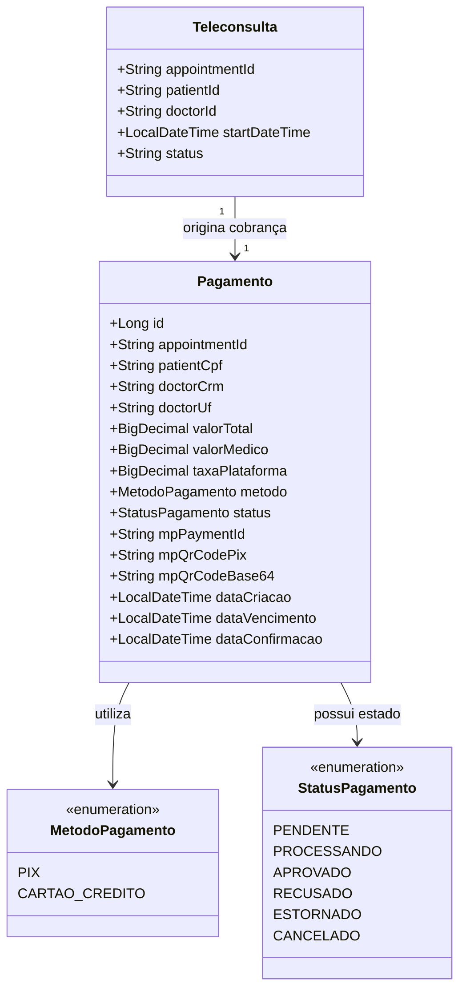
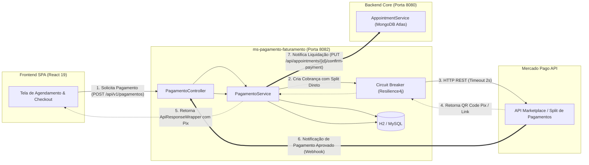
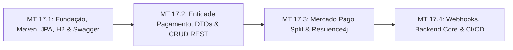

# ESPECIFICAÇÃO TÉCNICA SDD — SPEC-17
## Microsserviço de Gateway de Pagamento & Split Direto BACEN (Mercado Pago)
### Plataforma Active Age — Telessaúde Geriátrica Integral
### Faculdade de Tecnologia de Diadema (Fatec Luigi Papaiz) — DSM 4º Semestre
**Disciplinas de Foco:** Sistemas Distribuídos (ILP-038) & Integração e Entrega Contínua (ISW-033)  
**Líder Técnico & Product Owner (PO):** Guilherme Silva  
**Arquiteto & Engenheiro de Software:** Antigravity (AI)  
**Status da Spec:** PROPOSTA TÉCNICA AGUARDANDO APROVAÇÃO DO PO 📋  
**Data da Elaboração:** 07 de Novembro de 2026  
**Diretrizes Pedagógicas Integradas:** Padrões Arquiteturais SOA (Thomas Erl), Modelo SIGVS-Faturamento, 4 Camadas MVC com Service Layer, Resilience4j, Spring Data JPA e Risk-Based Testing.

---

## 1. Concepção e Classificação do Serviço (SOA / Thomas Erl)

### 1.1 Classificação do Serviço no Ecossistema Active Age
De acordo com os padrões de Arquitetura Orientada a Serviços (SOA) formulados por Thomas Erl:
* **Serviço de Entidade (Negócios - *Entity Service*):** O microsserviço `ms-pagamento-faturamento` é classificado primariamente como um Serviço de Entidade de alto reuso, centrado na entidade de domínio **`Pagamento` / `Fatura`**. Ele encapsula o ciclo de vida da transação financeira: criação, cobrança (Pix / Cartão), status de liquidação, cálculo de split e conciliação.
* **Serviço de Tarefa (Coordenação/Workflow - *Task Service*):** Atua na coordenação do fluxo de checkout do agendamento de teleconsulta, orquestrando a comunicação síncrona com o gateway externo (**Mercado Pago**) e disparando a confirmação de reserva para o Backend Core.
* **Serviços Utilitários (*Utility Services*):** Funcionalidades transversais como envio de notificações (e-mail/SMS/WhatsApp de confirmação de pagamento) e trilha de auditoria global (`audit_logs`) permanecem desacopladas, consumidas de forma assíncrona.

### 1.2 Estágios Lógicos de Construção
1. **Análise Orientada a Serviços:** Mapeamento do processo de negócio de cobrança médica sem dicotomia (Res. CFM nº 2.314/2022);
2. **Projeto de Serviço:** Especificação formal do contrato das interfaces RESTful através de **OpenAPI 3 / Swagger** (`/swagger-ui/index.html`);
3. **Implementação & Implantação:** Codificação em Java 21 LTS + Spring Boot 3, com inversão de dependência (DIP), processamento de webhooks e conteinerização Docker multi-stage;
4. **Validação:** Suíte de testes automatizados com JUnit 5, Mockito e JaCoCo (cobertura > 80%), testes baseados em risco (PCE, AVL, TFS) e esteira de CI/CD.

### 1.3 Modelo de Domínio Conceitual Enxuto


---

## 2. Arquitetura e Organização do Código

### 2.1 Os 3 Componentes Base do Microsserviço
1. **Elemento de Entrada / Interface:** Endpoints RESTful versionados expostos pelo `@RestController` magro;
2. **Processamento de Regras:** Camada de serviço (`@Service`) blindada com interfaces e regras de split sem dicotomia;
3. **Banco de Dados Próprio (*Database-per-Service*):** Banco de dados relacional dedicado e isolado acessado via **Spring Data JPA / Hibernate 6**. Nenhum outro serviço da plataforma possui acesso direto às tabelas financeiras.

### 2.2 Arquitetura em 4 Camadas (MVC com Service Layer)
* **Camada de Apresentação (`@RestController`):** Porta de entrada estritamente magra. Responsável apenas por validar entradas (Jakarta Validation `@Valid`), rotear requisições HTTP e devolver respostas envelopadas em JSON;
* **Camada de Serviço/Negócio (`@Service`):** Centraliza cálculos financeiros, validação de regras de negócio, regras de split do Mercado Pago e contingência com Circuit Breaker. O Controller nunca acessa o repositório diretamente;
* **Camada de Persistência (`@Repository`):** Interface estendendo `JpaRepository<Pagamento, Long>` que traduz chamadas em SQL/JPQL e isola o banco de dados;
* **Camada de Banco de Dados:** H2 Database em memória para execução ultrarrápida de testes unitários/integrados e MySQL / PostgreSQL em ambiente produtivo.

### 2.3 Organização de Pacotes (Visão Lógica 4+1 — Modelo SIGVS-Faturamento)
```text
4-Semestre/ms-pagamento-faturamento/src/main/java/br/com/activeage/pagamento/
├── controller/
│   └── PagamentoController.java                 # @RestController magro (/api/v1/pagamentos)
├── service/
│   ├── IPagamentoService.java                   # Contrato de negócio da Fatura/Pagamento
│   ├── impl/
│   │   └── PagamentoServiceImpl.java            # Implementação com regras de negócio e split
│   ├── gateway/
│   │   ├── IMercadoPagoClient.java              # Interface cliente para a API do Mercado Pago
│   │   ├── impl/
│   │   │   └── MercadoPagoClientImpl.java       # Implementação HTTP REST do gateway
│   │   └── fallback/
│   │       └── MercadoPagoFallback.java         # Fallback acionado pelo Circuit Breaker
│   └── strategy/
│       ├── IEstrategiaSplit.java                # Interface OCP para estratégias de split
│       └── impl/
│           └── SplitDiretoSemDicotomiaStrategy.java # Split 100% médico (Res. CFM 2.314/2022)
├── repository/
│   └── IPagamentoRepository.java                # Interface Spring Data JPA (findByAppointmentId, etc.)
├── model/
│   ├── entity/
│   │   └── Pagamento.java                       # @Entity JPA com chave primária gerada
│   ├── enums/
│   │   ├── MetodoPagamento.java                 # PIX, CARTAO_CREDITO
│   │   └── StatusPagamento.java                 # PENDENTE, APROVADO, etc.
│   └── dto/
│       ├── PagamentoRequestDto.java             # Payload de criação (appointmentId, cpf, valor)
│       ├── PagamentoResponseDto.java            # Payload de retorno com QR Code e status
│       ├── WebhookNotificationDto.java          # Payload de eventos recebidos do Mercado Pago
│       └── ApiResponseWrapper.java              # Envelope padrão (status, data, message)
└── config/
    ├── OpenApiConfig.java                       # Swagger UI / OpenAPI 3 (@OpenAPIDefinition)
    ├── ResilienceConfig.java                    # Configurações do Resilience4j (Circuit Breaker)
    └── GlobalExceptionHandler.java              # Tratador global de exceções e validações
```

---

## 3. Design da API, Contratos e Persistência (JPA)

### 3.1 Padrões de URI e Métodos HTTP (REST)
* Recursos nomeados estritamente com **substantivos no plural e minúsculos**;
* **Versionamento obrigatório na URI:** `/api/v1/pagamentos`;
* Mapeamento de verbos HTTP:
  * `POST /api/v1/pagamentos`: Registra nova intenção de pagamento e gera cobrança Pix/Cartão com split;
  * `GET /api/v1/pagamentos/{id}`: Consulta dados de um pagamento por ID primário;
  * `GET /api/v1/pagamentos/consulta/{appointmentId}`: Busca a fatura vinculada à teleconsulta;
  * `POST /api/v1/pagamentos/{id}/estorno`: Sub-recurso de ação financeira para cancelamento e estorno da consulta (política ética de > 24 horas);
  * `POST /api/v1/pagamentos/webhooks/mercadopago`: Endpoint assíncrono para recepção de notificações de pagamento do Mercado Pago;
  * `GET /health`: Endpoint de monitoramento de saúde do microsserviço.

### 3.2 Envelope de Resposta Padronizado (`ApiResponseWrapper<T>`)
Todas as respostas da API seguem a estrutura de envelope uniforme:
```json
{
  "status": "SUCCESS",
  "message": "Cobrança Pix gerada com sucesso",
  "timestamp": "2026-11-07T10:45:00.123Z",
  "data": {
    "pagamentoId": 1,
    "appointmentId": "6724ff001122334455667788",
    "status": "PENDENTE",
    "metodo": "PIX",
    "valorTotal": 250.00,
    "valorMedico": 250.00,
    "taxaPlataforma": 0.00,
    "qrCodePix": "00020126580014br.gov.bcb.pix0136...",
    "qrCodeBase64": "iVBORw0KGgoAAAANSUhEUgAA...",
    "dataVencimento": "2026-11-07T11:15:00Z"
  }
}
```

### 3.3 Códigos de Status HTTP Adotados
* `200 OK`: Consulta ou estorno realizado com sucesso;
* `201 Created`: Pagamento/fatura registrado e cobrança gerada no gateway;
* `400 Bad Request`: Erro de validação de payload (ex: CPF inválido, valor menor ou igual a zero);
* `404 Not Found`: Pagamento ou consulta não encontrado;
* `422 Unprocessable Entity`: Consulta já possui pagamento aprovado (violação semântica);
* `503 Service Unavailable`: Falha no gateway externo gerenciada pelo Circuit Breaker com fallback.

### 3.4 Regras da Entidade JPA (`@Entity`)
* Anotada com `@Entity` e `@Table(name = "tb_pagamentos")`;
* Construtor sem argumentos (`@NoArgsConstructor`) obrigatório pelo Hibernate;
* Não é declarada como `final`;
* Chave primária `@Id` com `@GeneratedValue(strategy = GenerationType.IDENTITY)`;
* Mapeamento de `BigDecimal` com precisão financeira (`precision = 10, scale = 2`);
* Enums persistidos como `@Enumerated(EnumType.STRING)` para legibilidade e integridade.

---

## 4. Comunicação entre Microsserviços e Técnicas de Resiliência

### 4.1 Topologia de Comunicação Distribuída


### 4.2 Resiliência com Resilience4j (Circuit Breaker & Fallback)
1. **Configuração do Circuit Breaker:**
   * **Estado Fechado (*Closed*):** Fluxo normal de chamadas à API do Mercado Pago;
   * **Taxa de Falha Limite (*Failure Rate Threshold*):** Se 50% das últimas 10 requisições falharem ou estourarem o timeout, o circuito **Abre** (*Open*);
   * **Estado Aberto (*Open*):** Requisições subsequentes são rejeitadas de imediato, poupando threads e memória do Tomcat;
   * **Estado Meio-Aberto (*Half-Open*):** Após 15 segundos em estado aberto, o Resilience4j permite 3 requisições de teste para verificar se o Mercado Pago restabeleceu a operação.
2. **Estratégia de Fallback para Pagamentos:**
   * Caso o circuito abra ou o Mercado Pago esteja fora do ar, o microsserviço aciona `MercadoPagoFallback.java`;
   * O pagamento é salvo localmente no banco de dados com status `PENDENTE_PROCESSAMENTO_POSTERIOR`;
   * O paciente recebe mensagem acolhedora informando que o agendamento foi pré-reservado e que o link de pagamento será disponibilizado em instantes sem perda da vaga.
3. **Timeouts Curtos:** Limite estrito de **2,0 segundos** para requisições externas ao gateway.
4. **Caching Local (Caffeine Cache):** Cache em memória para parâmetros estáticos de configuração e credenciais de sellers.

---

## 5. Princípios e Padrões de Codificação

* **YAGNI (*You Ain't Gonna Need It*):** Foco estrito nas modalidades Pix e Cartão de Crédito com Split Direto. Nenhum código de boleto bancário ou moedas estrangeiras será desenvolvido antecipadamente;
* **SOLID:**
  * **SRP:** Separação rígida entre o Controller (HTTP/Rotas), Service (Negócio), GatewayClient (Integração HTTP) e Repository (Persistência);
  * **OCP:** A interface `IEstrategiaSplit` permite plugar novas regras de rateio (ex: planos futuros de assinatura SaaS) sem alterar a classe de serviço principal;
  * **LSP & ISP:** Interfaces enxutas e coesas (`IPagamentoService`, `IPagamentoRepository`);
  * **DIP:** Classes de alto nível dependem exclusivamente de interfaces injetadas via construtor (Spring DI);
* **Repository Pattern:** Utilização de `IPagamentoRepository extends JpaRepository<Pagamento, Long>` com consultas derivadas e JPQL limpo.

---

## 6. Stack Tecnológica e Infraestrutura

| Componente | Tecnologia Adotada | Finalidade |
|---|---|---|
| **Linguagem & Runtime** | Java 21 LTS | Performance com Virtual Threads e tipagem estática robusta |
| **Framework Base** | Spring Boot 3.4.x | Ecossistema maduro com Tomcat embutido e autoconfiguração |
| **Persistência & ORM** | Spring Data JPA + Hibernate 6 | Mapeamento objeto-relacional com Repository Pattern |
| **Banco de Dados (Dev/Testes)** | H2 Database (In-Memory) | Execução ultrarrápida de suítes de testes automatizados |
| **Banco de Dados (Produção)** | PostgreSQL / MySQL | Persistência transacional relacional com integridade referencial ACID |
| **Resiliência** | Resilience4j (Spring Boot Starter) | Circuit Breaker, Timeouts, Retry e Fallbacks |
| **Validação** | Jakarta Validation (`@Valid`, `@NotNull`) | Validação declarativa na entrada de DTOs |
| **Documentação da API** | SpringDoc OpenAPI 3 (`springdoc-openapi`) | Geração interativa de Swagger UI em `/swagger-ui/index.html` |
| **Documentação Técnica** | Maven Javadoc Plugin | Exportação de documentação de classes em HTML (`target/site/apidocs`) |
| **Testes Automatizados** | JUnit 5 + Mockito + MockMvc + JaCoCo | Testes unitários, integrados e cobertura mínima de 80% |
| **Gerenciador de Build** | Apache Maven (`pom.xml`) | Gerenciamento de ciclo de vida e dependências |
| **Containerização** | Docker Multi-Stage (`eclipse-temurin:21-alpine`) | Imagem de produção leve e execução com usuário não-root |

---

## 7. Compliance Ético-Médico Inegociável (CFM, BACEN & LGPD)

1. **Vedação Absoluta à Dicotomia Médica (Resolução CFM nº 2.314/2022 & 2.336/2023):**
   * É expressamente vedado que a plataforma Active Age retenha porcentagem ou comissão sobre o valor da consulta médica;
   * **Arquitetura de Split Direto:** A transação do Mercado Pago é configurada como **Marketplace com Split Primário**: o valor integral dos honorários médicos cai diretamente na subconta/chave Pix do médico credenciado;
   * A plataforma cobra exclusivamente mensalidade de software (SaaS) ou taxa tecnológica fixa regulamentada, sem intermediação percentual clínica.
2. **Regulamentação do BACEN:**
   * Todo fluxo de liquidação financeira ocorre dentro do ambiente regulado do Banco Central através do gateway credenciado (Mercado Pago). A plataforma não realiza custódia de valores de terceiros;
3. **Privacidade e LGPD (Lei nº 13.709/2018):**
   * O microsserviço de pagamento armazena estritamente os dados fiscais/financeiros necessários para emissão da fatura (CPF, Nome e Identificador de Transação), sem armazenar dados de prontuário, queixas clínicas ou prontuário médico.

---

## 8. Estratégia de Testes Baseada em Risco (Risk-Based Testing) & BDD

### 8.1 Matriz de Risco (Probabilidade x Severidade)
* **Risco Alto (TFS - Teste de Fluxo e Transições de Estado):** Fluxo de confirmação de pagamento via Webhook, liquidação com split direto e chamada ao Circuit Breaker com fallback;
* **Risco Médio (AVL - Análise de Valor Limite):** Valores limítrofes de consulta (R$ 0,00, R$ 0,01, R$ 9.999,99) e prazos de expiração de QR Code Pix;
* **Risco Baixo (PCE - Particionamento de Classes de Equivalência):** Formatação de CPF, chaves de idempotência e validação de campos obrigatórios no DTO.

### 8.2 Cenários BDD em Gherkin

#### Cenário 1: Geração de cobrança Pix com split direto para o médico (Caminho Feliz - PCE/TFS)
```gherkin
Dado que o paciente "Dona Maria" agenda uma teleconsulta no valor de R$ 250,00 com o "Dr. Alan Turing"
E o médico possui subconta credenciada no Mercado Pago
Quando o microsserviço recebe uma requisição POST em "/api/v1/pagamentos" com os dados da consulta
Então o sistema deve criar a fatura com status "PENDENTE"
E deve chamar a API do Mercado Pago configurando o split de 100% dos honorários para o médico
E deve retornar o código HTTP 201 Created com o QR Code Pix e o Payload envelopado em ApiResponseWrapper
```

#### Cenário 2: Confirmação de pagamento via Webhook e liberação da consulta (TFS)
```gherkin
Dado que existe uma fatura com status "PENDENTE" para a consulta "APPT-100"
Quando o Mercado Pago envia um webhook POST em "/api/v1/pagamentos/webhooks/mercadopago" com status "approved"
Então o microsserviço deve atualizar o status da fatura para "APROVADO"
E deve registrar a data e hora de liquidação
E deve notificar o Backend Core para confirmar o agendamento da teleconsulta
E deve retornar o código HTTP 200 OK para o Mercado Pago
```

#### Cenário 3: Ativação do Circuit Breaker e Fallback por indisponibilidade do gateway (Risco Alto)
```gherkin
Dado que a API externa do Mercado Pago está apresentando lentidão superior a 2 segundos ou falha de conexão
Quando o paciente solicita o pagamento da teleconsulta
Então o Circuit Breaker do Resilience4j deve acionar a estratégia de Fallback
E deve salvar a fatura local com status "PENDENTE_PROCESSAMENTO_POSTERIOR"
E deve retornar o código HTTP 503 com mensagem amigável garantindo que a vaga do idoso está reservada
```

---

## 9. Plano de Execução em Micro Tarefas

Para manter o rigor do Spec-Driven Development (SDD) e permitir validações incrementais com valor tangível a cada passo, a **SPEC-17** é dividida em **4 Micro Tarefas**:



* **Micro Tarefa 17.1 — Fundação do Microsserviço de Pagamento:**
  * Criação da pasta `4-Semestre/ms-pagamento-faturamento/`;
  * Configuração do `pom.xml` (Java 21 LTS, Spring Boot 3.4.x, Spring Data JPA, H2, Resilience4j, SpringDoc OpenAPI, JaCoCo);
  * Implementação da classe principal `@SpringBootApplication`, configuração do Swagger UI e endpoint `/health`.
* **Micro Tarefa 17.2 — Domínio, Entidade JPA, DTOs e CRUD REST:**
  * Implementação da entidade `@Entity Pagamento`, enums `MetodoPagamento` e `StatusPagamento`;
  * Implementação de `IPagamentoRepository extends JpaRepository<Pagamento, Long>`;
  * Implementação de `IPagamentoService` e `PagamentoServiceImpl`;
  * Implementação do `PagamentoController` (`POST /api/v1/pagamentos`, `GET /api/v1/pagamentos/{id}`);
  * Testes unitários com JUnit 5 / MockMvc cobrindo classes de equivalência (PCE).
* **Micro Tarefa 17.3 — Integração com Mercado Pago e Blindagem com Resilience4j:**
  * Implementação de `IMercadoPagoClient` e `MercadoPagoClientImpl` (geração de QR Code Pix e preferências com split direto);
  * Configuração do Circuit Breaker, Timeouts de 2s e Fallback com Resilience4j (`MercadoPagoFallback.java`);
  * Testes de resiliência e simulação de contingência.
* **Micro Tarefa 17.4 — Webhook de Liquidação, Notificação do Core e CI/CD:**
  * Implementação do endpoint `POST /api/v1/pagamentos/webhooks/mercadopago`;
  * Sincronização com o Backend Core para confirmação atômica da consulta;
  * Dockerfile multi-stage com usuário não-root;
  * Integração da suíte no pipeline de CI/CD do GitHub Actions com quality gate JaCoCo (> 80%).

---

## 10. Critérios de Aceite da Spec (Definition of Done)

- [ ] Microsserviço criado e compilando com Java 21 LTS e Spring Boot 3;
- [ ] Banco de dados H2 configurado para testes locais e suporte a banco relacional para produção;
- [ ] Documentação viva gerada automaticamente em `/swagger-ui/index.html`;
- [ ] Envelope padronizado `ApiResponseWrapper<T>` em todos os retornos;
- [ ] Circuit Breaker configurado com Resilience4j e fallback testado;
- [ ] Suíte de testes automatizados com JUnit 5 e MockMvc com cobertura JaCoCo superior a 80%;
- [ ] Conformidade ética estrita perante o CFM (split direto sem dicotomia);
- [ ] 0 violações de segurança e imagem Docker multi-stage validada com Trivy.
