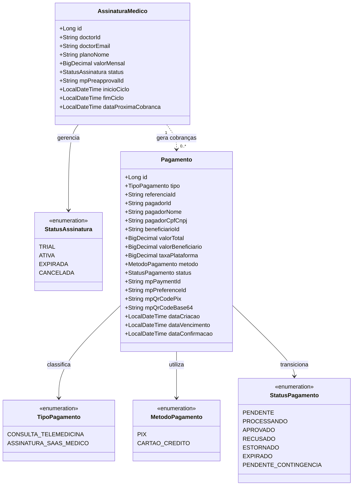
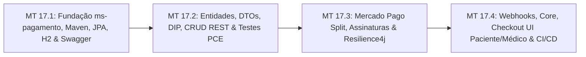

# ESPECIFICAÇÃO TÉCNICA SDD — SPEC-17
## Microsserviço de Gateway de Pagamento, Split Direto BACEN e Gestão de Assinaturas SaaS (Mercado Pago)
### Plataforma Active Age — Telessaúde Geriátrica Integral
### Faculdade de Tecnologia de Diadema (Fatec Luigi Papaiz) — DSM 4º Semestre
**Disciplinas de Foco:** Sistemas Distribuídos (ILP-038) & Integração e Entrega Contínua (ISW-033)  
**Líder Técnico & Product Owner (PO):** Guilherme Silva  
**Arquiteto & Engenheiro de Software:** Antigravity (AI)  
**Status da Spec:** PROPOSTA TÉCNICA AGUARDANDO APROVAÇÃO FORMAL DO PO 📋  
**Data da Elaboração:** 07 de Novembro de 2026  
**Diretrizes Pedagógicas Integradas:** Padrões Arquiteturais SOA (Thomas Erl), Modelo SIGVS-Faturamento, Arquitetura em 4 Camadas MVC com Service Layer, Inversão de Dependência (DIP), Resilience4j (Circuit Breaker, Timeouts, Fallbacks e Caching Local), Spring Data JPA, YAGNI, SOLID e Testes Baseados em Risco (Risk-Based Testing).

---

## 1. Concepção e Classificação do Serviço (SOA / Thomas Erl)

### 1.1 Classificação do Serviço no Ecossistema Active Age
De acordo com os padrões formais de Arquitetura Orientada a Serviços (SOA) formulados por Thomas Erl, o microsserviço `ms-pagamento-faturamento` é classificado estruturalmente em 3 pilares:

1. **Serviço de Entidade (Negócios - *Entity Service*):**
   * Focado estritamente nas operações transacionais e regras de domínio das entidades financeiras centrais: **`Pagamento`** (fatura de cobrança individual) e **`AssinaturaMedico`** (contrato recorrente de consultório digital);
   * Possui altíssimo grau de reuso, isolamento e integridade referencial ACID em banco de dados relacional próprio (*Database-per-Service*);
   * Modela e gerencia os dois fluxos de receita e liquidação da plataforma:
     - **Modalidade 1 (Consulta Telemedicina):** Pagamento efetuado pelo paciente com **Split Direto de 100% dos honorários para o médico**, em estrita conformidade com a proibição de dicotomia médica (Resoluções CFM nº 2.314/2022 e 2.336/2023);
     - **Modalidade 2 (Assinatura SaaS do Médico):** Pagamento recorrente mensal efetuado pelo médico geriatra à Active Age pelo uso da infraestrutura de consultório virtual (R$ 149,90/mês), após o encerramento da degustação gratuita de 15 dias.

2. **Serviço de Tarefa (Coordenação/Workflow - *Task Service*):**
   * Orquestra processos complexos de múltiplos passos:
     - *Workflow de Agendamento com Pagamento:* Recebe intenção de consulta -> Bloqueia slot com reserva temporária -> Cria cobrança Pix/Cartão no gateway -> Aguarda liquidação -> Dispara confirmação da consulta para o `backend-core`;
     - *Workflow de Expiração e Reciclagem:* Monitora transações pendentes -> Cancela reservas não pagas no tempo limite (15 min) -> Devolve o slot para `LIVRE` na agenda do médico;
     - *Workflow de Renovação SaaS:* Processa renovações mensais -> Atualiza status de acesso do médico no `backend-core`.

3. **Serviços Utilitários (*Utility Services*):**
   * Funcionalidades transversais desacopladas em componentes utilitários:
     - Geração de QR Code Pix e payloads de cobrança;
     - Conversão monetária com precisão contábil (`BigDecimal`);
     - Validação de assinaturas criptográficas de webhooks do Mercado Pago;
     - Interceptadores de resiliência e fallback com Resilience4j.

---

### 1.2 Estágios Lógicos de Construção
1. **Análise Orientada a Serviços:** Mapeamento integral dos processos de negócio (Split Direto da Teleconsulta e Assinatura SaaS B2B) com identificação de requisitos funcionais e não funcionais (latência < 2s, 99.9% disponibilidade, isolamento de dados fiscais LGPD);
2. **Projeto de Serviço:** Especificação rigorosa dos contratos RESTful via **OpenAPI 3 / Swagger** (`/swagger-ui/index.html`), envelopes uniformes `ApiResponseWrapper<T>` e inversão de dependência com interfaces Java;
3. **Implementação & Implantação:** Codificação em Java 21 LTS + Spring Boot 3.4.x + Spring Data JPA/Hibernate 6, integrando Circuit Breaker (Resilience4j) e conteinerização Docker multi-stage;
4. **Validação:** Testes baseados em risco (PCE, AVL, TFS), testes unitários com Mockito, testes de integração com MockMvc/H2, cobertura JaCoCo superior a 80% e esteira de CI/CD industrial.

---

### 1.3 Modelo de Domínio Conceitual Integrado


---

## 2. Onde o Pagamento se Conecta no Ecossistema Atual & O Que Precisa Mudar

### 2.1 Análise de Impacto no Sistema Existente
Para acomodar as duas modalidades de pagamento com estabilidade e sem quebrar nenhuma funcionalidade homologada nas releases anteriores (v0.1.0 a v0.4.0 e SPEC-15/16), mapeamos exatamente os componentes impactados:

```mermaid
flowchart TD
    subgraph PACIENTE_FLOW["Fluxo 1: Consulta do Paciente (Split Direto)"]
        A1["BuscaMedicos / Perfil"] --> A2["AgendarConsultaModal: Escolhe Slot"]
        A2 --> A3["Tela de Checkout Pix/Cartão"]
        A3 --> A4["ms-pagamento: POST /api/v1/pagamentos/consulta"]
        A4 --> A5["Mercado Pago: Split 100% Médico"]
        A5 --> A6["Webhook Mercado Pago -> ms-pagamento"]
        A6 --> A7["backend-core: Confirma Consulta AGENDADA"]
    end

    subgraph MEDICO_FLOW["Fluxo 2: Assinatura SaaS do Médico (Degustação 15D -> Plano Mensal)"]
        B1["DashboardMedico: Card 3 SaaS"] --> B2["Modal Assinar SaaS (R$ 149,90/mês)"]
        B2 --> B3["ms-pagamento: POST /api/v1/pagamentos/assinatura"]
        B3 --> B4["Mercado Pago: 100% Plataforma Active Age"]
        B4 --> B5["Webhook Mercado Pago -> ms-pagamento"]
        B5 --> B6["backend-core: Ativa Assinatura (30 dias)"]
    end
```



### 2.2 Mapeamento Detalhado por Módulo

| Módulo do Repositório | Componente / Arquivo Atual | Alterações Necessárias |
|---|---|---|
| **`ms-pagamento-faturamento`** | *Novo Microsserviço* (Java 21 / Spring Boot 3 / JPA) | Criação completa: controllers REST, serviços com DIP, repositórios JPA, integração Mercado Pago, Resilience4j, Caching Caffeine, H2 para testes. |
| **`backend-core` (Domain)** | `AppointmentStatus.java` | Adicionar status `AGUARDANDO_PAGAMENTO` e `CANCELADA_FALTA_PAGAMENTO`. |
| **`backend-core` (Domain)** | `User.java` | Adicionar campos de assinatura SaaS: `subscriptionStatus` (`TRIAL_ATIVO`, `ASSINATURA_ATIVA`, `ASSINATURA_EXPIRADA`) e `subscriptionExpiresAt`. |
| **`backend-core` (Services)** | `AppointmentService.java` | Na reserva do paciente, criar agendamento inicialmente como `AGUARDANDO_PAGAMENTO`. Criar métodos internos para confirmação atômica pós-pagamento (`confirmPayment`) e expiração pós-timeout (`cancelExpiredPayment`). |
| **`backend-core` (Services)** | `DoctorScheduleService.java` | Atualizar métricas de `trialDaysRemaining` e bloquear criação de horários futuros caso a degustação tenha expirado sem assinatura ativa. |
| **`backend-core` (Controllers)** | `InternalCallbackController.java` *(novo)* | Endpoints perimetrais para comunicação segura entre microsserviços: `PATCH /api/internal/appointments/{id}/confirm-payment`, `PATCH /api/internal/doctors/{id}/activate-subscription`. |
| **`frontend-react` (Paciente)** | `AgendarConsultaModal.tsx` | Integrar etapa 2 de Checkout: exibição do resumo financeiro (honorários do médico), seleção Pix/Cartão, renderização do QR Code Pix dinâmico com botão de cópia tátil e cronômetro de 15 minutos. |
| **`frontend-react` (Paciente)** | `MinhasConsultas.tsx` | Adicionar badge âmbar `Aguardando Pagamento` com botão "Pagar Agora" para consultas dentro da janela de validade do Pix. |
| **`frontend-react` (Médico)** | `DashboardMedico.tsx` | Dinamizar o Card 3: exibir status de Degustação Ativa com contagem regressiva, badge de Assinatura Ativa (com data de renovação) ou Alerta de Expiração com botão "Assinar Consultório Virtual". |
| **`frontend-react` (Médico)** | `AssinaturaSaaSModal.tsx` *(novo)* | Modal acessível (WCAG) com detalhes do plano SaaS (R$ 149,90/mês, telemedicina ilimitada, prontuário ICP-Brasil, Split Direto de 100% dos honorários) e checkout Pix/Cartão. |
| **`frontend-react` (Sala)** | `TeleconsultaRoom.tsx` | Barreira ética: garantir que a sala só seja acessada se a consulta estiver paga (`status === 'AGENDADA'`) e o médico estiver regularizado. |

---

## 3. Arquitetura e Organização do Código (Visão Lógica 4+1 — Modelo SIGVS-Faturamento)

### 3.1 Os 3 Componentes Base do Microsserviço
1. **Elemento de Entrada / Interface:** Endpoints RESTful versionados expostos por controladores magros anotados com `@RestController`;
2. **Processamento de Regras:** Camada de serviço (`@Service`) protegida com interfaces, inversão de dependência (DIP) e estratégias de cálculo financeiro (OCP);
3. **Banco de Dados Relacional Dedicado (*Database-per-Service*):** Persistência relacional isolada com Spring Data JPA e Hibernate 6.

### 3.2 Arquitetura em 4 Camadas (MVC com Service Layer)
* **Camada de Apresentação (`@RestController`):** Mantém-se extremamente enxuta. Valida dados de entrada (Jakarta `@Valid`), mapeia exceções para respostas padronizadas e delega o processamento ao serviço;
* **Camada de Serviço/Negócio (`@Service`):** Centraliza cálculos monetários, transições de status, comunicação com o gateway do Mercado Pago, ativação do Circuit Breaker e persistência transacional (`@Transactional`);
* **Camada de Persistência (`@Repository`):** Interfaces estendendo `JpaRepository` isolando SQL/JPQL;
* **Camada de Banco de Dados:** H2 Database em memória (execução rápida de testes automatizados com zero dependência externa) e suporte a PostgreSQL / MySQL em produção.

### 3.3 Estrutura de Pacotes do Microsserviço
```text
4-Semestre/ms-pagamento-faturamento/
├── pom.xml                                      # Gerenciador Maven (Java 21, Spring Boot 3, JPA, Resilience4j)
├── Dockerfile                                   # Build multi-stage (eclipse-temurin:21-alpine)
└── src/
    ├── main/
    │   ├── java/br/com/activeage/pagamento/
    │   │   ├── ActiveAgePagamentoApplication.java # Ponto de entrada @SpringBootApplication
    │   │   ├── controller/
    │   │   │   ├── PagamentoController.java      # REST: /api/v1/pagamentos
    │   │   │   ├── AssinaturaController.java     # REST: /api/v1/assinaturas
    │   │   │   └── WebhookController.java        # REST: /api/v1/webhooks/mercadopago
    │   │   ├── service/
    │   │   │   ├── IPagamentoService.java        # Contrato de negócio de Pagamentos
    │   │   │   ├── IAssinaturaService.java       # Contrato de negócio de Assinaturas SaaS
    │   │   │   ├── impl/
    │   │   │   │   ├── PagamentoServiceImpl.java
    │   │   │   │   └── AssinaturaServiceImpl.java
    │   │   │   ├── gateway/
    │   │   │   │   ├── IMercadoPagoGateway.java  # Interface de integração com o gateway
    │   │   │   │   ├── impl/
    │   │   │   │   │   └── MercadoPagoGatewayImpl.java
    │   │   │   │   └── fallback/
    │   │   │   │       └── MercadoPagoFallback.java # Contingência do Circuit Breaker
    │   │   │   └── strategy/
    │   │   │       ├── IEstrategiaSplit.java     # Interface OCP para estratégias de repasse
    │   │   │       ├── impl/
    │   │   │       │   ├── SplitDiretoConsultaStrategy.java # 100% Médico (Res. CFM nº 2.314/2022)
    │   │   │       │   └── AssinaturaSaaSStrategy.java      # 100% Plataforma Active Age
    │   │   ├── repository/
    │   │   │   ├── IPagamentoRepository.java     # Spring Data JPA para tb_pagamentos
    │   │   │   └── IAssinaturaRepository.java    # Spring Data JPA para tb_assinaturas
    │   │   ├── model/
    │   │   │   ├── entity/
    │   │   │   │   ├── Pagamento.java            # @Entity JPA tb_pagamentos
    │   │   │   │   └── AssinaturaMedico.java     # @Entity JPA tb_assinaturas
    │   │   │   ├── enums/
    │   │   │   │   ├── TipoPagamento.java        # CONSULTA_TELEMEDICINA, ASSINATURA_SAAS_MEDICO
    │   │   │   │   ├── MetodoPagamento.java      # PIX, CARTAO_CREDITO
    │   │   │   │   ├── StatusPagamento.java      # PENDENTE, APROVADO, RECUSADO, EXPIRADO, etc.
    │   │   │   │   └── StatusAssinatura.java     # TRIAL, ATIVA, EXPIRADA, CANCELADA
    │   │   │   └── dto/
    │   │   │       ├── PagamentoConsultaRequest.java
    │   │   │       ├── PagamentoAssinaturaRequest.java
    │   │   │       ├── PagamentoResponse.java
    │   │   │       ├── AssinaturaResponse.java
    │   │   │       ├── WebhookEventDto.java
    │   │   │       └── ApiResponseWrapper.java   # Envelope padronizado (status, data, message)
    │   │   ├── config/
    │   │   │   ├── OpenApiConfig.java            # Swagger UI OpenAPI 3
    │   │   │   ├── ResilienceConfig.java         # Resilience4j (Circuit Breaker & Retry)
    │   │   │   ├── CacheConfig.java              # Caffeine Cache para planos e taxas
    │   │   │   └── RestClientConfig.java         # RestClient com timeouts estritos de 2s
    │   │   └── exception/
    │   │       ├── GlobalExceptionHandler.java   # Tratamento centralizado de erros HTTP
    │   │       └── PagamentoException.java
    │   └── resources/
    │       ├── application.yml
    │       ├── application-test.yml
    │       └── application-prod.yml
    └── test/
        └── java/br/com/activeage/pagamento/      # Testes automatizados (JUnit 5 + MockMvc + Mockito)
```

---

## 4. Design da API, Contratos e Persistência (JPA)

### 4.1 Padrões de URI e Métodos HTTP (REST)
* Recursos nomeados no **plural e em letras minúsculas**, com **versionamento explícito** na URI (`/api/v1/...`):
  * `POST /api/v1/pagamentos/consulta`: Cria cobrança para consulta do paciente com Split Direto para a conta do médico;
  * `POST /api/v1/pagamentos/assinatura`: Cria cobrança para assinatura SaaS mensal do médico (Active Age);
  * `GET /api/v1/pagamentos/{id}`: Consulta dados de um pagamento específico;
  * `GET /api/v1/pagamentos/consulta/{appointmentId}`: Busca pagamento vinculado a um agendamento;
  * `GET /api/v1/assinaturas/medico/{doctorId}`: Consulta situação cadastral da assinatura do médico;
  * `POST /api/v1/pagamentos/{id}/estorno`: Sub-recurso para cancelamento ético de consulta (> 24h) com devolução do valor;
  * `POST /api/v1/webhooks/mercadopago`: Recepção de notificações assíncronas do Mercado Pago;
  * `GET /health`: Endpoint de integridade operacional do microsserviço.

### 4.2 Envelope Padronizado de Resposta (`ApiResponseWrapper<T>`)
Todas as respostas JSON seguem o padrão corporativo:
```json
{
  "status": "SUCCESS",
  "message": "Cobrança Pix gerada com sucesso",
  "timestamp": "2026-11-07T11:45:00.123Z",
  "data": {
    "pagamentoId": 101,
    "tipo": "CONSULTA_TELEMEDICINA",
    "referenciaId": "6724ff001122334455667788",
    "status": "PENDENTE",
    "metodo": "PIX",
    "valorTotal": 250.00,
    "valorBeneficiario": 250.00,
    "taxaPlataforma": 0.00,
    "qrCodePix": "00020126580014br.gov.bcb.pix0136...",
    "qrCodeBase64": "iVBORw0KGgoAAAANSUhEUgAA...",
    "dataVencimento": "2026-11-07T12:00:00Z"
  }
}
```

### 4.3 Regras de Entidades JPA (`@Entity`)
* Classes mapeadas com `@Entity` e `@Table(name = "tb_pagamentos")` e `@Table(name = "tb_assinaturas")`;
* Construtores sem argumentos (`@NoArgsConstructor`) e construtores completos para suporte ao Hibernate;
* Chaves primárias com `@Id` e `@GeneratedValue(strategy = GenerationType.IDENTITY)`;
* Valores monetários em `BigDecimal` mapeados com precisão (`precision = 10, scale = 2`);
* Enums persistidos via `@Enumerated(EnumType.STRING)` para auditoria limpa no banco relacional.

---

## 5. Técnicas de Resiliência (Resilience4j) & Caching (Caffeine)

### 5.1 Circuit Breaker no Gateway de Pagamento
* **Biblioteca:** Resilience4j Spring Boot Starter;
* **Instância:** `mercadoPagoCircuitBreaker`;
* **Estados e Parâmetros:**
  - **Closed (Fechado):** Operação nominal. Monitora as últimas 10 requisições HTTP;
  - **Taxa de Falha:** Se ≥ 50% das chamadas falharem ou estourarem o timeout, o circuito abre (*Open*);
  - **Open (Aberto):** Rejeita imediatamente novas chamadas ao Mercado Pago sem consumir conexões do pool;
  - **Half-Open (Meio-Aberto):** Após 15 segundos em estado aberto, libera 3 requisições de teste para verificar a recuperação do gateway.
* **Timeouts Curtos:** Definidos em **2,0 segundos** via `RestClient` / `RestTemplate` para evitar esgotamento de threads.

### 5.2 Estratégias de Fallback (Contingência)
* Quando o Circuit Breaker abrir ou o Mercado Pago estiver indisponível:
  1. A transação é gravada no banco local com status `PENDENTE_CONTINGENCIA`;
  2. O paciente recebe resposta amigável informando que a pré-reserva da sua consulta está garantida e que o link de pagamento será disponibilizado em instantes;
  3. No caso da assinatura do médico, o acesso é mantido provisoriamente em modo de tolerância (*grace period* de 48 horas).

### 5.3 Caching Local com Caffeine
* Parâmetros de planos SaaS (ex: valores, benefícios) e tabelas de configuração financeira são cacheados em memória via **Caffeine Cache** (`@Cacheable("planosSaas")`), com tempo de expiração de 30 minutos (TTL), reduzindo overhead de I/O em leitura de tabelas estáticas.

---

## 6. Princípios e Padrões de Codificação (SOLID & YAGNI)

* **YAGNI (*You Ain't Gonna Need It*):**
  - Implementação focada estritamente nas duas modalidades necessárias (Consulta Pix/Cartão com Split e Assinatura SaaS do Médico). Rejeitadas abstrações desnecessárias para boletos bancários em lote ou múltiplas moedas internacionais.
* **SOLID:**
  - **SRP (Single Responsibility):** Controllers apenas roteiam e validam; Services concentram regras de split e status; Gateways realizam chamadas HTTP externas; Repositories executam SQL;
  - **OCP (Open/Closed):** A interface `IEstrategiaSplit` permite criar novos modelos de rateio financeiro sem alterar a implementação dos serviços principais;
  - **LSP / ISP:** Interfaces enxutas e coesas com contratos específicos (`IPagamentoService`, `IAssinaturaService`);
  - **DIP (Dependency Inversion):** Todas as classes de serviço e controladores dependem de interfaces abstratas, com injeção via construtor (`@RequiredArgsConstructor` do Lombok).

---

## 7. Compliance Ético-Médico Inegociável (CFM Res. nº 2.314/2022 e 2.336/2023)

1. **Vedação Absoluta à Dicotomia Médica:**
   * A plataforma Active Age **NUNCA** retém comissão percentual sobre a consulta realizada pelo médico;
   * O valor bruto da consulta médica é repassado **100%** diretamente para a conta/chave Pix do médico através do split regulado do Mercado Pago;
   * A remuneração da Active Age é derivada estritamente da **Assinatura de Software (SaaS)** paga pelo médico pelo uso da infraestrutura tecnológica de telessaúde.
2. **Conformidade com a LGPD (Lei nº 13.709/2018):**
   * O microsserviço de pagamento manipula exclusivamente dados estritamente necessários para cobrança fiscal (CPF/CNPJ, nome, valor, id de agendamento). É terminantemente proibido o trânsito de dados de anamnese, prontuário, hipóteses diagnósticas (CID-11) ou laudos de exames neste serviço.

---

## 8. Estratégia de Testes Baseada em Risco (Risk-Based Testing) & BDD

### 8.1 Matriz de Riscos de Teste
* **Risco Alto (TFS - Teste de Fluxo e Transições de Estado):**
  - Ciclo de vida completo do pagamento: PENDENTE -> APROVADO via Webhook;
  - Reversão e liberação de horário do médico caso o Pix expire;
  - Disparo de disjuntor (Circuit Breaker) e acionamento do fallback.
* **Risco Médio (AVL - Análise de Valor Limite):**
  - Valores limítrofes de teleconsulta (R$ 0,00, R$ 0,01, R$ 1.500,00) e precisão de casas decimais em `BigDecimal`;
  - Janelas de expiração de 15 minutos do QR Code Pix.
* **Risco Baixo (PCE - Particionamento de Classes de Equivalência):**
  - Formatação e validação de CPF/CNPJ de pagadores;
  - Validação de chaves de idempotência e envelopes `ApiResponseWrapper<T>`.

### 8.2 Cenários BDD em Gherkin

#### Cenário 1: Agendamento de Consulta com Cobrança Pix e Split 100% Médico (Caminho Feliz - TFS)
```gherkin
Dado que o paciente "Dona Maria" agenda uma teleconsulta de R$ 250,00 com o "Dr. Alan Turing"
Quando o microsserviço recebe o pedido POST em "/api/v1/pagamentos/consulta"
Então o sistema deve criar a fatura com status "PENDENTE"
E deve solicitar ao Mercado Pago a geração do QR Code Pix configurando 100% do repasse para o médico
E deve retornar o código HTTP 201 Created com a chave Pix Copia e Cola e a imagem Base64
```

#### Cenário 2: Liquidação via Webhook e Liberação Automática da Consulta (TFS)
```gherkin
Dado que existe uma cobrança de consulta com status "PENDENTE" para o agendamento "APPT-100"
Quando o Mercado Pago dispara o Webhook POST em "/api/v1/webhooks/mercadopago" com status "approved"
Então o microsserviço deve atualizar a fatura local para "APROVADO"
E deve notificar o Backend Core via "PATCH /api/internal/appointments/APPT-100/confirm-payment"
E o Backend Core deve alterar a consulta para status "AGENDADA"
E deve responder HTTP 200 OK para o Mercado Pago
```

#### Cenário 3: Assinatura SaaS do Médico após o Período de Degustação (Caminho Feliz - TFS)
```gherkin
Dado que o médico "Dr. Marcos Silveira" concluiu os 15 dias de degustação gratuita
Quando o médico solicita a contratação do plano mensal de R$ 149,90 via "POST /api/v1/pagamentos/assinatura"
Então o sistema deve gerar a fatura de assinatura para a plataforma Active Age
E ao confirmar o pagamento, o status do médico deve ser atualizado para "ASSINATURA_ATIVA" por 30 dias
```

#### Cenário 4: Queda do Gateway Externo e Ativação do Circuit Breaker (Risco Alto)
```gherkin
Dado que a API do Mercado Pago ultrapassou o tempo limite de 2 segundos ou está fora do ar
Quando uma nova requisição de pagamento é recebida
Então o Circuit Breaker deve interceptar a requisição e acionar o fallback
E deve gravar a transação como "PENDENTE_CONTINGENCIA"
E deve retornar o código HTTP 503 com mensagem clara e acolhedora garantindo a pré-reserva
```

---

## 9. Plano de Execução em Micro Tarefas (SDD)

A execução da **SPEC-17** é estruturada em **4 Micro Tarefas Sequenciais**, com testes e entregas tangíveis em cada etapa:



### Micro Tarefa 17.1 — Fundação do Microsserviço de Pagamento & Faturamento
* **Objetivo:** Estabelecer a infraestrutura base do novo microsserviço Java 21 LTS + Spring Boot 3 no repositório.
* **Entregáveis:**
  1. Criação do diretório `4-Semestre/ms-pagamento-faturamento/`;
  2. Criação do `pom.xml` com Spring Boot 3.4.x, Spring Data JPA, H2 Database (testes locais em memória), Resilience4j, Caffeine Cache, SpringDoc OpenAPI 3, Lombok e JaCoCo;
  3. Configuração dos arquivos `application.yml` e `application-test.yml`;
  4. Implementação da classe principal `ActiveAgePagamentoApplication.java`, `OpenApiConfig.java` e do endpoint de monitoramento `/health`;
  5. Criação do envelope genérico padronizado `ApiResponseWrapper<T>` e `GlobalExceptionHandler.java`;
  6. Compilação Maven validada (`mvn clean compile`).

### Micro Tarefa 17.2 — Modelos de Domínio, Persistência JPA e Serviços com DIP
* **Objetivo:** Implementar o modelo relacional de cobranças e assinaturas SaaS com separação rígida de responsabilidades e inversão de dependência.
* **Entregáveis:**
  1. Entidades JPA `@Entity`: `Pagamento.java` (`tb_pagamentos`) e `AssinaturaMedico.java` (`tb_assinaturas`) com enums associados;
  2. Interfaces de persistência: `IPagamentoRepository` e `IAssinaturaRepository` estendendo `JpaRepository`;
  3. Contratos de serviço e implementações: `IPagamentoService` / `PagamentoServiceImpl` e `IAssinaturaService` / `AssinaturaServiceImpl`;
  4. Estratégias de Repasse (OCP): `IEstrategiaSplit` com `SplitDiretoConsultaStrategy` (100% médico) e `AssinaturaSaaSStrategy` (100% Active Age);
  5. Controladores REST magros: `PagamentoController.java` e `AssinaturaController.java`;
  6. Suíte de testes unitários e de integração com MockMvc e JUnit 5 cobrindo classes de equivalência (PCE) e valores limite (AVL).

### Micro Tarefa 17.3 — Gateway Mercado Pago, Resiliência com Resilience4j & Caching Caffeine
* **Objetivo:** Integrar o cliente HTTP com a API do Mercado Pago (Split Direto e Assinaturas SaaS) e blindar o serviço contra falhas externas com disjuntor e contingência.
* **Entregáveis:**
  1. Interface `IMercadoPagoGateway` e implementação `MercadoPagoGatewayImpl` para geração de Pix (QR Code string e imagem Base64) e preferências de split;
  2. Configuração do Circuit Breaker do Resilience4j com timeouts estritos de 2s e retentativas controladas;
  3. Implementação da estratégia de contingência `MercadoPagoFallback.java` para mitigação de indisponibilidade externa;
  4. Configuração de Cache em memória com Caffeine (`CacheConfig.java`) para planos SaaS e tabelas estáticas;
  5. Testes automatizados de resiliência simulando timeout e estado Open/Half-Open do disjuntor.

### Micro Tarefa 17.4 — Webhook de Liquidação, Conexão com Core, Interfaces do Paciente/Médico & CI/CD
* **Objetivo:** Fechar o ciclo completo de ponta a ponta: processamento de webhooks do Mercado Pago, sincronização com o `backend-core`, telas táteis de checkout no `frontend-react` e esteira de CI/CD industrial.
* **Entregáveis:**
  1. Endpoint de Webhook no microsserviço: `POST /api/v1/webhooks/mercadopago` com validação de assinatura e atualização atômica no banco relacional;
  2. Ajustes no `backend-core`:
     - Adição do status `AGUARDANDO_PAGAMENTO` e `CANCELADA_FALTA_PAGAMENTO` em `AppointmentStatus.java`;
     - Adição dos campos `subscriptionStatus` e `subscriptionExpiresAt` em `User.java`;
     - Criação do controlador de callback interno `InternalCallbackController.java` (`PATCH /api/internal/appointments/{id}/confirm-payment` e `PATCH /api/internal/doctors/{id}/activate-subscription`);
  3. Ajustes no `frontend-react`:
     - `AgendarConsultaModal.tsx`: Etapa 2 de Checkout com QR Code Pix dinâmico, código de cópia e contagem regressiva de 15 minutos;
     - `MinhasConsultas.tsx`: Exibição de badge `Aguardando Pagamento` com botão tátil para retomar pagamento;
     - `DashboardMedico.tsx` & `AssinaturaSaaSModal.tsx`: Card 3 dinâmico com contagem de degustação e modal de assinatura do plano de R$ 149,90/mês;
  4. Dockerfile multi-stage com usuário não-root e scanner de vulnerabilidades Trivy;
  5. Integração na esteira GitHub Actions com quality gate JaCoCo superior a 80%.

---

## 10. Critérios de Aceite da Release (Definition of Done)

- [ ] Microsserviço `ms-pagamento-faturamento` compilando em Java 21 LTS e Spring Boot 3;
- [ ] Banco de dados H2 configurado para testes automatizados rápidos com zero dependência de infraestrutura externa;
- [ ] Documentação OpenAPI 3 / Swagger UI gerada automaticamente em `/swagger-ui/index.html`;
- [ ] Envelope padronizado `ApiResponseWrapper<T>` implementado em todas as respostas;
- [ ] Circuit Breaker do Resilience4j ativo com timeouts de 2,0s e fallback funcional;
- [ ] Cache Caffeine ativo para planos de assinatura SaaS;
- [ ] Compliance ético-médico inegociável verificado: Split Direto de 100% dos honorários da consulta médica para o médico (CFM Res. nº 2.314/2022);
- [ ] Fluxo de Assinatura SaaS do Médico operacional (R$ 149,90/mês para a plataforma Active Age após 15 dias de degustação);
- [ ] Sincronização atômica entre `ms-pagamento-faturamento` e `backend-core` via webhooks;
- [ ] Frontend React 19 integrado com acessibilidade (sem `window.alert()`, botões ampliados e `FeedbackModal.tsx`);
- [ ] Cobertura de testes automatizados com JaCoCo superior a 80%;
- [ ] Imagem Docker multi-stage aprovada sem vulnerabilidades críticas no scanner Trivy.
