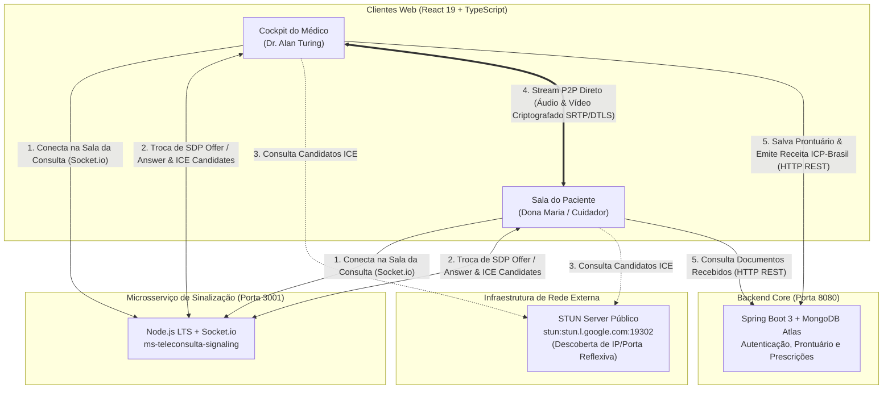
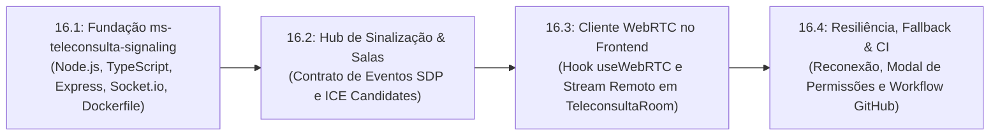

# ESPECIFICAÇÃO TÉCNICA SDD — SPEC-16
## Microsserviço de Teleconsulta WebRTC Nativo (Signaling Server)
### Plataforma Active Age — Telessaúde Geriátrica Integral
### Faculdade de Tecnologia de Diadema (Fatec Luigi Papaiz) — DSM 4º Semestre
**Disciplinas de Foco:** Sistemas Distribuídos (ILP-038) & Integração e Entrega Contínua (ISW-033)  
**Líder Técnico & Product Owner (PO):** Guilherme Silva  
**Arquiteto & Engenheiro de Software:** Antigravity (AI)  
**Status da Spec:** Em Execução (Micro Tarefa 16.1 Concluída ✅) 🚀  
**Data da Elaboração:** 03 de Novembro de 2026

---

### 1. Contexto & Motivação Arquitetural

No 3º Semestre, o Active Age implementou com êxito o **Cockpit de Teleconsulta (UC12-Demo)** em [`TeleconsultaRoom.tsx`](../../3-Semestre/frontend-react/src/pages/teleconsulta/TeleconsultaRoom.tsx). Nessa versão, validamos todo o fluxo ético e documental:
- Prontuário Geriátrico Imutável com Avaliação Geriátrica Ampla (AGA), CID-11 e Hash SHA-256 (UC14 / RN003);
- Visualização de exames e laudos do GridFS em tempo real durante a chamada (UC13);
- Emissão de Receitas e Atestados Digitais com código ICP-Brasil `AA-2026-XXXXXX` (UC15).

Contudo, para fins de demonstração visual no 3º Semestre, a área de vídeo utilizava o stream da webcam local (`getUserMedia`) em espelho. 

No **4º Semestre**, com foco em **Sistemas Distribuídos (ILP-038)**, a arquitetura deve evoluir para suportar **videoconferência Peer-to-Peer (P2P) real** de alta performance e baixíssima latência entre o Médico e o Paciente/Cuidador, através do padrão **WebRTC (Web Real-Time Communication)**.

---

### 2. Por que Desacoplar em um Novo Microsserviço?

Em uma arquitetura distribuída moderna:
1. **Proteção do Core de Negócios:** O **Backend Core (Spring Boot)** é responsável pela persistência transacional (MongoDB Atlas), segurança de tokens JWT, regras éticas do CFM, agendamento concorrente e emissão de prontuários. Submeter o Spring Boot ao overhead de milhares de conexões persistentes de WebSockets para sinalização de mídia degradaria sua responsabilidade primária.
2. **Especialização de Protocolos:** O protocolo WebRTC necessita de um servidor de sinalização (*Signaling Server*) ultra-leve para troca de mensagens transitórias de rede (SDP Offer/Answer e ICE Candidates). O ecossistema **Node.js LTS com TypeScript e Socket.io** é a referência global da indústria para essa função, processando eventos orientados a I/O não bloqueante em nanossegundos.
3. **Escalabilidade Horizontal Independente:** O serviço de sinalização pode ser escalado horizontalmente em containers sem impactar a camada de banco de dados do Core.

---

### 3. Topologia e Arquitetura Distribuída

---

### 4. Protocolo de Sinalização (Contrato de Eventos Socket.io)

O microsserviço de sinalização isola as chamadas através de **salas virtuais efêmeras** indexadas pelo `appointmentId`.

| Evento (Emit) | Origem | Destino | Payload | Descrição |
|---|---|---|---|---|
| `join-room` | Cliente | Servidor | `{ appointmentId, userId, userRole, userName }` | Registra o participante na sala da teleconsulta. |
| `user-connected` | Servidor | Clientes da Sala | `{ socketId, userId, userRole, userName }` | Notifica que um novo participante (médico ou paciente) ingressou. |
| `offer` | Cliente (Iniciador) | Servidor | `{ toSocketId, sdp }` | Envia a proposta de conexão SDP (Session Description Protocol). |
| `offer` | Servidor | Cliente Alvo | `{ fromSocketId, sdp }` | Repassa a proposta SDP para o par remoto. |
| `answer` | Cliente Alvo | Servidor | `{ toSocketId, sdp }` | Responde com a aceitação SDP com os codecs compatíveis. |
| `answer` | Servidor | Cliente (Iniciador) | `{ fromSocketId, sdp }` | Entrega a resposta SDP para fechar o handshake. |
| `ice-candidate` | Cliente | Servidor | `{ toSocketId, candidate }` | Envia rota de rede descoberta pelo STUN. |
| `ice-candidate` | Servidor | Cliente Alvo | `{ fromSocketId, candidate }` | Entrega a rota de rede ao outro par para conexão P2P. |
| `toggle-media` | Cliente | Servidor | `{ appointmentId, mediaType, enabled }` | Informa se mutou áudio ou desativou câmera. |
| `peer-media-toggled` | Servidor | Clientes da Sala | `{ socketId, mediaType, enabled }` | Notifica o par para atualizar a UI (ícone de microfone cortado). |
| `leave-room` / `disconnect` | Cliente | Servidor | `{ appointmentId }` | Limpa a conexão e notifica a sala sobre a desconexão do par. |

---

### 5. Acessibilidade e Interface Humano-Computador (IHC / WCAG)

Como a plataforma atende idosos e médicos geriatras, o comportamento do WebRTC seguirá regras estritas de UX:
1. **Proibição de Diálogos Nativos:** Proibido o uso de `window.alert()` ou `confirm()`. Caso a câmera/microfone seja bloqueada pelo navegador, será acionado o modal acessível [`FeedbackModal.tsx`](../../3-Semestre/frontend-react/src/components/common/FeedbackModal.tsx) com instruções passo a passo (ícone do cadeado).
2. **Badges Claras de Conexão:**  
   - 🟡 *Amarelo:* "Aguardando o médico entrar na sala..." ou "Conectando ao paciente...";
   - 🟢 *Verde:* "Conexão P2P Criptografada Ativa (Áudio & Vídeo)";
   - 🔴 *Vermelho / Reconectando:* "Instabilidade momentânea de rede. Tentando reconectar...".
3. **Controles Táteis Ampliados:** Botões de alta densidade tátil (mínimo 56px de altura) com contraste WCAG 2.1 AA para:
   - Ativar/Desativar Microfone;
   - Ativar/Desativar Câmera;
   - Sair da Sala com segurança sem desligar a consulta inadvertidamente.

---

### 6. Fatiamento em Micro Tarefas Testáveis (Passo a Passo SDD)

Para garantir rastreabilidade e permitir validações incrementais a cada etapa:

#### 📌 Micro Tarefa 16.1: Fundação do Microsserviço (`4-Semestre/ms-teleconsulta-signaling/`) — [CONCLUÍDA ✅]
- [x] Inicialização do projeto Node.js LTS com TypeScript, Express, Socket.io e CORS;
- [x] Configuração de `tsconfig.json`, `package.json` com scripts (`dev`, `build`, `test`);
- [x] Criação de `Dockerfile` multi-stage leve baseado em `node:22-alpine` com usuário não-root e healthcheck;
- [x] Endpoint HTTP de healthcheck: `GET /health` retornando status UP, version, uptime e timestamp;
- [x] Testes automatizados com Vitest e Supertest cobrindo rota raiz `/`, `/health` e rota inexistente (3 testes passando com 100% de sucesso).

#### 📌 Micro Tarefa 16.2: Hub de Sinalização WebRTC & Gerenciamento de Salas
- Lógica de isolamento de salas por `appointmentId`;
- Limite seguro de 2 participantes ativos por sala de teleconsulta (Médico e Paciente/Cuidador);
- Roteamento transparente de eventos `offer`, `answer`, `ice-candidate` e `toggle-media`;
- Teste automatizado com dois clientes virtuais de socket simulando o handshake de conexão e desconexão.

#### 📌 Micro Tarefa 16.3: Integração no Frontend React 19 (`TeleconsultaRoom.tsx`)
- Implementação do custom hook [`useWebRTC.ts`](../../3-Semestre/frontend-react/src/hooks/useWebRTC.ts);
- Configuração do `RTCPeerConnection` com servidores STUN do Google (`stun:stun.l.google.com:19302`);
- Exibição de 2 feeds de vídeo em `TeleconsultaRoom.tsx`:
  - Vídeo principal: Stream de alta definição do participante remoto (Médico na visão do paciente, e Paciente na visão do médico);
  - Vídeo em miniatura (Picture-in-Picture): Stream da câmera local do usuário;
- Sincronização dos seletores táteis de microfone e câmera com a faixa de mídia do WebRTC (`track.enabled`).

#### 📌 Micro Tarefa 16.4: Resiliência de Rede, Fallback de Permissões e CI
- Fila de buffer para *ICE Candidates* (caso cheguem antes da aplicação da descrição remota `remoteDescription`);
- Reconexão automática em caso de oscilação momentânea do Wi-Fi;
- Modal de instrução amigável caso a permissão de câmera/microfone seja recusada;
- Integração do microsserviço na esteira do GitHub Actions (`.github/workflows/ci-active-age.yml`) com linter e compilação automatizada.

---

### 7. Critérios de Aceite Inegociáveis

1. [ ] **Chamada P2P Real Funcional:** Dois navegadores diferentes (ou aba normal e anônima) logados como Médico e Paciente na consulta de hoje conseguem estabelecer áudio e vídeo bidirecional em tempo real.
2. [ ] **Zero Regressão Clínica:** O Prontuário Geriátrico Imutável, a visualização de exames anexados do GridFS e a emissão de receitas com código ICP-Brasil continuam funcionando perfeitamente sem qualquer lentidão ou interferência.
3. [ ] **Isolamento de Segurança:** Participantes de uma consulta não conseguem escutar nem receber stream de outras consultas (isolamento estrito de salas por `appointmentId`).
4. [ ] **Containers Autônomos:** O microsserviço compila em imagem Docker leve e opera na porta configurável `3001` (com proxy ou CORS liberado para o frontend).
5. [ ] **Conformidade de Código:** 100% TypeScript estrito, zero avisos de linter e cobertura de testes automatizados da sinalização.

---
*Especificação elaborada em conformidade com as normas acadêmicas da Fatec Diadema e governança SDD do Active Age.*
