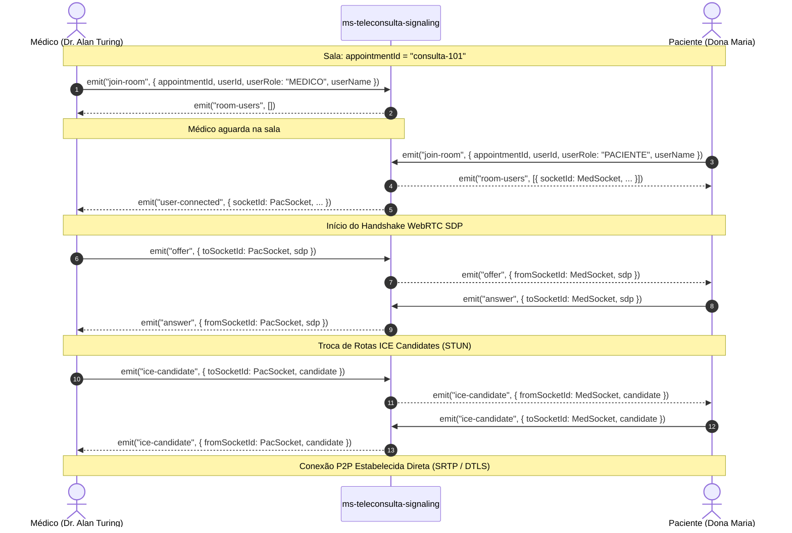
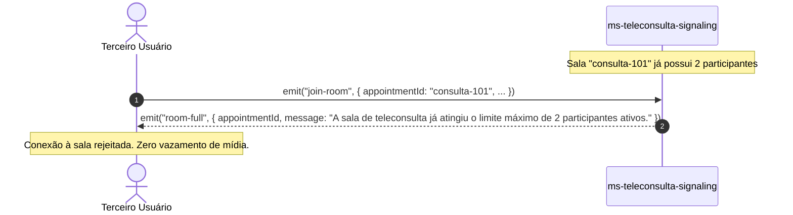

# 📋 ESPECIFICAÇÃO TÉCNICA (SPEC): HUB DE SINALIZAÇÃO WEBRTC & GERENCIAMENTO DE SALAS

> **Código da Spec:** SPEC-16.2  
> **Projeto:** Active Age — Plataforma Integral de Telessaúde Geriátrica  
> **Módulo:** Microsserviço de Sinalização WebRTC (`ms-teleconsulta-signaling`) — Micro Tarefa 16.2  
> **Casos de Uso Relacionados:** UC12 (Realizar Teleconsulta Médica Geriátrica)  
> **Requisitos Funcionais / Regras de Negócio:** RF009, RN003, RN-SIG-01, RN-SIG-02, RN-SIG-03, RN-SIG-04, RN-SIG-05  
> **Normas de Referência Ética & Regulatória:** Resolução CFM nº 2.314/2022 (Sigilo e Privacidade da Teleconsulta), SBIS NGS1, Lei Federal nº 13.709/2018 (LGPD - Privacidade por Padrão)  
> **Disciplinas de Foco:** Sistemas Distribuídos (ILP-038) & Integração e Entrega Contínua (ISW-033)  
> **Data:** 06 de Novembro de 2026  
> **Status da Spec:** CONCLUÍDA E TESTADA EM AMBIENTE AUTOMATIZADO ✅  
> **Metodologia:** Spec-Driven Development (SDD)

---

### 1. Visão Geral & Objetivos da Micro Tarefa

A **Micro Tarefa 16.2** expande a fundação estabelecida na MT 16.1, transformando o microsserviço `ms-teleconsulta-signaling` em um **Hub de Sinalização de Alta Performance e Baixa Latência** para videoconferência WebRTC.

O objetivo central é gerenciar salas virtuais efêmeras e seguras indexadas pelo `appointmentId`, viabilizando o handshake de rede (*Signaling*) entre o Médico Geriatra e o Idoso/Cuidador para o estabelecimento da conexão Peer-to-Peer (P2P) de áudio e vídeo criptografados.

---

### 2. Topologia de Sinalização & Diagramas de Sequência

#### 2.1. Handshake de Conexão e Troca de SDP (Offer / Answer)



#### 2.2. Bloqueio de Intrusão & Limite Seguro de 2 Participantes



---

### 3. Contrato de Dados & Eventos Socket.io

| Evento | Direção | Payload | Descrição / Regra de Negócio |
|---|---|---|---|
| `join-room` | Cliente ➔ Servidor | `JoinRoomPayload` | Solicita ingresso na sala efêmera identificada por `appointmentId`. |
| `room-users` | Servidor ➔ Cliente | `RoomParticipant[]` | Lista os participantes que já estavam presentes na sala para o novo integrante. |
| `user-connected` | Servidor ➔ Sala | `UserConnectedPayload` | Notifica os participantes já presentes que um novo membro entrou na sala. |
| `room-full` | Servidor ➔ Cliente | `RoomFullPayload` | Rejeita o ingresso caso a sala já possua 2 participantes ativos (segurança médica). |
| `room-error` | Servidor ➔ Cliente | `{ appointmentId, message }` | Notifica erro de validação (ex: payload com campos obrigatórios ausentes). |
| `offer` | Cliente ➔ Servidor ➔ Alvo | `OfferPayload` | Encaminha proposta de sessão SDP do iniciador para o par remoto. |
| `answer` | Cliente ➔ Servidor ➔ Alvo | `AnswerPayload` | Encaminha resposta de sessão SDP do par remoto para o iniciador. |
| `ice-candidate` | Cliente ➔ Servidor ➔ Alvo | `IceCandidatePayload` | Encaminha candidatos de rede ICE (STUN/TURN) entre os pares. |
| `toggle-media` | Cliente ➔ Servidor | `ToggleMediaPayload` | Informa que o usuário mutou seu microfone ou desligou sua câmera. |
| `peer-media-toggled` | Servidor ➔ Sala | `PeerMediaToggledPayload` | Notifica o par remoto para atualizar o ícone na UI de teleconsulta. |
| `leave-room` | Cliente ➔ Servidor | `void` | Solicita desvinculação voluntária da sala ativa. |
| `disconnect` | Cliente ➔ Servidor | `void` | Tratamento automático de desconexão (queda de rede, fechamento de aba). |
| `user-disconnected` | Servidor ➔ Sala | `UserDisconnectedPayload` | Notifica o participante remanescente que seu par desconectou. |

---

### 4. Regras de Negócio e Governança de Rede (RN-SIG)

- **RN-SIG-01 (Isolamento Estrito de Consultas):** Cada consulta possui um canal exclusivo isolado por `appointmentId`. O servidor nunca transmitirá mensagens de sinalização entre consultas distintas.
- **RN-SIG-02 (Trava de Privacidade / Limite de 2 Participantes):** Em estrita conformidade com a Resolução CFM nº 2.314/2022 e a LGPD, cada sala de teleconsulta comporta no máximo **2 participantes simultâneos** (o Médico e o Paciente ou seu Cuidador legal). Qualquer 3º ingresso é sumariamente bloqueado com evento `room-full`.
- **RN-SIG-03 (Idempotência de Ingresso):** Se o mesmo socket reenviar `join-room` para a mesma consulta (ex: reconexão lógica da SPA), o estado anterior é preservado sem contagem de participantes duplicados.
- **RN-SIG-04 (Coleta de Lixo & Gestão de Memória):** Quando o último participante de uma consulta se desconecta, a chave da sala é removida do mapa em memória (`rooms.delete(appointmentId)`), garantindo consumo de memória $\mathcal{O}(N)$ proporcional unicamente às consultas em andamento.
- **RN-SIG-05 (Sinalização Imediata de Queda):** Ao desconectar um socket (evento `disconnect`), o servidor imediatamente localiza a sala associada via mapa reverso indexado $\mathcal{O}(1)$ (`socketToRoom`), remove o participante e notifica o par remoto via `user-disconnected`.

---

### 5. Arquitetura dos Componentes

```
4-Semestre/ms-teleconsulta-signaling/
├── src/
│   ├── types/
│   │   └── signaling.ts            # Interfaces e contratos de dados tipados
│   ├── services/
│   │   └── roomManager.ts          # Gerenciador de estado em memória com lock de 2 participantes
│   ├── signaling/
│   │   └── signalingHandler.ts     # Handlers de eventos Socket.io e roteamento SDP/ICE
│   ├── app.ts                      # Express app e healthcheck HTTP (MT 16.1)
│   ├── server.ts                   # Servidor HTTP com integração do Socket.io
│   └── __tests__/
│       ├── health.test.ts          # Testes de healthcheck HTTP (MT 16.1)
│       └── signaling.test.ts       # Testes de integração de sinalização WebRTC (MT 16.2)
```

---

### 6. Plano de Testes Automatizados (Critérios de Aceite)

A validação da Micro Tarefa 16.2 será realizada através de uma suíte automatizada com **Vitest + `socket.io-client`**, executando clientes virtuais reais conectados ao servidor:

| Caso de Teste | Ação | Resultado Esperado |
|---|---|---|
| **TC-SIG-01** | Médico emite `join-room` | Servidor responde `room-users` com array vazio `[]`. |
| **TC-SIG-02** | Paciente emite `join-room` na mesma sala | Paciente recebe `room-users` contendo o Médico; Médico recebe `user-connected` com dados da Paciente. |
| **TC-SIG-03** | 3º participante tenta emitir `join-room` | Servidor responde `room-full` com mensagem explicativa e não adiciona à sala. |
| **TC-SIG-04** | Médico envia `offer` com SDP para Paciente | Paciente recebe evento `offer` com `fromSocketId` do Médico e conteúdo SDP intacto. |
| **TC-SIG-05** | Paciente responde com `answer` com SDP para Médico | Médico recebe evento `answer` com `fromSocketId` da Paciente e conteúdo SDP intacto. |
| **TC-SIG-06** | Médico e Paciente enviam `ice-candidate` | Cada par recebe o candidato ICE direcionado pelo outro par sem cruzamento de dados. |
| **TC-SIG-07** | Paciente emite `toggle-media` mutando áudio | Médico recebe `peer-media-toggled` com `{ mediaType: 'audio', enabled: false }`. |
| **TC-SIG-08** | Paciente desconecta o socket | Médico recebe `user-disconnected`; estado da sala no `roomManager` é atualizado para 1 participante. |
| **TC-SIG-09** | Médico desconecta em seguida | A sala é totalmente desalocada da memória do servidor (`rooms.size` reduzido). |

---

### 7. Critérios de Conclusão da Micro Tarefa 16.2

1. [x] Implementação de `src/types/signaling.ts` com 100% de tipagem estrita;
2. [x] Implementação de `src/services/roomManager.ts` com mapa em memória e limite seguro de 2 participantes;
3. [x] Implementação de `src/signaling/signalingHandler.ts` com roteamento SDP, ICE, toggle-media e desconexão;
4. [x] Atualização de `src/server.ts` integrando os handlers de sinalização na instância do `io`;
5. [x] Criação de `src/__tests__/signaling.test.ts` com todos os 9 cenários de teste automatizados passando com 100% de sucesso (10 testes totais no Vitest);
6. [x] Compilação TypeScript via `npm run build` (`tsc`) sem warnings ou erros;
7. [x] Atualização dos documentos oficiais (`PLANO_DE_RELEASE_ACTIVE_AGE.md`, `GEMINI.md`, `README.md` das specs).

---
*Especificação técnica submetida à aprovação do Product Owner (Guilherme Silva).*  
*Metodologia SDD — Active Age 2026.*
