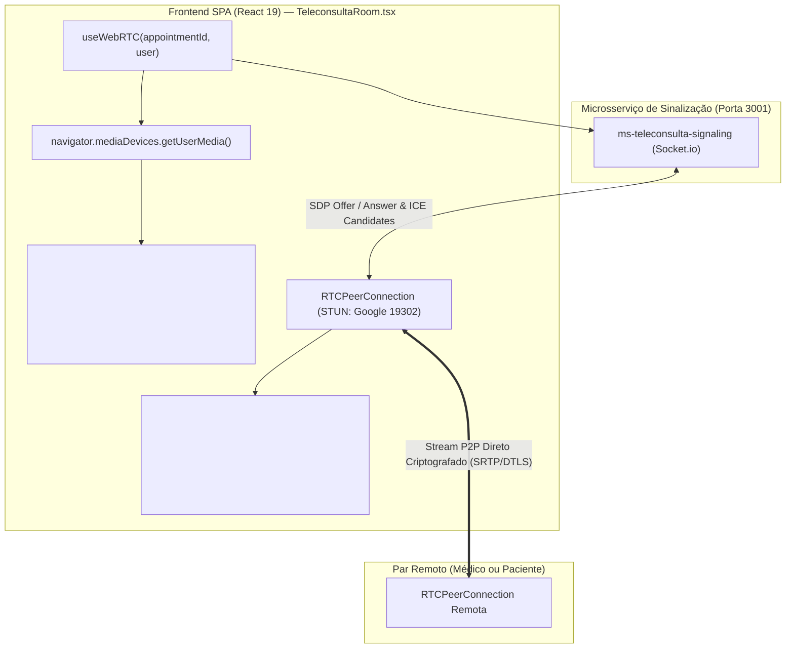

# 📋 ESPECIFICAÇÃO TÉCNICA (SPEC): CLIENTE WEBRTC NO FRONTEND (REACT 19)

> **Código da Spec:** SPEC-16.3  
> **Projeto:** Active Age — Plataforma Integral de Telessaúde Geriátrica  
> **Módulo:** Integração do Cliente WebRTC no Cockpit de Teleconsulta — Micro Tarefa 16.3  
> **Casos de Uso Relacionados:** UC12 (Realizar Teleconsulta Médica Geriátrica), UC13 (Visualização de Exames), UC14 (Prontuário Imutável), UC15 (Prescrições ICP-Brasil)  
> **Requisitos Funcionais / Regras de Negócio:** RF009, RN003, RN-FRONT-01, RN-FRONT-02, RN-FRONT-03, RN-SIG-01, RN-SIG-02  
> **Normas de Referência Ética & IHC:** Resolução CFM nº 2.314/2022 (Diretrizes de Telessaúde e Sigilo), WCAG 2.1 AA (Acessibilidade Geriátrica - Botões táteis 48px+ e ausência de modais bloqueantes nativos)  
> **Disciplinas de Foco:** Sistemas Distribuídos (ILP-038) & Interface Humano-Computador (IHC)  
> **Data:** 06 de Novembro de 2026  
> **Status da Spec:** CONCLUÍDA E TESTADA NO FRONTEND SPA ✅  
> **Metodologia:** Spec-Driven Development (SDD)

---

### 1. Visão Geral & Objetivos da Micro Tarefa

A **Micro Tarefa 16.3** conecta o frontend SPA em **React 19 + TypeScript** ao microsserviço de sinalização `ms-teleconsulta-signaling` (desenvolvido e homologado nas MTs 16.1 e 16.2), substituindo a visualização simulada do Cockpit de Teleconsulta ([`TeleconsultaRoom.tsx`](../../3-Semestre/frontend-react/src/pages/teleconsulta/TeleconsultaRoom.tsx)) por uma **videoconferência Peer-to-Peer (P2P) real** de alta definição e baixíssima latência.

---

### 2. Topologia de Interação Frontend ➔ Sinalização ➔ P2P



---

### 3. Desenho Arquitetural do Custom Hook: `useWebRTC.ts`

* **Localização:** `3-Semestre/frontend-react/src/hooks/useWebRTC.ts`
* **Dependência:** `socket.io-client` instalada no `frontend-react`.

#### 3.1. Assinatura e Parâmetros
```typescript
interface UseWebRTCOptions {
  appointmentId: string;
  userId: string;
  userRole: string;
  userName: string;
  signalingUrl?: string; // Variável VITE_SIGNALING_URL ou http://localhost:3001
}
```

#### 3.2. Estados e Retorno do Hook
```typescript
interface UseWebRTCResult {
  localStream: MediaStream | null;
  remoteStream: MediaStream | null;
  connectionStatus: 'idle' | 'connecting' | 'waiting' | 'connected' | 'reconnecting' | 'error';
  isMuted: boolean;
  isVideoOff: boolean;
  peerMuted: boolean;
  peerVideoOff: boolean;
  peerName: string | null;
  errorMessage: string | null;
  toggleAudio: () => void;
  toggleVideo: () => void;
  leaveRoom: () => void;
  localVideoRef: React.RefObject<HTMLVideoElement | null>;
  remoteVideoRef: React.RefObject<HTMLVideoElement | null>;
}
```

#### 3.3. Máquina de Estados e Ciclo de Vida WebRTC
1. **Inicialização:**
   - Efetua `getUserMedia({ video: true, audio: true })` para obter o stream da webcam e microfone locais.
   - Atribui o stream ao elemento `<video ref={localVideoRef} muted />`.
2. **Conexão ao Hub de Sinalização:**
   - Conecta ao Socket.io do `ms-teleconsulta-signaling`.
   - Emite `join-room` com `{ appointmentId, userId, userRole, userName }`.
3. **Resolução de Handshake SDP:**
   - **Cenário A (Entrou e o Par já estava na sala):** Cria o `RTCPeerConnection`, adiciona as faixas locais (`addTrack`), gera a `offer`, define `localDescription` e emite `offer` para o par.
   - **Cenário B (Recebeu `offer` do par que entrou):** Cria o `RTCPeerConnection`, adiciona as faixas locais, aplica `setRemoteDescription`, gera a `answer`, define `localDescription` e devolve `answer`.
   - **Cenário C (Recebeu `answer`):** Aplica `setRemoteDescription`.
4. **Fila de Buffer para ICE Candidates:**
   - Candidatos ICE que chegam antes da aplicação da descrição remota são enfileirados em um buffer (`iceCandidateQueue`) e processados assim que o handshake SDP se completa.
5. **Recepção de Mídia Remota (`ontrack`):**
   - Associa `event.streams[0]` ao `<video ref={remoteVideoRef} />`.
   - Atualiza o status da conexão para `connected`.
6. **Desligamento Seguro de Hardware (`cleanup`):**
   - Ao desmontar a tela ou sair da consulta, interrompe todas as faixas ativas (`track.stop()`), desliga a luz física da câmera do idoso/médico, fecha a `RTCPeerConnection` e desconecta o socket.

---

### 4. Reformulação da Interface em `TeleconsultaRoom.tsx`

#### 4.1. Vídeo Principal Remoto (Alta Definição)
- Exibe o feed de vídeo do outro participante da consulta (Médico na tela do Paciente; Dona Maria na tela do Médico).
- Quando o par remoto estiver com a câmera desligada ou a conexão estiver pendente, exibe uma tela amigável e acessível com:
  - Avatar grande e semântico;
  - Nome completo e papel do par;
  - Status em tempo real (ex: *"Aguardando o Dr. Alan Turing entrar na sala..."* ou *"Dr. Alan Turing desativou a câmera temporariamente"*).

#### 4.2. Miniatura Picture-in-Picture Local
- Posicionada no canto inferior direito da janela de vídeo;
- Exibe o próprio usuário com espelhamento horizontal natural (`scale-x-[-1]`);
- Se o usuário desativar a câmera, exibe suas iniciais e indicador "Câmera desativada".

#### 4.3. Badges Dinâmicas de Conexão (IHC / WCAG)
- 🟡 **Aguardando:** *"Aguardando o participante entrar na sala..."* (com pulso suave);
- 🟢 **Conectado:** *"Conexão P2P Criptografada Ativa (Áudio e Vídeo)"*;
- 🔴 **Reconectando:** *"Oscilação de rede detectada. Reconectando..."*.

#### 4.4. Controles Táteis Ampliados (48px+)
- Botões de **Microfone** e **Câmera** sincronizados com as faixas WebRTC locais (`track.enabled = !track.enabled`);
- Emissão de evento Socket.io `toggle-media` para que o par remoto veja um badge de microfone mutado ou câmera fechada;
- Botão **Sair da Sala** com modal acessível `FeedbackModal` (sem nenhum diálogo bloqueante nativo `window.confirm`).

---

### 5. Regras de Negócio e Salvaguardas (RN-FRONT)

- **RN-FRONT-01 (Liberação Obrigatória de Recursos de Hardware):** No `useEffect` de cleanup de `TeleconsultaRoom.tsx` e `useWebRTC.ts`, toda faixa (`track`) do `MediaStream` DEVE invocar `track.stop()`. Isso garante que o led de gravação da webcam do paciente e do médico se apague ao sair da sala.
- **RN-FRONT-02 (Proibição de Diálogos Nativos):** Bloqueio absoluto de `window.alert()` e `window.confirm()`. Erros de permissão de câmera/microfone (ex: `NotAllowedError`) devem disparar o componente `FeedbackModal.tsx` com orientações passo a passo para o idoso (ícone de cadeado na barra de endereços).
- **RN-FRONT-03 (Zero Regressão das Funções Clínicas):** Todas as funcionalidades do 3º Semestre permanecem intactas:
  - Prontuário Geriátrico Imutável com AGA e CID-11;
  - Assinatura digital com geração de Hash SHA-256;
  - Visualização de exames anexados do GridFS;
  - Emissão e impressão timbrada P&B de receitas e atestados com código `AA-2026-XXXXXX`.

---

### 6. Configuração de Rede & Variáveis de Ambiente

No arquivo `3-Semestre/frontend-react/.env` (ou fallback padrão no código):
```env
VITE_SIGNALING_URL=http://localhost:3001
```
Em produção (Vercel/Render), a URL aponta para a rota pública do microsserviço de sinalização implantado.

---

### 7. Plano de Validação & Critérios de Aceite

| Caso de Teste | Procedimento | Critério de Aceite |
|---|---|---|
| **TC-FRONT-01** | Paciente e Médico entram na mesma consulta (ex: aba normal e anônima) | Ambos estabelecem conexão WebRTC direta e visualizam o feed de vídeo um do outro. |
| **TC-FRONT-02** | Paciente clica no botão "Silenciar Microfone" | Áudio da paciente é mutado; Médico vê o badge de microfone mutado na tela. |
| **TC-FRONT-03** | Médico desativa a câmera | Vídeo do médico é substituído pelo avatar/nome na tela da paciente; led da câmera do médico apaga. |
| **TC-FRONT-04** | Usuário nega permissão de câmera no navegador | É exibido o `FeedbackModal` amigável com instruções de desbloqueio sem quebrar a aplicação. |
| **TC-FRONT-05** | Médico finaliza o prontuário e assina com hash SHA-256 | Prontuário é gravado com integridade; consulta ganha status `REALIZADA`; receitas sincronizadas com a paciente. |
| **TC-FRONT-06** | Usuário clica em "Sair da Sala" | Câmera e microfone são imediatamente liberados (`track.stop()`); redirecionamento para o dashboard. |
| **TC-FRONT-07** | Execução de `npm run build` e linter no frontend | Compilação do TypeScript e Vite sem nenhum erro. |

---

### 8. Fatiamento das Ações de Implementação

1. [x] Adicionar dependência `socket.io-client` no `3-Semestre/frontend-react/package.json`;
2. [x] Criar o hook [`useWebRTC.ts`](../../3-Semestre/frontend-react/src/hooks/useWebRTC.ts) com controle de SDP, ICE Candidates, buffer de conexão e mute de faixas;
3. [x] Atualizar [`TeleconsultaRoom.tsx`](../../3-Semestre/frontend-react/src/pages/teleconsulta/TeleconsultaRoom.tsx) integrando os feeds de vídeo `<video ref={remoteVideoRef} />` e `<video ref={localVideoRef} />`;
4. [x] Implementar os estados e feedbacks acessíveis de áudio/vídeo e status de conexão P2P;
5. [x] Validar a compilação do frontend via `npm run build` (sucesso em 1.56s com TypeScript estrito);
6. [x] Atualizar a documentação oficial (`PLANO_DE_RELEASE_ACTIVE_AGE.md`, `GEMINI.md`, `README.md` das specs).

---
*Especificação técnica submetida à aprovação do Product Owner (Guilherme Silva).*  
*Metodologia SDD — Active Age 2026.*
