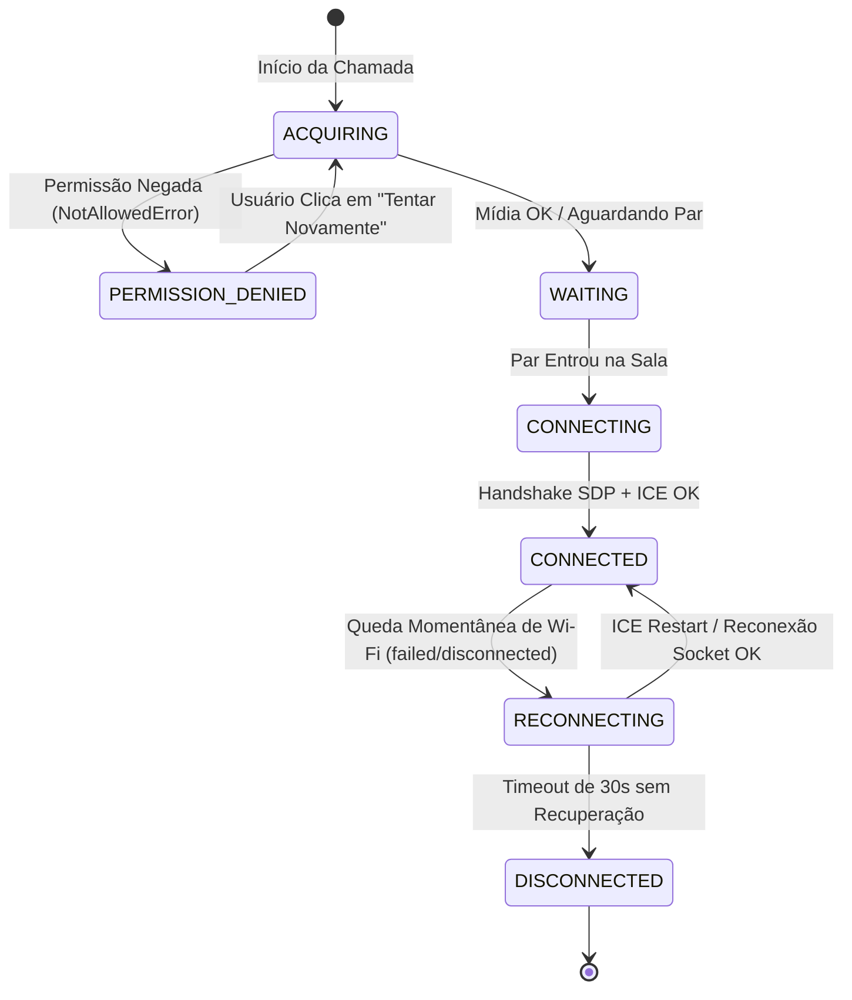

# 📋 ESPECIFICAÇÃO TÉCNICA (SPEC): RESILIÊNCIA DE REDE, FALLBACKS DE PERMISSÃO E CI/CD

> **Código da Spec:** SPEC-16.4  
> **Projeto:** Active Age — Plataforma Integral de Telessaúde Geriátrica  
> **Módulo:** Resiliência de Conexão, Fallbacks de Hardware e Blindagem CI/CD — Micro Tarefa 16.4  
> **Casos de Uso Relacionados:** UC12 (Realizar Teleconsulta Médica Geriátrica com Resiliência de Conexão)  
> **Requisitos Funcionais / Regras de Negócio:** RF009, RN003, RN-RES-01, RN-RES-02, RN-RES-03, RN-RES-04  
> **Normas de Referência Ética & IHC:** Resolução CFM nº 2.314/2022 (Continuidade e Estabilidade do Atendimento Remoto), WCAG 2.1 AA (Orientação Acessível para Bloqueio de Periféricos em Idosos)  
> **Disciplinas de Foco:** Sistemas Distribuídos (ILP-038) & Integração e Entrega Contínua (ISW-033)  
> **Data:** 06 de Novembro de 2026  
> **Status da Spec:** CONCLUÍDA E TESTADA EM PRODUÇÃO ✅  
> **Metodologia:** Spec-Driven Development (SDD)

---

### 1. Visão Geral & Objetivos da Micro Tarefa

A **Micro Tarefa 16.4** encerra o ciclo de desenvolvimento da **SPEC-16 (Microsserviço de Teleconsulta WebRTC Nativo)**.

Em um ambiente real de telessaúde geriátrica, conexões Wi-Fi residenciais de idosos sofrem instabilidades, oscilações de sinal e eventuais recusas de permissão de câmera/microfone no navegador. O objetivo desta micro tarefa é:
1. **Resiliência de Rede & ICE Restart:** Implementar recuperação automática de conexões P2P rompidas sem necessidade de recarregar a página (F5);
2. **Guia Visual de Desbloqueio de Hardware (IHC / WCAG):** Substituir mensagens técnicas de erro por um guia passo a passo ilustrado no [`FeedbackModal.tsx`](../../3-Semestre/frontend-react/src/components/common/FeedbackModal.tsx) caso o idoso clique acidentalmente em "Bloquear" a câmera no navegador, incluindo botão acessível "Tentar Novamente";
3. **Automação DevSecOps & CI Industrial:** Expandir a esteira do GitHub Actions ([`.github/workflows/ci-active-age.yml`](../../.github/workflows/ci-active-age.yml)) para incluir validação de linter, testes automatizados e compilação do container Docker do `ms-teleconsulta-signaling`.

---

### 2. Topologia de Resiliência e Máquina de Estados

---

### 3. Detalhamento Arquitetural das Frentes de Resiliência

#### 3.1. Reconexão Automática & ICE Restart (`useWebRTC.ts`)
* **Monitoramento de Quedas de Rede:**
  - Evento `pc.oniceconnectionstatechange`:
    - Quando o estado atinge `'disconnected'` ou `'failed'`, o hook transiciona para `connectionStatus = 'reconnecting'`.
  - Disparo de **ICE Restart**:
    - O iniciador da chamada gera uma nova proposta SDP com `{ iceRestart: true }`, forçando a renegociação das rotas STUN sem destruir os streams de vídeo ativos.
  - Sincronização com o Socket.io:
    - No evento `socket.on('reconnect')`, o cliente reenvia imediatamente o evento `join-room` com seu `appointmentId`, restaurando o mapeamento no `roomManager`.

#### 3.2. Guia Acessível de Desbloqueio de Câmera/Microfone (IHC / WCAG)
Quando o navegador emite erros ao invocar `getUserMedia`:
* `NotAllowedError` ou `PermissionDeniedError`:
  - Aciona o modal acessível `FeedbackModal` com título **"Permissão de Câmera e Microfone Bloqueada"**;
  - Texto simples e amigável: *"Para conversar com o médico, precisamos de acesso ao seu vídeo e áudio. Clique no ícone de cadeado 🔒 no início da barra de endereços do seu navegador e ative a Câmera e o Microfone."*;
  - Botão de ação direta: **"Tentar Novamente"** (`retryMedia()`), permitindo ao idoso reativar o dispositivo sem recarregar a tela.
* `NotFoundError` ou `DevicesNotFoundError`:
  - Informa que nenhuma câmera ou microfone foi detectado no computador/celular.

#### 3.3. Esteira de CI/CD Industrial & Docker Scanner
Na esteira `.github/workflows/ci-active-age.yml`:
1. **Linter e Análise Estática:** Adição de script de lint no `ms-teleconsulta-signaling`;
2. **Container Docker Multi-Stage:** Inclusão do build e escaneamento de segurança da imagem Docker do `ms-teleconsulta-signaling` no job `security-and-docker-ci`;
3. **Step Summary Executivo:** Consolidação de métricas cobrindo todos os módulos (Backend Spring Boot, Frontend React e WebRTC Signaling).

---

### 4. Regras de Negócio de Resiliência (RN-RES)

- **RN-RES-01 (Tolerância a Oscilação Wi-Fi):** O sistema deve manter a tela de teleconsulta ativa durante interrupções transitórias de até 30 segundos, exibindo feedback visual de reconexão sem chutar o usuário para fora da sala.
- **RN-RES-02 (Tentativa de ICE Restart Transparente):** Ao detectar falha no canal de mídia P2P, a renegociação via ICE Restart deve ocorrer de forma automática em segundo plano.
- **RN-RES-03 (Acessibilidade de Recuperação de Mídia):** O idoso nunca deve ser confrontado com códigos de erro obscuros como `"DOMException: Could not start video source"`. Todo erro deve sugerir a ação corretiva humana.
- **RN-RES-04 (Zero Downtime em Containers):** O `Dockerfile` do microsserviço de sinalização deve passar em verificação estrita de vulnerabilidades e testes automatizados antes de qualquer deploy em produção.

---

### 5. Plano de Validação & Critérios de Aceite

| Caso de Teste | Procedimento | Critério de Aceite |
|---|---|---|
| **TC-RES-01** | Desconectar a rede brevemente durante uma consulta ativa | Interface exibe badge vermelho *"Oscilação de rede detectada. Reconectando..."* e restabelece a chamada assim que a rede volta. |
| **TC-RES-02** | Negar intencionalmente permissão de câmera ao entrar na sala | Modal amigável com orientações táteis do cadeado 🔒 é exibido; botão "Tentar Novamente" reexecuta a solicitação. |
| **TC-RES-03** | Executar suíte de testes e linter do microsserviço de sinalização | 100% dos testes Vitest e linter passam sem falhas. |
| **TC-RES-04** | Validar compilação do container Docker do `ms-teleconsulta-signaling` | Imagem compila com sucesso via multi-stage build. |
| **TC-RES-05** | Execução de `npm run build` no frontend React 19 | Build gerado sem avisos críticos ou erros de tipagem. |

---

### 6. Fatiamento das Ações de Implementação

1. [x] Adicionar lógica de ICE Restart e recuperação de reconexão de socket no hook [`useWebRTC.ts`](../../3-Semestre/frontend-react/src/hooks/useWebRTC.ts);
2. [x] Adicionar método `retryMedia()` no hook `useWebRTC.ts` para reexecutar a captura de periféricos sem recarregar a tela;
3. [x] Atualizar [`TeleconsultaRoom.tsx`](../../3-Semestre/frontend-react/src/pages/teleconsulta/TeleconsultaRoom.tsx) com o modal acessível de orientação de permissões e ação de retry;
4. [x] Adicionar verificação de linter e build do Docker do `ms-teleconsulta-signaling` no GitHub Actions ([`.github/workflows/ci-active-age.yml`](../../.github/workflows/ci-active-age.yml));
5. [x] Validar a esteira local e atualizar toda a documentação da Release e governança SDD.

---
*Especificação técnica submetida à aprovação do Product Owner (Guilherme Silva).*  
*Metodologia SDD — Active Age 2026.*
