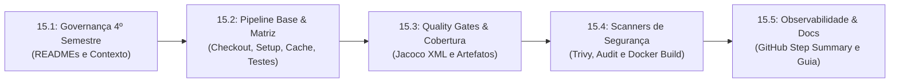

# ESPECIFICAÇÃO TÉCNICA SDD — SPEC-15
## Pipeline de CI/CD Industrial no GitHub Actions & Quality Gates
### Plataforma Active Age — Telessaúde Geriátrica Integral
### Faculdade de Tecnologia de Diadema (Fatec Luigi Papaiz) — DSM 4º Semestre
**Líder Técnico & Product Owner (PO):** Guilherme Silva  
**Arquiteto & Engenheiro DevOps:** Antigravity (AI)  
**Status da Spec:** Aguardando Aprovação Formal do PO ⏳  
**Data da Elaboração:** 02 de Novembro de 2026

---

### 1. Contexto & Motivação

Com a conclusão exitosa e homologação das Releases v0.1.0 a v0.4.0 (3º Semestre), o projeto Active Age conta com uma arquitetura corporativa estável composta por:
- **Backend Core:** Java 21 LTS + Spring Boot 3 + Spring Security + MongoDB Atlas;
- **Frontend SPA:** React 19 + TypeScript + Vite + Tailwind CSS v4.

Para iniciar o **4º Semestre** com foco na disciplina **Integração e Entrega Contínua (ISW-033)**, é imperativo instituir uma **esteira de CI/CD automatizada de nível industrial** no **GitHub Actions**, capaz de auditar continuamente a saúde, qualidade, segurança e conformidade do código a cada `push` e `pull_request`, garantindo que nenhuma regressão ou vulnerabilidade alcance a branch principal (`main`).

---

### 2. Os 9 Pilares da Pipeline (Requisitos do PO)

A esteira foi estruturada para cumprir integralmente os 9 requisitos arquiteturais solicitados pelo PO:

1. **Gatilhos (Triggers):** Execução automática em `push` e `pull_request` nas branches `main` e `develop` com filtro de paths relevantes (`3-Semestre/**`, `4-Semestre/**`, `.github/workflows/**`), além de `workflow_dispatch` para disparo manual sob demanda.
2. **Ambiente de Execução (Runners):** `ubuntu-latest` isolado, reprodutível e limpo a cada build.
3. **Obtenção do Código (Checkout):** `actions/checkout@v4` com `fetch-depth: 0` para suportar métricas de histórico e scanners diferenciais.
4. **Preparação de Ambientes e Dependências (Setup):** Setup declarativo de **Java 21 LTS (Temurin)** e **Node.js 22 LTS**, garantindo compatibilidade estrita com as ferramentas locais.
5. **Quality Gates Perimetrais:**
   - *Análise Estática / Linter:* Validação de tipagem do TypeScript (`tsc -b`) sem erros;
   - *Testes Automatizados:* Execução de todos os testes unitários com JUnit 5 e Mockito (`./mvnw test`);
   - *Cobertura de Código:* Integração com **Jacoco** gerando métricas XML de cobertura de classes e métodos;
   - *Análise de Segurança (DevSecOps):* Scanner de dependências vulneráveis com **Trivy** e `npm audit`;
   - *Análise Avançada de Qualidade:* Estrutura pronta para integração com SonarCloud/CodeQL.
6. **Estratégia de Matriz e Cache (Otimização):**
   - Matriz paralela dividida em jobs independentes (`backend-ci` e `frontend-ci`);
   - Cache das dependências do Maven (`~/.m2/repository`) e do npm (`~/.npm`), reduzindo o tempo de execução para menos de 90 segundos.
7. **Geração e Publicação de Artefatos / Containers:**
   - Upload de relatórios de testes Surefire e cobertura Jacoco como artefatos baixáveis (`actions/upload-artifact@v4`);
   - Validação do container Docker multi-stage (`docker build -t active-age-backend-core:test 3-Semestre/backend-core`).
8. **Ambientes e Controle de Mudança (Continuous Delivery):**
   - Segregação de branches com regras de proteção para impedir merges quando a pipeline estiver vermelha.
9. **Feedback e Observabilidade:**
   - Geração de um sumário executivo visual e elegante em Markdown injetado diretamente no `$GITHUB_STEP_SUMMARY` do GitHub Actions com tabela de status consolidada.

---

### 3. Fatiamento em Micro Tarefas Testáveis (Passo a Passo)

Para garantir que o Guilherme possa **entender o que está acontecendo e testar cada etapa individualmente**, a implementação da SPEC-15 será estritamente dividida nas seguintes micro tarefas sequenciais:

---

#### 📌 Micro Tarefa 15.1: Governança do 4º Semestre & Docs
* **Status:** Concluída nesta etapa preliminar.
* **Escopo:**
  * Atualização de `4-Semestre/README.md`;
  * Criação de `4-Semestre/docs/ARQUITETURA_PIPELINE_CICD_E_QUALITY_GATES.md`;
  * Criação de `4-Semestre/docs_ia/CONTEXTO_OPERACIONAL_E_GOVERNANCA_4_SEMESTRE.md`;
  * Criação de `4-Semestre/docs_ia/specs/README.md` e desta `SPEC-15`.

---

#### 📌 Micro Tarefa 15.2: Fundação da Pipeline Base no GitHub Actions (Matriz Paralela)
* **Objetivo:** Criar o workflow base `.github/workflows/ci-active-age.yml` rodando em matriz paralela para Backend e Frontend com caching de dependências.
* **Ações Técnicas:**
  1. Criar `.github/workflows/ci-active-age.yml` com os triggers (`push`, `pull_request`, `workflow_dispatch`);
  2. Implementar Job 1 (`backend-ci`):
     - Checkout `actions/checkout@v4`;
     - Setup Java 21 (`actions/setup-java@v4` com `distribution: 'temurin'`);
     - Cache Maven configurado;
     - Garantir permissão de execução do wrapper (`chmod +x ./3-Semestre/backend-core/mvnw`);
     - Executar compilação e testes unitários: `./mvnw test` apontando para `3-Semestre/backend-core`.
  3. Implementar Job 2 (`frontend-ci`):
     - Checkout `actions/checkout@v4`;
     - Setup Node 22 (`actions/setup-node@v4` com `node-version: 22`);
     - Cache npm configurado;
     - Instalar dependências (`npm ci` ou `npm install`);
     - Executar checagem de tipagem e build: `npm run build` apontando para `3-Semestre/frontend-react`.
* **Critério de Teste e Aceite:**
  - O Guilherme commita e dá push;
  - Abre a aba **Actions** no repositório do GitHub (`https://github.com/GuilhermeSilva-25/active-age/actions`);
  - Ambos os jobs (`backend-ci` e `frontend-ci`) rodam em paralelo e finalizam com status **Verde (Success)** em menos de 2 minutos.

---

#### 📌 Micro Tarefa 15.3: Quality Gates de Código, Cobertura Jacoco & Artefatos
* **Objetivo:** Adicionar métricas de cobertura de código com Jacoco e upload de artefatos de testes.
* **Ações Técnicas:**
  1. Configurar o plugin `jacoco-maven-plugin` no `3-Semestre/backend-core/pom.xml` para gerar `jacoco.xml` na fase de teste;
  2. No workflow `.github/workflows/ci-active-age.yml`:
     - Adicionar step de upload do relatório Surefire (`actions/upload-artifact@v4`) com os resultados dos testes;
     - Adicionar step de upload do relatório Jacoco (`target/site/jacoco/`);
     - Adicionar step no frontend para validar checagem estática com TypeScript sem permissividade.
* **Critério de Teste e Aceite:**
  - O workflow gera na aba Actions uma seção de **Artifacts** com os arquivos `backend-test-results` e `jacoco-coverage-report` disponíveis para download e auditoria.

---

#### 📌 Micro Tarefa 15.4: Quality Gates de Segurança (DevSecOps) & Container Docker
* **Objetivo:** Validar a segurança contra vulnerabilidades conhecidas (CVEs) e a integridade da imagem Docker de produção.
* **Ações Técnicas:**
  1. Adicionar no job de frontend o step `npm audit --audit-level=high` para checagem de vulnerabilidades críticas;
  2. Integrar a action oficial **Trivy (Aqua Security)** para scanner de vulnerabilidades em bibliotecas de código aberto;
  3. Criar o Job 3 (`docker-validation`):
     - Executa `docker build -t active-age-backend-core:test 3-Semestre/backend-core`;
     - Garante que a imagem Docker multi-stage utilizada no Render compila com sucesso na nuvem sem falhas de pacote.
* **Critério de Teste e Aceite:**
  - O workflow executa o scanner de segurança com 0 vulnerabilidades bloqueantes e o container Docker constrói com sucesso.

---

#### 📌 Micro Tarefa 15.5: Observabilidade (GitHub Step Summary) & Documentação Executiva
* **Objetivo:** Criar um painel visual no GitHub Actions e documentar as instruções de manutenção.
* **Ações Técnicas:**
  1. Adicionar script em bash no final do workflow que escreve no `$GITHUB_STEP_SUMMARY`:
     - Tabela formatada em Markdown com os status de cada portão de qualidade;
     - Resumo de testes executados, tempo de execução e badges;
  2. Criar o documento `4-Semestre/devops/docs-pipeline.md` explicando detalhadamente para o Guilherme como interpretar os relatórios, rodar localmente e configurar branch protection.
* **Critério de Teste e Aceite:**
  - O Guilherme clica na execução no GitHub Actions e vê imediatamente um sumário executivo limpo, profissional e informativo no próprio navegador.

---

### 4. Definition of Done (DoD) da SPEC-15

A SPEC-15 será considerada integralmente concluída quando:
- [ ] Todas as 5 micro tarefas forem executadas, testadas e validadas uma a uma;
- [ ] A pipeline estiver rodando com sucesso no GitHub Actions em menos de 2 minutos por execução completa;
- [ ] O Guilherme confirmar que compreendeu o funcionamento de cada etapa e conferir o resultado verde no repositório GitHub;
- [ ] Todos os commits estiverem no padrão Conventional Commits em português na branch `main`.

---
*Especificação Técnica redigida para aprovação do Product Owner.*  
*Projeto Integrador Active Age — Fatec Diadema.*
